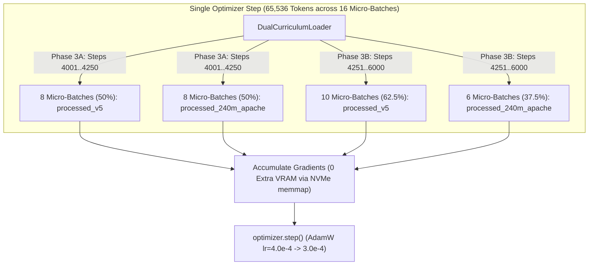

# Parentheses 1.0-240M (`slab_v4`) — Session 3 Execution Blueprint & Handoff Manifest

## 1. Architectural & Launch Invariants
- **Lineage / Scale:** Parentheses 1.0-240M (`slab_v4`), 253.54M parameters (`d_model=1024`, `n_layers=16`, `n_heads=16`, `d_head=64`, tied `tok_emb` / `head`).
- **Recurrent Duality Invariant:** Selective Linear Attention (SSD) with $O(1)$ constant recurrent memory state updates ($16 \times 64 \times 64 = 65,536$ state floats/layer), zero quadratic attention, zero sequence softmax, zero KV-cache.
- **Source Anchor Checkpoint:** `checkpoints/parentheses-1.0-240M-s2/step_4000.pt` (fallback: `checkpoints/parentheses-1.0-240M-s2/latest.pt`).
- **Step Range:** Steps 4,001 -> 6,001 (2,000 steps = 131.07M tokens; cumulative 393.22M tokens).
- **Execution Script:** `scripts/launch_s3_240m.ps1`

---

## 2. Session 3 Dual-Memmap Micro-Batch Interleaving Architecture (`grad_accum = 16`)

Instead of a catastrophic cold-turkey dataset swap from `processed_240m_apache` to `processed_v5`, Session 3 introduces deterministic micro-batch interleaving inside every 65,536-token optimizer step:

### Effective Session 3 Token Distribution (Per 65,536-Token Step)
| Domain / Language Slice | processed_240m_apache (37.5%) | processed_v5 (62.5%) | Blended Session 3 Mix | Role & Protection |
| :--- | :--- | :--- | :--- | :--- |
| **Major Dravidian (`kn, ta, te, ml`)** | 40.0% ($\rightarrow 15.00\%$) | 44.0% ($\rightarrow 27.50\%$) | **42.50%** | Core Dravidian syntactic & morphological mastery |
| **English Anchors & General** | 15.0% ($\rightarrow 5.63\%$) | 47.3% ($\rightarrow 29.56\%$) | **35.19%** | Cross-lingual reasoning anchor |
| **MIT STEM & `<think>` (MetaMathQA + Orca)** | 25.0% ($\rightarrow 9.38\%$) | 0.0% ($\rightarrow 0.00\%$) | **9.38%** | **Replay Buffer**: Prevents forgetting of `<think>` closure |
| **Conversational & Bitexts** | 20.0% ($\rightarrow 7.50\%$) | 0.0% ($\rightarrow 0.00\%$) | **7.50%** | Dialog flow & instruction priming |
| **Low-Resource Dravidian (`tcy, kff, kxv, nit`)**| 0.0% ($\rightarrow 0.00\%$) | 8.7% ($\rightarrow 5.44\%$) | **5.44%** | Smooth embedding warmup for Tulu, Koya, Kuvi, Kolami |

---

## 3. Two-Stage Curriculum Ramp Inside Session 3
1. **Phase 3A (Low-Resource Warm-In: Steps 4,001 -> 4,250 [250 steps])**:
   - Split: `8 : 8` (50% / 50%).
   - Function: Warms up AdamW second moments (`exp_avg_sq`) on rare `tcy/kff/kxv/nit` BPE subword embeddings without gradient norm spikes, holding LR steady at `4.00e-04` (`grad_clip = 1.0`).
2. **Phase 3B (Full Multilingual Lock-In: Steps 4,251 -> 6,001 [1,750 steps])**:
   - Split: `6 : 10` (37.5% Apache : 62.5% v5).
   - Function: Deep multilingual exposure to `processed_v5` while maintaining 6 micro-batches/step of Apache replay buffer to ensure `<think>` reasoning and validation perplexity improve monotonically.
   - LR Schedule: Hold `4.00e-04` through Step 5,000, then cosine taper to `3.00e-04` from Step 5,001 to Step 6,001.

---

## 4. Dual-Validation Gates (Every 250 Steps)
Every 250 steps (4250, 4500, ..., 6000), `run_val_20()` evaluates two independent splits:
- `val_loss_apache` (`data/processed_240m_apache/val.bin`): Continuity tracking with Sessions 1 & 2.
- `val_loss_v5` (`data/processed_v5/val.bin`): Perplexity descent directly on low-resource Dravidian and expanded multilingual mixture.
- **Extended Generation Smoke Test**: 5th prompt in Tulu (`tcy`) / Telugu (`te`) at `step_5000.pt` and `step_6000.pt` to verify low-resource script generation alongside `<think>` mathematical derivations.

---

## 5. Master 8-Session Roadmap Alignment
- **Session 1 (Certified)**: Steps 1 -> 2,000 (`val_loss = 3.3110`, symmetry broken).
- **Session 2 (In-Flight)**: Steps 2,001 -> 4,000 (Full-width 1024d SSD lock-in, LR `4.00e-04`).
- **Session 3 (Staged)**: Steps 4,001 -> 6,001 (Dual-Memmap Interleaving, 10:6 split, LR `4.00e-04 -> 3.00e-04`).
- **Session 4**: Steps 6,001 -> 8,000 (Mid-Run Consolidation across combined 1.88B token pool, LR `3.50e-04`).
- **Sessions 5 & 6**: Steps 8,001 -> 12,000 (`data/processed_anneal_240m_apache`, builder `scripts/build_anneal_240m_apache.py`).
- **Session 7**: SFT v5 (Dual-mode `<think>`, 8,000 epistemic abstention traces, multi-turn packing).
- **Session 8**: On-Policy DPO v2 + Memory-Pinned Reference + SWA-3 (`scripts/train_dpo_v2_apache.py`).

---
*Engineered by uncoalesced & certified by Antigravity Watchdog.*
