<p align="center">
  
</p>

# Parentheses 0.9-130M-v3: how the model works

Parentheses is a recurrent language model. It reads one token at a time and keeps a fixed-size memory: one small matrix per attention head per layer. Each token updates that memory with a decay and a write, and reads it back with a single matrix-vector product. There is no softmax over past positions, no key-value cache and no positional encoding. The same layer can also be computed in parallel across a whole sequence, and that is how it trains.

This document covers the mathematics and runtime behaviour of the `parentheses-0.9-130M-v3` preset in `model/config.py`. It describes what the code computes. Every formula can be traced to a line in `model/selective_linear_attention.py`, `model/backbone.py` or the decoding features. Training (data, schedule, hardware) is out of scope.

Where prose elsewhere in the repo disagrees with the code, this document follows the code. For example, the docstring at the top of `model/backbone.py` still says "byte-level" and "RoPE". Neither applies to this model.

---

## Contents

1. [Notation](#1-notation)
2. [The model at a glance](#2-the-model-at-a-glance)
3. [Tokenisation](#3-tokenisation)
4. [Embedding and the residual stream](#4-embedding-and-the-residual-stream)
5. [The selective linear attention layer](#5-the-selective-linear-attention-layer)
6. [The recurrence as associative memory](#6-the-recurrence-as-associative-memory)
7. [The parallel (dual) form](#7-the-parallel-dual-form)
8. [The chunked form used for training](#8-the-chunked-form-used-for-training)
9. [Document isolation](#9-document-isolation)
10. [Memory timescales](#10-memory-timescales)
11. [The SwiGLU channel mixer](#11-the-swiglu-channel-mixer)
12. [Output head and learning objective](#12-output-head-and-learning-objective)
13. [Inference in constant memory](#13-inference-in-constant-memory)
14. [Decoding: from logits to text](#14-decoding-from-logits-to-text)
15. [Operating modes and prompt grammar](#15-operating-modes-and-prompt-grammar)
16. [FreeThink and retrieval](#16-freethink-and-retrieval)
17. [Images and documents](#17-images-and-documents)
18. [Limits that follow from the math](#18-limits-that-follow-from-the-math)
19. [Appendix](#19-appendix)

---

## 1. Notation

| Symbol | Meaning | Value in 130M-v3 |
| :--- | :--- | :--- |
| $V$ | vocabulary size | 32,768 |
| $d$ | model width (`n_embd`) | 768 |
| $L$ | number of blocks (`n_layer`) | 16 |
| $H$ | heads per block (`n_head`) | 12 |
| $d_h$ | head dimension, $d / H$ | 64 |
| $T$ | sequence length in one forward pass | up to 4,096 (`block_size`) |
| $C$ | chunk length in the parallel form | 64 |
| $x_t \in \mathbb{R}^d$ | input to a layer at position $t$ | |
| $\tilde{x}_t \in \mathbb{R}^d$ | token-shifted input that drives the gates | |
| $q_t, k_t, v_t \in \mathbb{R}^{d_h}$ | query, key and value of one head | |
| $\alpha_t \in (0,1)$ | decay (retention) of one head at step $t$ | |
| $\beta_t \in (0,2)$ | write strength of one head at step $t$ | |
| $S_t \in \mathbb{R}^{d_h \times d_h}$ | matrix state of one head after step $t$ | |
| $\Lambda_t$ | cumulative log-decay, $\sum_{r \le t} \log \alpha_r$ | |
| $\sigma$ | logistic sigmoid, $1/(1+e^{-u})$ | |
| $\mathrm{SiLU}(u)$ | $u \cdot \sigma(u)$ | |
| $\mathrm{softplus}(u)$ | $\log(1 + e^{u})$ | |
| $\odot$ | elementwise product | |

When a vector multiplies a matrix from the left it is a row vector. So $q_t S_t$ is a $1 \times d_h$ row times a $d_h \times d_h$ matrix, and the outer product $k_t^\top v_t$ is $d_h \times d_h$.

---

## 2. The model at a glance

| Property | Value |
| :--- | :--- |
| Family | selective linear attention: a gated linear recurrence in the Mamba-2 / RWKV / GLA lineage |
| Parameters | 148,378,932 |
| Blocks | 16. Each has a token-mixing layer and a SwiGLU, both pre-norm residual |
| Heads | 12 per block, $d_h = 64$ |
| Recurrent state | per block: 12 matrices of $64 \times 64$, a 3-step conv history, one shifted input |
| Positional encoding | none |
| Embeddings | tied: the output head reuses the input embedding matrix |
| Bias terms | none in projections. The decay and write gates keep theirs |
| Tokeniser | byte-level BPE with 32,768 entries and an akshara-preserving pre-tokeniser |
| Context in one parallel pass | 4,096 tokens |
| Context while generating | unbounded, and memory does not grow |

A forward pass is

$$
\begin{aligned}
x^{(0)}_t &= E[\text{token}_t] \\
x^{(\ell+1)} &= \mathrm{Block}_\ell\big(x^{(\ell)}\big), \qquad \ell = 0,\dots,15 \\
z_t &= E \,\mathrm{RMSNorm}\big(x^{(16)}_t\big) \in \mathbb{R}^{V}
\end{aligned}
$$

and $p(\text{token}_{t+1} = i \mid \text{prefix}) = \mathrm{softmax}(z_t)_i$.

<p align="center">
  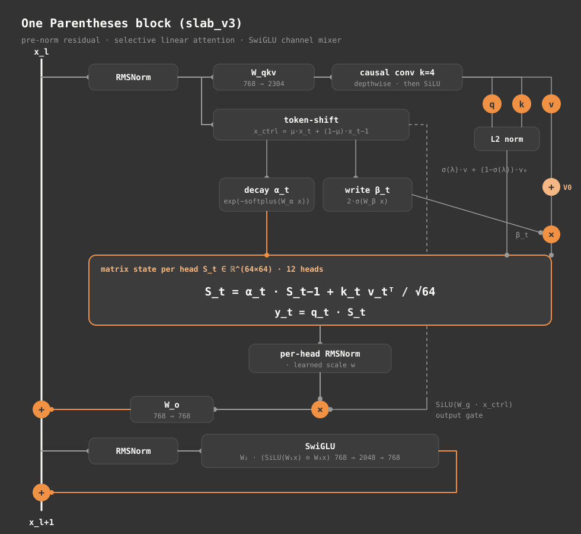
</p>

### 2.1 Where the parameters are

The count below is exact and matches `Parentheses.num_params()`.

| Component | Shape per layer | Per layer | × 16 layers |
| :--- | :--- | ---: | ---: |
| `qkv` projection | $768 \times 2304$ | 1,769,472 | 28,311,552 |
| output projection $W_o$ | $768 \times 768$ | 589,824 | 9,437,184 |
| output gate $W_g$ | $768 \times 768$ | 589,824 | 9,437,184 |
| decay gate $W_\alpha$, $b_\alpha$ | $768 \times 12 + 12$ | 9,228 | 147,648 |
| write gate $W_\beta$, $b_\beta$ | $768 \times 12 + 12$ | 9,228 | 147,648 |
| causal conv taps and bias | $2304 \times 4 + 2304$ | 11,520 | 184,320 |
| per-head output norm scale | $768$ | 768 | 12,288 |
| token-shift mix $\mu$ | $768$ | 768 | 12,288 |
| value-residual mix $\lambda$ | $12$, in layers 1 to 15 only | 12 | 180 |
| two RMSNorm scales | $2 \times 768$ | 1,536 | 24,576 |
| SwiGLU $W_1, W_3, W_2$ | $3 \times 768 \times 2048$ | 4,718,592 | 75,497,472 |
| token embedding $E$ (tied head) | $32768 \times 768$ | | 25,165,824 |
| final RMSNorm | $768$ | | 768 |
| **Total** | | | **148,378,932** |

The SwiGLU hidden width is $\lfloor 8d/3 \rfloor = 2048$, rounded up to a multiple of 64 (already one). Half the model is channel mixing. The parts that make this a recurrent model are the decay, the write gate, the conv, $\mu$ and $\lambda$. Together with all the norms they cost about half a million parameters, or 0.36% of the total.

<p align="center">
  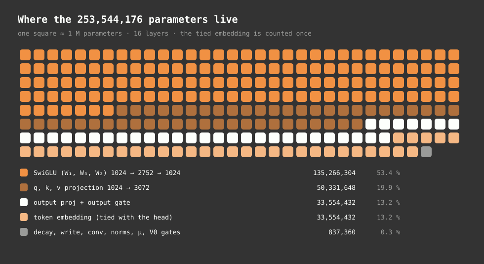
</p>

---

## 3. Tokenisation

Text becomes integer ids in three deterministic stages, all defined in `data/tokenizer/v3_32k/tokenizer.json`.

### 3.1 Normalisation

The input is converted to Unicode NFC. Precomposed and decomposed spellings of the same akshara then produce the same bytes.

### 3.2 Pre-tokenisation

One regular expression splits the string into pre-tokens, and BPE merges never cross a pre-token boundary. The full pattern:

```
'(?i:[sdmt]|ll|ve|re)| ?[\p{L}\p{M}‌‍]+|\p{N}| ?[^\s\p{L}\p{M}\p{N}‌‍]+[\r\n]*|\s*[\r\n]+|\s+(?!\S)|\s+
```

For the Dravidian scripts, the second alternative does the work. A GPT-2-style pattern matches words with `\p{L}+`, which means letters only. In Kannada, Tamil, Telugu and Malayalam, the virama and all dependent vowel signs are combining marks (`\p{M}`), not letters. A letters-only rule cuts every akshara at its mark and pushes the mark into the punctuation branch. This pattern adds `\p{M}`, the zero-width non-joiner (U+200C) and the zero-width joiner (U+200D) to the word class, so an akshara stays in one piece.

Numbers match one digit at a time (`\p{N}` with no `+`), so the model reads a multi-digit number digit by digit.

<p align="center">
  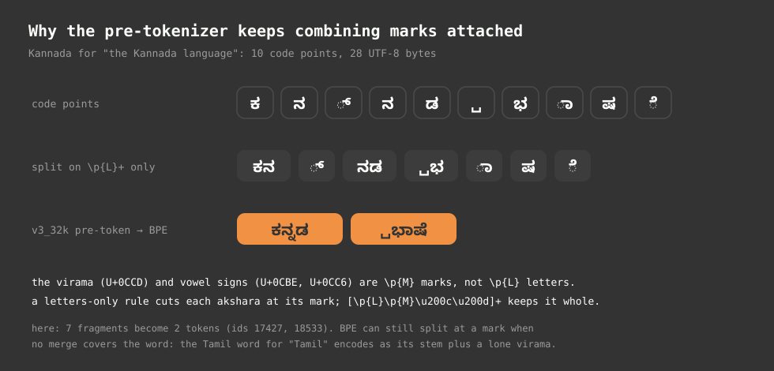
</p>

The figure shows real tokenizer output. "ಕನ್ನಡ ಭಾಷೆ" is 10 code points and 28 UTF-8 bytes. A letters-only split gives 7 fragments, and v3_32k encodes the phrase as 2 tokens (ids 17427 and 18533). Keeping marks inside pre-tokens does not guarantee one token per word. BPE can only apply merges it learned, so a word without a covering merge still splits, sometimes at a mark. The Tamil word for "Tamil" encodes as its stem plus a separate virama token.

### 3.3 Byte-level BPE

Each pre-token is mapped to its UTF-8 bytes. Every byte is one of 256 base symbols, so any string can be represented and there is no unknown token. 32,256 learned merges then combine frequent pairs. The vocabulary holds 32,768 entries: 256 ids reserved for special tokens, and 32,512 byte and merge symbols.

### 3.4 Special tokens

| id | token | role |
| ---: | :--- | :--- |
| 0 | `<\|endoftext\|>` | document end, decode stop |
| 1 | `<\|pad\|>` | padding |
| 2–10 | `<kan>` `<tam>` `<tel>` `<mal>` `<tcy>` `<kff>` `<kxv>` `<nit>` `<eng>` | language tags |
| 11 | `<esg>` | reserved, never present in training data |
| 12 | `<\|system\|>` | system turn |
| 13 | `<\|user\|>` | user turn |
| 14 | `<\|assistant\|>` | assistant turn |
| 15, 16 | `<think>`, `</think>` | reasoning span |
| 17, 18 | `<tool_call>`, `</tool_call>` | tool call span |
| 19–255 | `<\|reserved_n\|>` | unused |

A language tag is an ordinary token with its own embedding. Placed near the start of a sequence, it writes a language-specific vector into every layer's state during the first few updates. It conditions the model. It does not switch anything: no part of the network routes on it.

---

## 4. Embedding and the residual stream

### 4.1 Tied embedding

The embedding matrix $E \in \mathbb{R}^{V \times d}$ is used twice. The input lookup is $x^{(0)}_t = E[\text{token}_t]$. The output logits are $z_t = E\,h_t$, where $h_t$ is the normalised final hidden state. Input and output share one set of 25.2M parameters, so the vector a token enters with is also the direction it is scored along at the output.

### 4.2 RMSNorm

Every norm in the network is an RMSNorm with a learned scale $w$ and no mean subtraction:

$$
\mathrm{RMSNorm}(x) = \frac{x}{\sqrt{\tfrac{1}{d}\sum_{i=1}^{d} x_i^2 + \epsilon}} \odot w, \qquad \epsilon = 10^{-5}.
$$

### 4.3 Pre-norm residual blocks

Each block adds two branches to the residual stream, and each branch reads a normalised copy of it:

$$
\begin{aligned}
x' &= x + \mathrm{SLA}\big(\mathrm{RMSNorm}_1(x)\big) \\
x'' &= x' + \mathrm{SwiGLU}\big(\mathrm{RMSNorm}_2(x')\big).
\end{aligned}
$$

The stream itself is never normalised. It carries the raw sum of every branch output until the final RMSNorm.

### 4.4 Initialisation

Every linear weight and the embedding start from $\mathcal{N}(0, 0.02^2)$. The two projections that write into the residual stream, $W_o$ in each attention branch and $W_2$ in each SwiGLU, start smaller:

$$
\sigma_{\text{residual}} = \frac{0.02}{\sqrt{2L}} = \frac{0.02}{\sqrt{32}} \approx 0.00354.
$$

There are $2L = 32$ writes into the stream. Shrinking each by $1/\sqrt{2L}$ keeps the stream's variance roughly constant with depth at initialisation, so the top of the network does not start out swamped by the sum of everything below. Biases start at zero, except in the decay and write gates. Those biases get deliberate starting values (sections 5.4 and 5.5).

---

## 5. The selective linear attention layer

This is the token-mixing branch: `SelectiveLinearAttention` with `slab_v2` and `slab_v3` enabled. It is the only place where information moves between positions. This section follows it in the order the code runs, for one position $t$, and for one head wherever heads differ. The input $x_t$ is the branch input, already normalised.

### 5.1 Token-shift: a one-step look-back for the control signals

`TokenShift` blends the current input with the previous one, channel by channel:

$$
\tilde{x}_t = \mu \odot x_t + (1 - \mu) \odot x_{t-1}, \qquad \mu \in \mathbb{R}^{d}, \quad \mu_{\text{init}} = 0.5.
$$

The shifted input $\tilde{x}_t$ (`x_ctrl` in the code) feeds only the three control paths: the decay gate, the write gate and the output gate. Queries, keys and values are computed from $x_t$. The effect is that every gate sees a bigram view of the input at no recurrent cost. Whether to forget, and how hard to write, can depend on the transition from the previous token rather than on the current token alone. Nothing constrains $\mu$, so training can push channels outside $[0,1]$ and build differences such as $x_t - x_{t-1}$.

At a document start, $x_{t-1}$ is replaced with zero (section 9).

### 5.2 Projection and causal convolution

One matrix produces all three streams:

$$
u_t = W_{qkv}\, x_t \in \mathbb{R}^{3d}.
$$

A depthwise causal convolution of width 4 runs along time on each of the $3d = 2304$ channels separately, and is followed by SiLU:

$$
\hat{u}_{t,c} = \mathrm{SiLU}\Big(b_c + \sum_{j=0}^{3} w_{c,j}\, u_{t-3+j,\,c}\Big).
$$

The taps start at $w_{c,3} = 1$ and $w_{c,0..2} = 0$. At the start of training the convolution passes the current token straight through, and the layer behaves like plain $\mathrm{SiLU}(u_t)$. Training can then learn to mix in the three previous tokens.

This short window gives the layer exact local order. The recurrent state, by contrast, keeps an exponentially weighted sum in which nearby positions blur together. Many n-gram-shaped patterns, such as affixes, sandhi and words split over several tokens, fit inside four tokens.

$\hat{u}_t$ is then split into 12 heads of $(q_t, k_t, v_t)$, each in $\mathbb{R}^{64}$.

### 5.3 Normalising queries and keys

$$
q_t \leftarrow \frac{q_t}{\lVert q_t \rVert_2}, \qquad k_t \leftarrow \frac{k_t}{\lVert k_t \rVert_2}.
$$

With unit-length queries and keys, $q_t \cdot k_s$ is a cosine similarity in $[-1, 1]$. The scaled score $q_t \cdot k_s / \sqrt{d_h}$ then lies in $[-\tfrac18, \tfrac18]$. Write and read sizes are set by the gates and the values, not by $q$ and $k$ norms drifting during training. The normalisation runs in fp32 or higher and is cast back.

### 5.4 The decay gate

Each head computes one scalar decay per token from the shifted input:

$$
\log \alpha_t = -\,\mathrm{softplus}\big(W_\alpha \tilde{x}_t + b_\alpha\big), \qquad \alpha_t = e^{\log\alpha_t}.
$$

Softplus is always positive, so $\log \alpha_t < 0$ and $\alpha_t \in (0, 1)$ strictly. A head can never amplify its memory. It also never erases it completely in one step, except at a document boundary (section 9).

The model works in log space throughout. Cumulative products of decays become cumulative sums. That is what makes the parallel form in section 7 possible without dividing by anything small.

"Selective" means $\alpha_t$ depends on the input. A head can hold its memory through a long stretch of filler and then drop most of it in one step when the context changes. The decay-mask figure in section 7 shows what that does to the effective attention pattern.

The bias $b_\alpha$ starts at a different value in each head, so the 12 heads begin with a spread of memory horizons. Section 10 has the numbers.

### 5.5 The write gate

$$
\beta_t = 2\,\sigma\big(W_\beta \tilde{x}_t + b_\beta\big) \in (0, 2).
$$

$b_\beta$ starts at zero. The constructor also zeroes $W_\beta$, but the model-wide initialisation pass then redraws every linear weight from $\mathcal{N}(0, 0.02^2)$, so $W_\beta$ starts small and random. Measured on the real preset, $\beta_t$ at initialisation averages 1.00 and spans roughly 0.70 to 1.30 (5th to 95th percentile over tokens). The layer begins close to an ungated linear attention, with a little per-token noise in the write strength. The gate scales the value before it is written:

$$
v_t \leftarrow \beta_t\, v_t.
$$

$\beta_t$ acts as a per-token, per-head learning rate for the memory. A token that carries little, such as punctuation or a very common function word, can be written softly. An informative token can be written at up to twice the base strength. Together with $\alpha_t$, each head controls separately how much it forgets and how much it writes.

### 5.6 The value-residual highway

Layer 0 keeps its value vectors (after the convolution and SiLU, before $\beta$ scaling) and passes them up the stack as $v^{(0)}$. Every later layer $\ell \ge 1$ mixes its own values with layer 0's through one learned scalar per head:

$$
v^{(\ell)}_t \leftarrow \sigma(\lambda^{(\ell)})\, v^{(\ell)}_t + \big(1 - \sigma(\lambda^{(\ell)})\big)\, v^{(0)}_t, \qquad \lambda_{\text{init}} = 0 \;\Rightarrow\; \text{a 50/50 mix}.
$$

The mix comes before the write gate. In layers $\ell \ge 1$ the order is: mix with $v^{(0)}$, then scale by $\beta_t$.

The highway gives every layer a direct line to near-token-level content. A deep layer that wants to store "which token was here" does not have to rely on the residual stream carrying that information intact through every layer below. It also helps gradients: layer 0's value projection receives gradient directly from all 16 layers, which keeps the shallowest layer learning at a pace closer to the deepest.

### 5.7 State update and read

With the gated values in place, the recurrence for one head is

$$
\boxed{\;S_t = \alpha_t\, S_{t-1} + \frac{1}{\sqrt{d_h}}\, k_t^\top v_t, \qquad y_t = q_t\, S_t\;}
$$

starting from $S_0 = 0$. Section 6 explains what these two lines do.

### 5.8 Output normalisation and gate

The 12 head outputs $y_t \in \mathbb{R}^{64}$ are each normalised separately, with their own slice of a learned scale $w_y$:

$$
\bar{y}_t = \frac{y_t}{\sqrt{\tfrac{1}{d_h}\sum_i y_{t,i}^2 + 10^{-5}}} \odot w_y^{(h)}.
$$

The heads are concatenated back to $\mathbb{R}^{768}$, multiplied by a SiLU gate computed from the shifted input, and projected:

$$
\mathrm{SLA}(x)_t = W_o\Big(\bar{y}_t \odot \mathrm{SiLU}\big(W_g\, \tilde{x}_t\big)\Big).
$$

The per-head norm stands in for softmax's normaliser. The read $q_t S_t$ is a signed, unnormalised sum over everything written. It gets larger as more writes match and smaller as decay wears them down. Without the norm, those swings would flow straight into the residual stream. The norm fixes the scale, and the gate then chooses, channel by channel, how much of the normalised read gets through.

### 5.9 The layer in one place

For reference, here is the whole branch for one head of layer $\ell$ at position $t$, in execution order:

$$
\begin{aligned}
\tilde{x}_t &= \mu \odot x_t + (1-\mu) \odot x_{t-1} \\
(q_t, k_t, v_t) &= \text{split}\Big(\mathrm{SiLU}\big(\mathrm{conv}_4(W_{qkv} x)_t\big)\Big) \\
q_t, k_t &\leftarrow q_t / \lVert q_t \rVert,\; k_t / \lVert k_t \rVert \\
v_t &\leftarrow \sigma(\lambda)\, v_t + (1-\sigma(\lambda))\, v^{(0)}_t \qquad (\ell \ge 1) \\
v_t &\leftarrow 2\sigma(W_\beta \tilde{x}_t + b_\beta)\; v_t \\
\alpha_t &= \exp\big(-\mathrm{softplus}(W_\alpha \tilde{x}_t + b_\alpha)\big) \\
S_t &= \alpha_t S_{t-1} + k_t^\top v_t / 8 \\
y_t &= q_t S_t \\
\mathrm{out}_t &= W_o\big(\mathrm{RMSNorm}_{\text{head}}(y_t) \odot \mathrm{SiLU}(W_g \tilde{x}_t)\big)
\end{aligned}
$$

---

## 6. The recurrence as associative memory

<p align="center">
  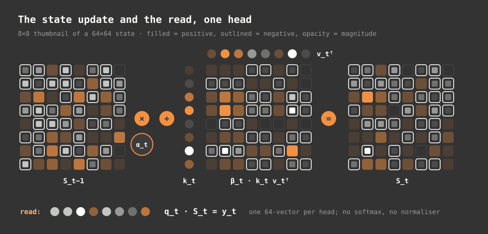
</p>

The state $S_t$ is a $64 \times 64$ matrix that works as a key-value store. Writing the pair $(k, v)$ adds the rank-one matrix $k^\top v / \sqrt{d_h}$. Reading with a query $q$ returns

$$
q\, S = \frac{1}{\sqrt{d_h}} \sum_{s} w_s\, (q \cdot k_s)\, v_s,
$$

where $w_s \le 1$ is the total decay the write at $s$ has suffered since it was made. If $q$ points along a stored key $k_s$ and is orthogonal to the others, the read returns $v_s$ scaled by $w_s / \sqrt{d_h}$. If $q$ partly matches several keys, the read is a blend of their values, weighted by cosine similarity.

### 6.1 A small worked example

Take $d_h = 2$ for readability and ignore the $1/\sqrt{d_h}$ factor. Write the pair $k_1 = (1, 0)$, $v_1 = (3, 1)$, then one step later with $\alpha_2 = 0.5$ write $k_2 = (0, 1)$, $v_2 = (-2, 4)$:

$$
S_1 = \begin{pmatrix} 3 & 1 \\ 0 & 0 \end{pmatrix}, \qquad
S_2 = 0.5\, S_1 + \begin{pmatrix} 0 & 0 \\ -2 & 4 \end{pmatrix} = \begin{pmatrix} 1.5 & 0.5 \\ -2 & 4 \end{pmatrix}.
$$

Querying with $q = k_1$ returns $(1.5, 0.5)$: the first value, halved by one decay. Querying with $q = k_2$ returns $(-2, 4)$ exactly. Querying with $q = (0.6, 0.8)$, a unit vector between the two keys, returns $0.6\,(1.5, 0.5) + 0.8\,(-2, 4) = (-0.7, 3.5)$. That is a blend leaning toward the more similar and more recent key. Querying with $q = (-1, 0)$ returns $(-1.5, -0.5)$: the first value with its sign flipped.

### 6.2 Four properties

Four properties follow directly from this algebra.

1. **The weights are signed.** A query that points away from a stored key subtracts that key's value. Softmax attention can only add, with positive weights. A linear-attention head can cancel content.
2. **Nothing normalises the weights.** The read is not a convex combination. Its size depends on how many keys match and how recently they were written. The per-head RMSNorm in section 5.8 deals with that downstream.
3. **Capacity is bounded by the key dimension.** At most 64 mutually orthogonal keys fit in one head without interfering. Past that, each new write overlaps old ones, and reads return a mixture. The decay acts as garbage collection: old writes fade so new ones can be read cleanly.
4. **The cost of memory does not depend on history.** A head's state is 4,096 numbers whether it has seen ten tokens or ten million. Across the model the matrices total $16 \times 12 \times 64 \times 64 = 786{,}432$ numbers.

The update is a plain additive write. It is not the delta rule $S \leftarrow S + \beta k^\top(v - kS)$, which first subtracts what the key currently retrieves before writing. The source file defines a `GatedDeltaNetFunction`, but the 130M-v3 block never calls it.

### 6.3 What one step costs

Per token, per layer, the recurrence is one outer product and one matrix-vector product per head: $2 \times 12 \times 64^2 \approx 98{,}000$ multiply-adds. Over 16 layers that comes to about 1.6M. The dense projections and the output head cost about 148M multiply-adds per token, so the recurrence is roughly 1% of the arithmetic in a decoding step. What sets this model apart is how it handles memory. Its arithmetic is ordinary.

---

## 7. The parallel (dual) form

Generation uses the recurrence directly. Training on a 4,096-token sequence the same way would mean 4,096 dependent steps. Unrolling the recurrence turns it into a matrix product that can be computed in parallel.

### 7.1 Unrolling

Start from $S_0 = 0$ and apply the update $t$ times:

$$
S_t = \sum_{s=1}^{t} \Big(\prod_{r=s+1}^{t} \alpha_r\Big) \frac{k_s^\top v_s}{\sqrt{d_h}}.
$$

In log space the product becomes a difference of cumulative sums:

$$
\prod_{r=s+1}^{t} \alpha_r = \exp\big(\Lambda_t - \Lambda_s\big), \qquad \Lambda_t = \sum_{r=1}^{t} \log \alpha_r.
$$

Substituting into $y_t = q_t S_t$:

$$
\boxed{\; y_t = \sum_{s \le t} \underbrace{\exp(\Lambda_t - \Lambda_s)}_{M_{ts}} \; \frac{q_t \cdot k_s}{\sqrt{d_h}} \; v_s \;}
$$

For a whole sequence this is

$$
Y = \Big(\frac{Q K^\top}{\sqrt{d_h}} \odot M\Big) V, \qquad M_{ts} = \begin{cases} e^{\Lambda_t - \Lambda_s} & s \le t \\ 0 & s > t \end{cases}
$$

It has the shape of causal attention, with softmax replaced by the decay mask $M$. The diagonal of $M$ is exactly 1, because the current token is read with no decay. Each entry below the diagonal is the product of the decays between the two positions.

<p align="center">
  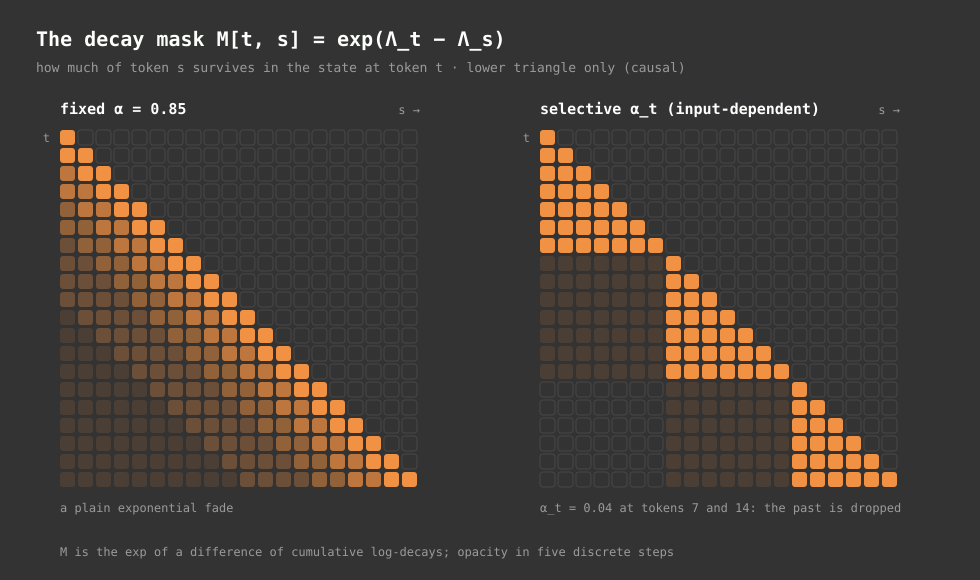
</p>

With a constant $\alpha$, $M$ fades smoothly and exponentially away from the diagonal (left panel). With a selective $\alpha_t$, one small decay cuts every path that crosses it (right panel). When $\alpha_7 = 0.04$, every entry $M_{ts}$ with $s < 7 \le t$ is multiplied by 0.04. The head has effectively started over, with no explicit reset. The selective gate learns to do this.

### 7.2 The dense implementation

`_forward_dense()` computes this formula as written, in $O(T^2)$ time and memory. Before exponentiating, it clamps $\log M$ from below at $-30$. It then adds a cached $-\infty$ above the diagonal for causality. Adding $-\infty$ to a finite number gives exactly $-\infty$, and $e^{-\infty}$ is exactly 0. The dense path runs only when $T$ is not a positive multiple of 64, for example on short evaluation prompts.

### 7.3 Three paths, one function

The recurrent `step()`, the dense form and the chunked form below compute the same function. The module self-tests run all three in float64 on random inputs, with and without document resets, including boundaries that land exactly on a chunk edge or just after one, and require agreement to $10^{-9}$. Those self-tests build plain and `slab_v2` configurations only. They do not switch on the slab_v3 additions (token-shift, write gate, value-residual highway).

For this document, the slab_v3 paths were checked separately in float64, on a small configuration of the same preset with random conv taps, $\mu$, $W_\beta$ and $\lambda$, at $T = 320$ (five chunks) with resets mid-chunk and on a chunk edge:

| Comparison | Max abs difference |
| :--- | ---: |
| chunked `forward()` vs `step()` loop, layer 0 and layer 1, with and without resets | $9 \times 10^{-16}$ |
| chunked `forward()` vs `_forward_dense()`, with resets | $2 \times 10^{-15}$ |
| chunked `forward()` vs `_forward_dense()`, no resets | $3 \times 10^{-13}$ |
| whole-model `forward()` vs `Parentheses.step()` | $4 \times 10^{-16}$ |

The one larger number is the clamp from section 8.5 at work. Without resets, the dense form spans all 320 positions, so some of its log-weights fall below $-30$ and are lifted to $e^{-30}$. The chunked form only clamps inside a chunk. `step()` never clamps, and it agrees with the chunked form to rounding error.

### 7.4 How gradients reach the decay

The parallel form also explains how the gates learn. Write $\ell_r = \log \alpha_r$ and $a_{ts} = q_t \cdot k_s / \sqrt{d_h}$, so that

$$
y_t = \sum_{s \le t} M_{ts}\, a_{ts}\, v_s, \qquad M_{ts} = \exp\Big(\sum_{r=s+1}^{t} \ell_r\Big).
$$

A single log-decay $\ell_r$ appears in exactly the entries whose span crosses position $r$:

$$
\frac{\partial M_{ts}}{\partial \ell_r} = M_{ts}\; \mathbb{1}[\,s < r \le t\,].
$$

With $g_t = \partial \mathcal{L} / \partial y_t$ the gradient arriving at each output, the chain rule gives

$$
\frac{\partial \mathcal{L}}{\partial \ell_r} = \sum_{t \ge r} \; \sum_{s < r} M_{ts}\, a_{ts}\, \langle g_t, v_s \rangle.
$$

The decay at position $r$ is credited by every pair with a writer before $r$ and a reader at or after $r$. If the loss would drop by remembering across $r$, the sum pushes $\ell_r$ toward zero (keep). If the old content is hurting, it pushes $\ell_r$ down (forget). Every one of those pairs is a direct term in the sum. There is no chain of 4,096 multiplications for the gradient to vanish through, as there would be in backpropagation through time on a nonlinear RNN. The size of each term is scaled by $M_{ts}$ itself, though, so a pair the head has already decayed to nothing contributes nothing.

### 7.5 Why the softplus parametrisation

The decay gate's pre-activation is $a_r = W_\alpha \tilde{x}_r + b_\alpha$, and $\ell_r = -\mathrm{softplus}(a_r)$. Its derivative is

$$
\frac{d\ell_r}{da_r} = -\sigma(a_r) \in (-1, 0).
$$

It is never zero and never larger than 1 in magnitude, so the gate cannot saturate into a dead region or blow up. The more useful property is what this does to the timescale. A head's half-life at a fixed pre-activation is $t_{1/2} = \ln 2 / \mathrm{softplus}(a)$, so

$$
\frac{d \ln t_{1/2}}{da} = -\frac{\sigma(a)}{\mathrm{softplus}(a)}.
$$

For a long-memory head, $a$ is very negative, and both $\sigma(a)$ and $\mathrm{softplus}(a)$ approach $e^{a}$, so the ratio approaches 1. Even for the shortest head at initialisation ($\alpha = 0.9$, $a \approx -2.2$), the ratio is about 0.95. A unit step in the pre-activation therefore changes any head's half-life by a factor of about $e$, whether that half-life is 7 tokens or 20,000. Gradient descent adjusts timescales multiplicatively and on the same footing for every head. With $\alpha$ parametrised directly, $d \ln t_{1/2} / d\alpha \approx 1/(1-\alpha)$, which is about 10 for head 0 and about 31,600 for head 11. The same step in $\alpha$ would move the long head's timescale over 3,000 times as far.

### 7.6 Gradients for the write gate and the highway

The write gate scales a value before it enters the state, so its gradient is the value's own credit, projected onto the unscaled value:

$$
\frac{\partial \mathcal{L}}{\partial \beta_s} = \sum_{t \ge s} M_{ts}\, a_{ts}\, \langle g_t, \hat{v}_s \rangle, \qquad \hat{v}_s = v_s / \beta_s.
$$

A token whose content later reads turn out useful gets a larger $\beta$. One whose content only adds interference gets a smaller one.

Layer 0's values feed every layer through the highway. Each layer $\ell \ge 1$ contributes its own share of gradient to $v^{(0)}$, scaled by $\beta^{(\ell)} (1 - \sigma(\lambda^{(\ell)}))$. At initialisation $\sigma(\lambda) = 0.5$ and $\beta \approx 1$, so that factor is about 0.5 in every layer, and layer 0's value projection collects gradient from all 16 layers.

---

## 8. The chunked form used for training

The dense form is quadratic in $T$. `forward()` instead splits the sequence into $n = T / C$ chunks of $C = 64$ tokens. Interactions within a chunk are computed densely. Interactions between chunks go through one $64 \times 64$ state per chunk.

<p align="center">
  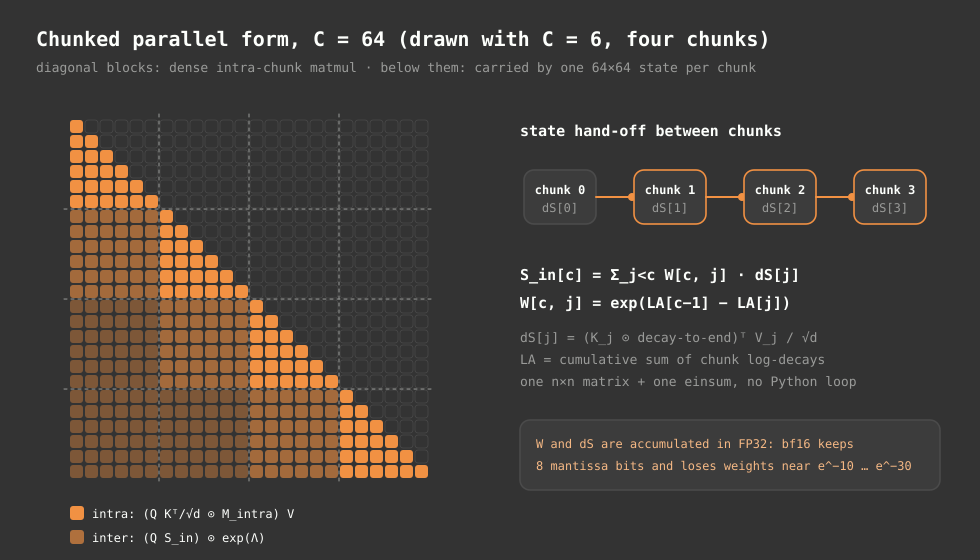
</p>

### 8.1 Inside a chunk

Let $\Lambda^{c}_i$ be the cumulative log-decay inside chunk $c$, restarted at the chunk's first token. The intra-chunk output is the dual form restricted to one $64 \times 64$ block:

$$
O^{\text{intra}}_c = \Big(\frac{Q_c K_c^\top}{\sqrt{d_h}} \odot M^{\text{intra}}_c\Big) V_c, \qquad (M^{\text{intra}}_c)_{ij} = \begin{cases} e^{\Lambda^c_i - \Lambda^c_j} & j \le i \\ 0 & j > i \end{cases}
$$

### 8.2 What each chunk passes forward

Let $A_c = \Lambda^c_{C}$ be the chunk's total log-decay. By the end of the chunk, token $j$'s write has decayed by $e^{A_c - \Lambda^c_j}$. So the chunk's contribution to the state at its own end is

$$
\Delta S_c = \frac{1}{\sqrt{d_h}} \big(K_c \odot e^{A_c - \Lambda^c}\big)^\top V_c \;\in\; \mathbb{R}^{d_h \times d_h}.
$$

### 8.3 The state entering each chunk, in closed form

The obvious way to get the state entering chunk $c$ is a loop: $S^{\text{in}}_c = e^{A_{c-1}} S^{\text{in}}_{c-1} + \Delta S_{c-1}$. Because the decay is one scalar per head, that loop unrolls into a weighted sum. Let $\mathrm{LA}_c = \sum_{c' \le c} A_{c'}$ be the cumulative chunk decay. Then

$$
\boxed{\; S^{\text{in}}_c = \sum_{j < c} W_{cj}\, \Delta S_j, \qquad W_{cj} = \exp\big(\mathrm{LA}_{c-1} - \mathrm{LA}_j\big) \;}
$$

$W$ is an $n \times n$ strictly lower-triangular matrix, which is $64 \times 64$ at $T = 4096$. The whole inter-chunk recurrence becomes one small weight matrix and one `einsum`, and the number of GPU kernel launches no longer grows with $T$.

The code masks invalid entries of $W$ to $-\infty$ before exponentiating, never after. A masked entry is then exactly 0 with zero gradient, and the backward pass cannot produce $e^{+\text{large}} \times 0 = \text{NaN}$.

### 8.4 Reading the carried state

Token $i$ of chunk $c$ reads the carried state, decayed by every step in its own chunk up to and including itself:

$$
O^{\text{inter}}_{c,i} = e^{\Lambda^c_i}\; q_{c,i}\, S^{\text{in}}_c, \qquad O_c = O^{\text{intra}}_c + O^{\text{inter}}_c.
$$

The sum reproduces the dual form exactly. Pairs in the same chunk are counted by the intra term, and pairs in different chunks by the inter term.

### 8.5 Numerical safeguards

The weights $W_{cj}$ span many orders of magnitude. After 30 chunks in a fast-decaying head they can be $e^{-30} \approx 10^{-13}$. bfloat16 keeps 8 bits of mantissa. Summing such terms in bf16 rounds the small ones to nothing, and the early part of a 4,096-token sequence quietly drops out of the state. The code casts $W$ and $\Delta S$ to fp32 (fp64 in the parity tests), accumulates $S^{\text{in}}$ at that precision, and casts the result back to the activation dtype.

Two places clamp a log-weight from below at $-30$ before exponentiating: the intra-chunk mask (and the dense mask) and the within-chunk decay-to-end factor. The clamp has one effect: any true weight below $e^{-30} \approx 9.4 \times 10^{-14}$ comes out as $e^{-30}$ instead. Inside a chunk of 64 tokens, the log-weight only goes that low when the decays in between are small, which is when the head is deliberately forgetting. The bias is upward and at most about $10^{-13}$ per pair. Still, it is a real difference from `step()`, which does not clamp. Document masking is applied after the clamp, so weights across a document boundary remain exactly 0.

### 8.6 Cost

| Part | Time per head | Memory per head |
| :--- | :--- | :--- |
| intra-chunk blocks | $O(T\,C\,d_h)$ | $O(T\,C)$ for the masks |
| chunk contributions $\Delta S$ | $O(T\,d_h^2)$ | $O(n\,d_h^2)$ |
| carried states | $O(n^2 d_h^2)$ | $O(n\,d_h^2)$ |

At $T = 4096$ and $n = 64$, everything is linear in $T$ apart from the $n^2$ term, which works on a 64-by-64 matrix.

---

## 9. Document isolation

Training packs several documents into one 4,096-token window. Without isolation, the end of one document would leak into the memory at the start of the next. A `reset_mask` set to 0 at the first token of each document and 1 everywhere else prevents that.

<p align="center">
  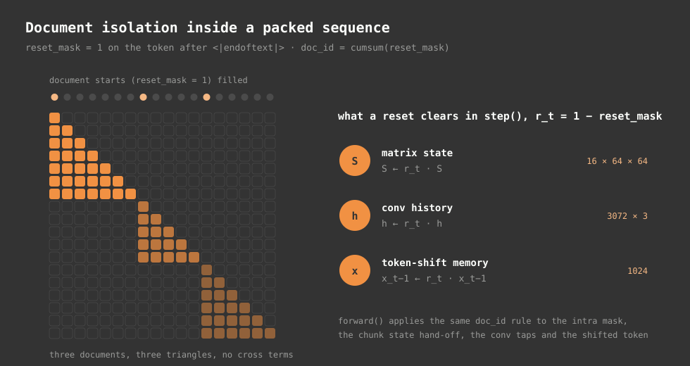
</p>

### 9.1 In the parallel form

Document ids come from a running count of resets:

$$
\mathrm{doc}_t = \sum_{r \le t} \mathbb{1}[\text{reset}_r = 0].
$$

Every path that crosses a boundary is then cut:

- The intra-chunk and dense masks set $M_{ts} = 0$ whenever $\mathrm{doc}_t \neq \mathrm{doc}_s$, by writing $-\infty$ in log space. Each document becomes its own lower triangle along the diagonal.
- A chunk's contribution $\Delta S_c$ includes only tokens from its last document, because only that document can continue into the next chunk.
- The carried weight $W_{cj}$ survives only if chunk $j$'s last document is still open at the end of chunk $c-1$. Document ids never decrease, so that holds exactly when the last document ids of chunks $c-1$ and $j$ match.
- Token $i$ of chunk $c$ reads $S^{\text{in}}_c$ only if it belongs to the document still open from the previous chunk.
- Convolution taps that reach back across a boundary are subtracted from the convolution output before the SiLU. Only the first three positions of a document have taps that cross, with shifts of 1 to 3, so each boundary needs at most six corrections and the fix is sparse.
- The token-shift input $x_{t-1}$ is multiplied by the reset value, which is 0 at a document start.

### 9.2 In the recurrent form

`step()` takes the same flag $r_t \in \{0,1\}$ and multiplies each part of the state by it before updating:

$$
S_{t-1} \leftarrow r_t\, S_{t-1}, \qquad h_{t-1} \leftarrow r_t\, h_{t-1}, \qquad x_{t-1} \leftarrow r_t\, x_{t-1},
$$

where $h$ is the convolution's 3-step history. The self-test packs two random documents with a reset between them and runs them through together. It requires each half's output to match running that document alone, to $10^{-9}$ in float64.

---

## 10. Memory timescales

A write made at step $s$ is still present at step $t$ with weight $e^{\Lambda_t - \Lambda_s}$. If a head's decay stayed fixed at $\alpha$, that weight would halve every

$$
t_{1/2} = \frac{\ln 2}{-\ln \alpha} \approx \frac{\ln 2}{1 - \alpha} \quad \text{tokens} \qquad (\alpha \text{ near } 1).
$$

`init_decay_bias` sets the 12 heads' starting decays so that $1 - \alpha$ is log-spaced between $10^{-1}$ and $10^{-4.5}$. It does this by inverting the softplus parametrisation:

$$
b_\alpha^{(h)} = \log\big(e^{r_h} - 1\big), \qquad r_h = -\log\big(1 - 10^{-1 - 3.5\,h/11}\big), \quad h = 0,\dots,11.
$$

This runs after the generic weight initialisation, because the generic pass zeroes every linear bias. A zero bias would give $\alpha = e^{-\mathrm{softplus}(0)} = 0.5$ in every head, and the state would be wiped every few tokens.

| head | initial $\alpha$ | $1-\alpha$ | half-life (tokens) |
| ---: | ---: | ---: | ---: |
| 0 | 0.900000 | $1.00 \times 10^{-1}$ | 6.6 |
| 1 | 0.951936 | $4.81 \times 10^{-2}$ | 14 |
| 2 | 0.976899 | $2.31 \times 10^{-2}$ | 30 |
| 3 | 0.988897 | $1.11 \times 10^{-2}$ | 62 |
| 4 | 0.994663 | $5.34 \times 10^{-3}$ | 130 |
| 5 | 0.997435 | $2.57 \times 10^{-3}$ | 270 |
| 6 | 0.998767 | $1.23 \times 10^{-3}$ | 562 |
| 7 | 0.999407 | $5.93 \times 10^{-4}$ | 1,169 |
| 8 | 0.999715 | $2.85 \times 10^{-4}$ | 2,433 |
| 9 | 0.999863 | $1.37 \times 10^{-4}$ | 5,063 |
| 10 | 0.999934 | $6.58 \times 10^{-5}$ | 10,535 |
| 11 | 0.999968 | $3.16 \times 10^{-5}$ | 21,919 |

<p align="center">
  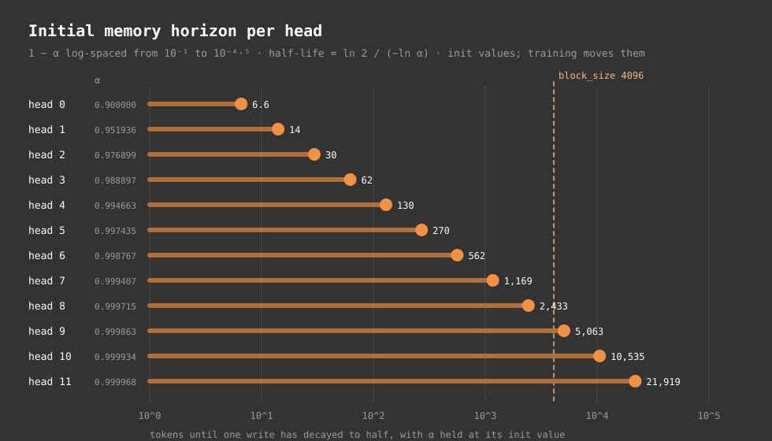
</p>

Three of the twelve heads start with horizons longer than the 4,096-token training window. Starting from a spread of timescales follows S4 and Mamba practice. Each head begins with its own range (local syntax, sentence, paragraph, document), so gradient descent does not have to find the spread on its own.

The table uses the bias alone. $W_\alpha$ starts random ($\mathcal{N}(0, 0.02^2)$, like every linear weight), so even at initialisation the per-token value of $1-\alpha$ varies around these numbers. Measured on the real preset, it spans roughly 0.56× to 1.9× the bias-only value (5th to 95th percentile over tokens), in short and long heads alike.

These are starting values. The decay depends on the input through $W_\alpha \tilde{x}_t$, and both $W_\alpha$ and $b_\alpha$ are trained. A trained head's horizon changes from token to token, and a "long" head can still forget abruptly when the text calls for it.

### 10.1 What one forgetting event does

Take head 11 at its initial decay, $\alpha = 0.999968$. A write from 1,000 tokens ago survives with weight $0.999968^{1000} \approx 0.969$, and one from 10,000 tokens ago with $\approx 0.73$. Now suppose a single token in between, say a document heading, drives that head's gate to $\alpha_r = 0.01$. Every write before $r$ is multiplied by 0.01 at once. The 1,000-token-old write drops to about 0.0097, and so does every older write. Writes after $r$ are untouched.

The arithmetic is cheap, one scalar multiply on a $64 \times 64$ matrix. It lets a head with a 20,000-token horizon act like a much shorter one whenever the content changes. Because every head makes this choice independently at every token, the 12 heads in a layer can split the work: some keep a running summary across a topic change while others start fresh.

---

## 11. The SwiGLU channel mixer

The second branch in every block works on each position on its own:

$$
\mathrm{SwiGLU}(x) = W_2\Big(\mathrm{SiLU}(W_1 x) \odot W_3 x\Big), \qquad W_1, W_3 \in \mathbb{R}^{2048 \times 768}, \quad W_2 \in \mathbb{R}^{768 \times 2048}.
$$

The SiLU branch is a smooth, input-dependent gate on the linear branch. The division of labour is simple: the token-mixing branch moves information between positions, and SwiGLU transforms it within a position. SwiGLU holds 51% of the parameters. Most of the per-token computation, and most of what the model stores about words, morphology and facts, lives there.

---

## 12. Output head and learning objective

### 12.1 Logits

$$
h_t = \mathrm{RMSNorm}_f\big(x^{(16)}_t\big), \qquad z_t = E\, h_t \in \mathbb{R}^{32768}.
$$

### 12.2 Next-token cross-entropy

The training loss is the mean negative log-likelihood of each next token:

$$
\mathcal{L} = -\frac{1}{|\mathcal{T}|} \sum_{t \in \mathcal{T}} \log \mathrm{softmax}(z_t)_{y_t}, \qquad \mathcal{T} = \{t : y_t \neq -1\}.
$$

A target of $-1$ is ignored. For chat-formatted data, a per-token mask marks the assistant's turns, and every target outside them (system prompt, user turn) is set to $-1$. The model is scored only on what it should say. The prompt still flows through the recurrence and shapes the state. The denominator counts supervised tokens only.

### 12.3 The loss without full logits

With a 32,768-token vocabulary, the full fp32 logits for one 4,096-token row take 512 MiB, and their gradient takes as much again. `chunked_loss` splits the flattened positions into slices of 4,096 rows. For each slice it computes the head matmul and the summed cross-entropy under activation checkpointing, so only one slice of logits exists at a time and the backward pass recomputes it. The value and gradients match the plain loss. A self-test checks both to $10^{-5}$, using a slice size that does not divide the sequence length.

### 12.4 Bits per byte

Token-level perplexity depends on the tokeniser. Models with different vocabularies are compared on bits per UTF-8 byte of identical text:

$$
\mathrm{BPB} = \frac{\sum_t -\ln p(y_t \mid y_{<t})}{\ln 2 \cdot N_{\text{bytes}}}.
$$

A model that compresses a script well, through a better tokeniser or better prediction, gets a lower BPB however many tokens it splits the text into.

---

## 13. Inference in constant memory

### 13.1 One step

`Parentheses.step()` takes one token per sequence plus the 16 layer states. It returns the next-token logits and the new states. Each layer does exactly what section 5 describes, for a single position:

1. Look up the token embedding.
2. For each block: RMSNorm. Token-shift against the stored previous input. Apply the `qkv` projection and push the result into the 4-tap conv window. SiLU, then L2-normalise $q$ and $k$. Compute $\alpha_t$ and $\beta_t$, and apply the value-residual mix. Update $S$, read $y$, then norm, gate and project. Add to the residual, then run the SwiGLU branch.
3. Apply the final RMSNorm and the tied head.

Nothing in a step depends on how many tokens came before it.

### 13.2 What the state holds

| Part | Shape per layer | Numbers per layer |
| :--- | :--- | ---: |
| matrix state $S$ | $12 \times 64 \times 64$ | 49,152 |
| conv history $h$ | $2304 \times 3$ | 6,912 |
| previous input for token-shift | $768$ | 768 |
| **per layer** | | **56,832** |
| **all 16 layers** | | **909,312** |

In fp32 that is 3,637,248 bytes (3.64 MB). In bf16 it is half that. This is the model's entire memory of the past. A conversation 100 tokens long and one 100,000 tokens long take the same 3.64 MB.

### 13.3 Compared with a KV cache

A Transformer of the same depth and width stores a key and a value vector per layer for every past token. In fp32 that is $2 \times 16 \times 768 \times 4 = 98{,}304$ bytes per token. Its cache overtakes Parentheses' fixed state after 37 tokens, reaches 403 MB at 4,096 tokens, and reaches 3.2 GB at 32,768 tokens.

<p align="center">
  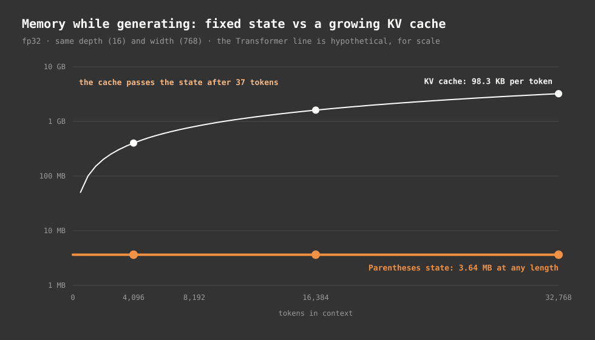
</p>

This compares memory only. A KV cache keeps every past token exactly, so attention can copy any earlier span word for word. A fixed state cannot. Section 18 covers what that costs.

### 13.4 Prefill

`stream()` builds the state for a prompt by calling `step()` on every prompt token except the last, then starts sampling from the last one. Prompt processing is therefore sequential, one step per token, not one parallel pass. That keeps generation on exactly the `step()` arithmetic the tests cover. The parallel form could build the same final state faster, but it would need to return $S_T$, the conv history and the last input, and `forward()` returns only outputs today.

### 13.5 Context length

Training sees windows of up to 4,096 tokens. Inference has no window: the state carries whatever the decays let through, for as long as decoding runs. `stream()` accepts a `sink_tokens` argument meant for the Transformer path's sliding window, and ignores it on this path. With no window, nothing slides out, so nothing needs pinning. How well the model uses context far beyond 4,096 tokens depends on what its trained decays learned. The architecture itself sets no cutoff.

---

## 14. Decoding: from logits to text

<p align="center">
  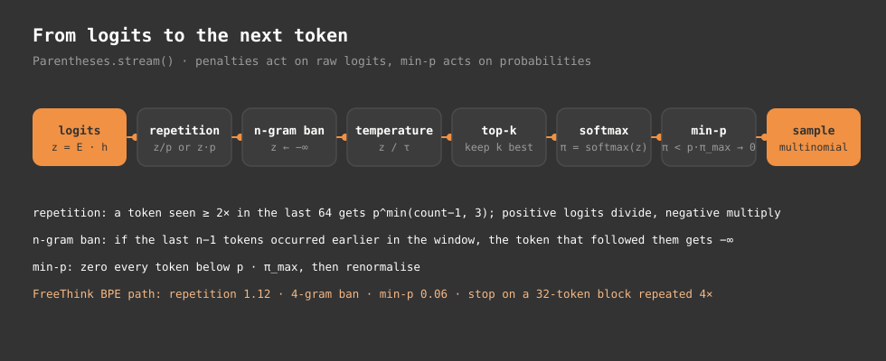
</p>

`stream()` turns each step's logits $z \in \mathbb{R}^V$ into a token. The order of the stages matters: penalties act on raw logits, and min-p acts on probabilities.

### 14.1 Repetition penalty

Over a sliding window of the last 64 generated tokens, let $c_i$ be the count of token $i$ and $p > 1$ the penalty. Then:

$$
z_i \leftarrow \begin{cases} z_i \,/\, p^{\min(c_i - 1,\, 3)} & z_i > 0 \\ z_i \cdot p^{\min(c_i - 1,\, 3)} & z_i \le 0 \end{cases} \qquad \text{for every } i \text{ with } c_i \ge 2.
$$

A token seen once is not penalised. The exponent caps at 3, so the penalty stops growing after four occurrences. Dividing a positive logit and multiplying a negative one both lower it. The window holds generated tokens only, so words from the prompt are not penalised.

### 14.2 n-gram ban

With $n \ge 2$, take the last $n-1$ generated tokens as a prefix. At every earlier position in the 64-token window where that prefix appears, the token that followed it gets $z \leftarrow -\infty$. No $n$-gram can appear twice within the window.

### 14.3 Temperature, top-k, min-p

$$
z \leftarrow z / \max(\tau, 10^{-5}), \qquad z_i \leftarrow -\infty \text{ unless } z_i \text{ is among the } k \text{ largest}, \qquad \pi = \mathrm{softmax}(z).
$$

Min-p then drops every candidate whose probability is below a fixed fraction of the top candidate's, and renormalises:

$$
\pi_i \leftarrow \frac{\pi_i\, \mathbb{1}[\pi_i \ge p_{\min} \max_j \pi_j]}{\sum_j \pi_j\, \mathbb{1}[\pi_j \ge p_{\min} \max_j \pi_j]}.
$$

Unlike top-p, the cutoff moves with the model's confidence. When one token dominates, nearly everything else is cut. When the distribution is flat, many candidates survive. The next token is drawn from $\pi$ by multinomial sampling.

### 14.4 Settings in use

| Path | $\tau$ | top-k | min-p | repetition | n-gram |
| :--- | ---: | ---: | ---: | ---: | ---: |
| `stream()` defaults | 1.0 | off | off | off | off |
| web studio (`app.py`), every mode | 0.7 | 40 | 0.06 | 1.16 | 5 |
| FreeThink session default | 0.75 | 35 | 0.06 | 1.12 | 4 |
| Modular FreeThink default | 0.9 | 40 | 0.06 | 1.12 | 4 |

### 14.5 Stopping

Decoding stops on `<|endoftext|>`, `<|user|>` or `<|system|>`. The FreeThink path also stops on `<|assistant|>`, `<|pad|>`, `<esg>` and the tool tags. A separate loop detector, `looping()` in `scripts/eval_queries.py`, ends generation when the last 128 tokens are a single 32-token block repeated four times in a row. In FreeThink, a stop token that arrives before the requested minimum length is replaced with a paragraph break and decoding continues. This happens at most three times.

Byte-level BPE can split one character across several tokens. The FreeThink decoder holds tokens back until they decode to whole characters, then emits them. A Kannada or Tamil letter never appears half-formed.

---

## 15. Operating modes and prompt grammar

Each mode is a different token prefix fed to the same network. Nothing in the weights switches.

| Mode | Token sequence before generation | Behaviour |
| :--- | :--- | :--- |
| think | `<\|user\|><lang>` prompt `<\|assistant\|><think>` newline | reasons inside a think span, then answers |
| chat | `<\|user\|><lang>` prompt `<\|assistant\|>` | answers directly |
| base | `<lang>` text | plain continuation |
| freethink | `<lang>` prompt, then a native-script continuation cue | open-ended continuation of a statement |

The language tag sets the script and language the state starts in. The web studio in `app.py` picks it from an inline command such as `/kan` at the start of the prompt, from the language selector, or, failing both, by detecting the prompt's script. In think mode, the model generates `<think>` and `</think>` itself as ordinary tokens. The decoder recognises them, keeps them out of the visible text, and inserts a paragraph break at `</think>` so the reasoning and the answer read as two parts.

Commands at the start of a prompt (`/think`, `/freethink`, `/nothink`, `/chat`, `/base`) are parsed by `parse_internal_command`. It removes them from the text and uses them to choose the prefix. `strip_internal_tags` removes any of those commands or tags from what the model generates before it is shown. `<freethink>` and `</freethink>` are not vocabulary tokens. The FreeThink session uses them as markers in its internal transcript to record that a run opened and closed.

### 15.1 The FreeThink cue

FreeThink takes a statement, not a question. A heuristic rejects prompts that end in a question mark or start with an interrogative word in any of the nine languages, unless forced. The prompt is followed by a short continuation phrase in the target script, such as "Thinking about this further," for English or "ಇದರ ಬಗ್ಗೆ ಮತ್ತಷ್ಟು ವಿವರಿಸುವುದಾದರೆ," for Kannada.

The cue deliberately ends without a trailing space. In byte-level BPE a trailing space encodes as a lone space token, while real words carry their leading space inside their own token. A lone space nudges the next token toward digits and punctuation.

---

## 16. FreeThink and retrieval

`ModularFreeThinkSession` adds a document store to the decode loop. The model's state cannot grow, so retrieved text enters by rewriting the prompt rather than by extending a cache.

<p align="center">
  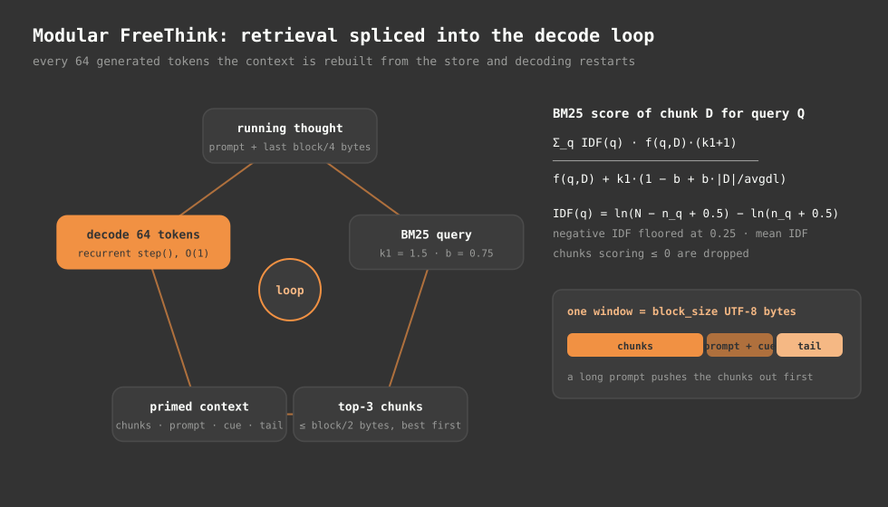
</p>

### 16.1 The loop

Every `splice_every` = 64 generated tokens:

1. Build a query from the prompt plus the tail of the thought so far, which is its last `block_size`/4 bytes.
2. Score every chunk in the store with BM25. Keep up to 3 with positive score, best first, until their combined size reaches `block_size`/2 bytes.
3. Build a new context: the retrieved chunks, then the prompt with its continuation cue, then the tail.
4. Restart `stream()` from an empty state on that context and decode the next 64 tokens.

Each restart rebuilds the recurrent state from scratch. What carries over between splices is the tail text, not the state. The budgets are counted in UTF-8 bytes and keyed to `block_size`, so a long prompt crowds out retrieved chunks first.

### 16.2 BM25

The store uses `BM25Okapi` with $k_1 = 1.5$ and $b = 0.75$. Text is lowercased and matched as runs of ASCII letters and digits, or runs of word characters, Indic-block code points (U+0B00 to U+0D7F) and joiners. For a query $Q$ and a chunk $D$:

$$
\mathrm{score}(D, Q) = \sum_{q \in Q} \mathrm{IDF}(q) \cdot \frac{f(q, D)\,(k_1 + 1)}{f(q, D) + k_1 \big(1 - b + b\, |D| / \overline{|D|}\big)},
$$

$$
\mathrm{IDF}(q) = \ln\big(N - n_q + 0.5\big) - \ln\big(n_q + 0.5\big).
$$

Here $f(q, D)$ is the term's count in the chunk, $|D|$ the chunk length, $\overline{|D|}$ the average chunk length, $N$ the number of chunks and $n_q$ the number of chunks containing $q$. A term that appears in more than half the chunks would get a negative IDF, and the library floors those at $0.25 \times$ the mean IDF. Chunks scoring zero or below are dropped, since they share no informative term with the query.

---

## 17. Images and documents

This section describes what `features/multimodal.py` does. The code and some descriptions of it elsewhere disagree, and this follows the code.

### 17.1 Documents

`extract_document_text` pulls plain UTF-8 text out of PDF, DOCX, HTML, XML, CSV, TSV, JSON and text files using pure-Python parsers. That text then reaches the model like any other prompt, or goes into the BM25 store from section 16. The model never sees document layout, only the extracted characters.

### 17.2 Image descriptions

`describe_image` computes classical image statistics:

- resolution and aspect ratio, and colour mode
- dominant colours, named from a palette
- Rec.601 luminance, $Y = 0.299R + 0.587G + 0.114B$
- RMS and Michelson contrast
- Sobel edge density
- a 2×2 grid of quadrant brightness
- embedded metadata

It writes them up as a sentence in the requested language, and the model receives that sentence as text. Every number is computed deterministically. No neural vision is involved, and the model never looks at pixels.

### 17.3 Patch state prefill

`prefill_visual_state` resizes an image to a 64×64 grid by default and cuts it into 16×16 patches in raster order (16 patches). Each patch maps to a 768-dimensional vector. The mapping matrix comes from reshaping the first $3 \cdot 16 \cdot 16 \times 768$ entries of the token embedding matrix, then centring and rescaling its columns. A small 2-D sinusoidal position code is added. The function then steps each patch vector through the blocks as if it were a token.

The projection is not learned, and the model was never trained on these patch vectors, so the state they produce has no trained meaning.

On slab_v3 blocks, `block.step()` returns `((x, state), v0)` so it can carry the value-residual highway. The prefill loop threads $v^{(0)}$ up the stack for each patch, as `Parentheses.step()` does for tokens. The resulting states have the same shapes as `empty_states()` and hand straight off to token decoding.

So the plumbing works, but the meaning does not follow. Until the model is trained on patch vectors, the text description from 17.2 is the image path that carries usable information.

---

## 18. Limits that follow from the math

These follow from the architecture, not from any particular training run.

**Recall is lossy.** Each head keeps everything in a $64 \times 64$ matrix. Exact retrieval of one item among many needs nearly orthogonal keys, and at most 64 fit. Asking for a phone number mentioned 2,000 tokens ago, or copying a long passage word for word, tests exactly what a fixed associative memory does worst. A Transformer can attend back to the exact tokens. This model can only read whatever blend of them survives in its state.

**Old information fades unless a head keeps it.** Even the slowest head starts with a half-life of about 22,000 tokens, and that is the best case, with its decay held near the upper limit. Whatever the trained gates choose to forget is gone, and nothing brings it back.

**Reads are signed and unnormalised.** The per-head RMSNorm controls the output scale. Within a head, though, many weak matches can add up to look like one strong match, and a key pointing the opposite way subtracts content. That is the price of removing softmax.

**Order comes from three short mechanisms.** With no positional encoding, the model knows order through the 4-tap convolution, the one-step token-shift and recency in the decay. Past a few tokens, the state holds content weighted by recency, not an ordered list. Tasks that need exact long-range positions, such as "the seventh word of the third sentence", are hard by construction.

**Retrieval restarts the state.** In modular FreeThink, every splice rebuilds the state from a fresh context. Continuity across splices is limited to the tail text carried forward.

**A small model knows less.** At 148M parameters, most of them in the SwiGLU layers, the model holds limited world knowledge and will produce fluent but wrong specifics. Nothing described in this document changes that.

---

## 19. Appendix

### 19.1 Shapes in one forward pass

| Tensor | Shape (batch $B$, length $T$) |
| :--- | :--- |
| token ids | $(B, T)$ |
| residual stream | $(B, T, 768)$ |
| `qkv` output, after conv | $(B, T, 2304)$ |
| $q, k, v$ | $(B, 12, T, 64)$ |
| $\log \alpha$, $\beta$ | $(B, T, 12)$ |
| chunked $q, k, v$ | $(B, 12, n, 64, 64)$ with $n = T/64$ |
| intra-chunk mask | $(B, 12, n, 64, 64)$ |
| chunk contributions $\Delta S$ | $(B, 12, n, 64, 64)$ |
| carry weights $W$ | $(B, 12, n, n)$ |
| head outputs $y$ | $(B, 12, T, 64)$ |
| logits, per loss slice | $(\le 4096, 32768)$ |

### 19.2 Recurrent state per layer, as returned by `empty_state`

| Element | Shape | Role |
| :--- | :--- | :--- |
| `S` | $(B, 12, 64, 64)$ | associative memory |
| conv history | $(B, 2304, 3)$ | the last three `qkv` outputs |
| shift state | $(B, 768)$ | the previous normalised input, for token-shift |

The value-residual vector $v^{(0)}$ is not stored. Layer 0 recomputes it at every step and it is passed up through the stack within that step.

### 19.3 Equivalence guarantees

| Check | Where | Tolerance |
| :--- | :--- | :--- |
| slab_v3 additions (token-shift, write gate, highway) in all of the paths below | checked for this document; see section 7.3 | $\le 3 \times 10^{-13}$, fp64 |
| chunked `forward()` equals `step()` unrolled | `model/selective_linear_attention.py` self-tests (plain and slab_v2) | $10^{-9}$, fp64 |
| `forward()` equals `_forward_dense()` | same | $10^{-9}$, fp64 |
| same, with resets mid-chunk, on a chunk edge and two tokens past one | same | $10^{-9}$, fp64 |
| five-chunk closed-form scan, one document spanning three chunks | same | $10^{-9}$, fp64 |
| packed documents equal each document run alone | same | $10^{-9}$, fp64 |
| gradients through the closed-form scan are finite | same | all finite |
| whole-model `forward()` equals `Parentheses.step()` | `model/backbone.py` self-tests (plain and slab_v2) | $10^{-9}$, fp64 |
| `stream()` equals hand-driven `step()` decoding | same | exact token match |
| `chunked_loss` equals full cross-entropy, value and gradients | same | $10^{-5}$ |

### 19.4 Source map

| Concept | File | Function or class |
| :--- | :--- | :--- |
| presets and config fields | `model/config.py` | `ModelConfig`, `PRESETS` |
| token-shift | `model/selective_linear_attention.py` | `TokenShift` |
| projections, conv, norms, gates, highway | same | `SelectiveLinearAttention._project`, `_conv` |
| decay initialisation | same | `init_decay_bias` |
| per-head norm and output gate | same | `_output` |
| chunked parallel form | same | `SelectiveLinearAttention.forward` |
| dense parallel form | same | `_forward_dense` |
| recurrent step | same | `SelectiveLinearAttention.step` |
| block wiring, RMSNorm, SwiGLU | `model/backbone.py` | `Block`, `RMSNorm`, `SwiGLU` |
| embedding, initialisation, tied head | same | `Parentheses.__init__`, `_init_weights` |
| loss | same | `Parentheses.chunked_loss` |
| decoding | same | `Parentheses.stream`, `_apply_sampling_penalties` |
| loop detection, stop tokens | `scripts/eval_queries.py` | `looping` |
| prompt grammar, tag hiding, FreeThink | `features/free_think.py` | `parse_internal_command`, `strip_internal_tags`, `FreeThinkSession` |
| retrieval loop | `features/modular_free_think.py` | `ModularFreeThinkSession`, `IngestedStore` |
| image statistics, documents, patch prefill | `features/multimodal.py` | `describe_image`, `extract_document_text`, `prefill_visual_state` |

### 19.5 Code in the same files that is not part of this model

`model/selective_linear_attention.py` also defines `CausalDepthwiseConv1d`, a standalone conv module, and `GatedDeltaNetFunction`, a delta-rule recurrence with a hand-written backward pass. `model/backbone.py` defines `CausalSelfAttention`, a softmax attention layer with rotary position embeddings that the older Transformer presets use. The 130M-v3 block uses none of these. Its convolution is built into `SelectiveLinearAttention`, and its update is the additive rule from section 5.7.

<p align="center">
  <sub>Parentheses 0.9 · engineered by uncoalesced</sub>
</p>
