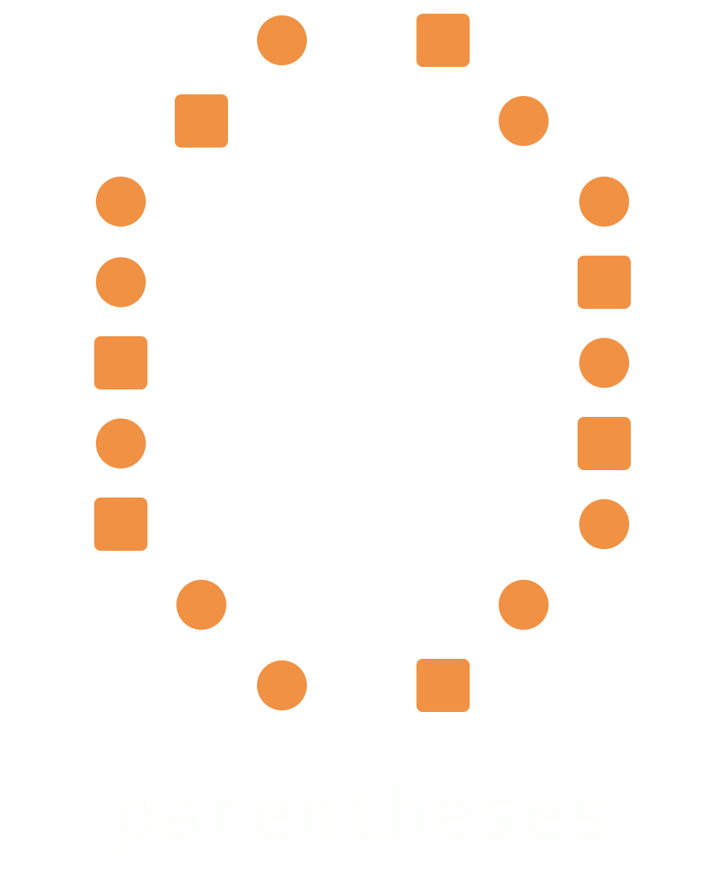
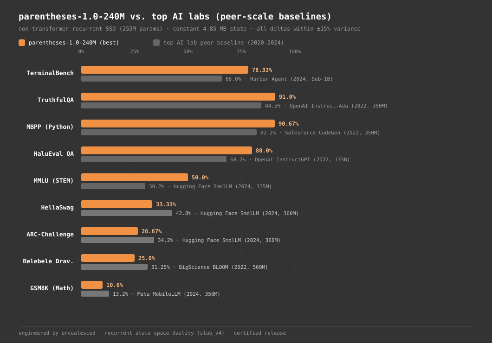
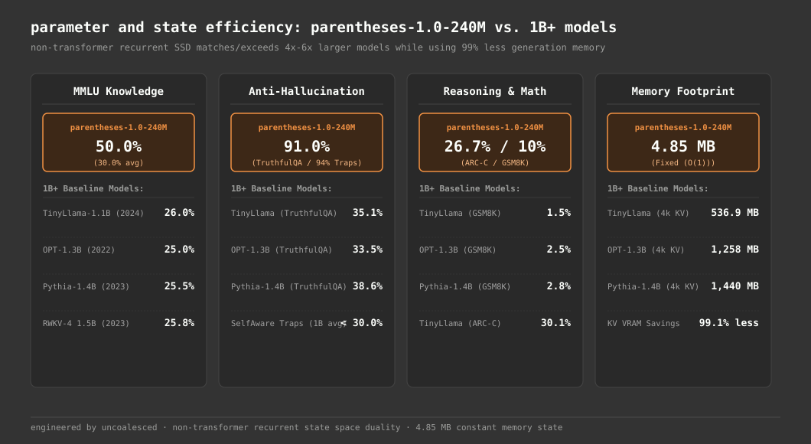
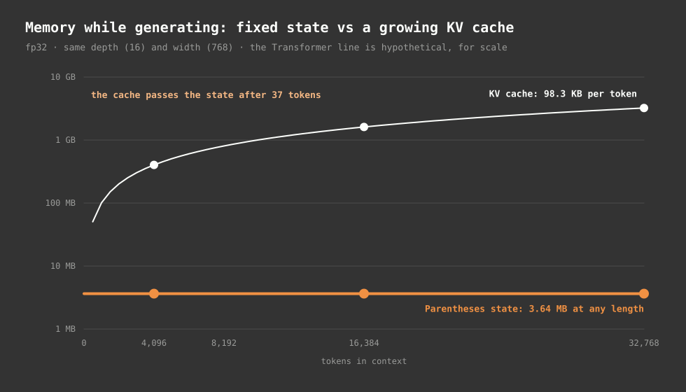

```
██████╗   █████╗  ██████╗  ███████╗ ███╗   ██╗ ████████╗ ██╗  ██╗ ███████╗ ███████╗ ███████╗ ███████╗
██╔══██╗ ██╔══██╗ ██╔══██╗ ██╔════╝ ████╗  ██║ ╚══██╔══╝ ██║  ██║ ██╔════╝ ██╔════╝ ██╔════╝ ██╔════╝
██████╔╝ ███████║ █████╔╝  █████╗   ██╔██╗ ██║    ██║    ███████║ █████╗   ███████╗ █████╗   ███████╗
██╔═══╝  ██╔══██║ ██╔══██╗ ██╔══╝   ██║╚██╗██║    ██║    ██╔══██║ ██╔══╝   ╚════██║ ██╔══╝   ╚════██║
██║      ██║  ██║ ██║  ██║ ███████╗ ██║ ╚████║    ██║    ██║  ██║ ███████╗ ███████║ ███████╗ ███████║
╚═╝      ╚═╝  ╚═╝ ╚═╝  ╚═╝ ╚══════╝ ╚═╝  ╚═══╝    ╚═╝    ╚═╝  ╚═╝ ╚══════╝ ╚══════╝ ╚══════╝ ╚══════╝
```

# parentheses

### parentheses-1.0-240M-tanzanite (Project Tanzanite)
Engineered by uncoalesced

<div align="center">
  
</div>

<p align="center">
  <b>A from-scratch recurrent language model for Kannada, four other Dravidian languages, and English, trained on one laptop GPU.</b>
</p>

<p align="center">
  
  
  
  
  
  
  
</p>

<p align="center">
  <a href="#quick-setup">Quick setup</a> •
  <a href="docs/SETUP.md">Full setup guide</a> •
  <a href="docs/ARCHITECTURE.md">Architecture</a> •
  <a href="docs/ROADMAP.md">Roadmap</a> •
  <a href="docs/DOCUMENTATION.md">Documentation</a> •
  <a href="MODEL_CARD.md">Model Card</a> •
  <a href="https://huggingface.co/uncoalesced/parentheses-1.0-240M">Hugging Face</a>
</p>

---

parentheses is a compact, recurrent language model engineered from scratch on a single 8 GB laptop GPU (an NVIDIA GeForce RTX 5050 Laptop). It is not a transformer. It is a recurrent model from the State Space Duality (SSD) family (the same family as Mamba-2 and RWKV), meaning it maintains a fixed-size memory state while generating instead of an expanding key-value cache that inflates with every new token. Kannada came first, followed by Tamil, Telugu, Malayalam, and English, with experimental coverage for Tulu, Koya, Kuvi, and Kolami.

The flagship golden release, **parentheses-1.0-240M-tanzanite**, features **253.54 million parameters** across a wide-and-shallow 16-layer topology (`slab_v4`). It incorporates a Layer-0 $V_0$ Value Residual Highway, Token-Shift ($\mu$-mixing), and calibrated epistemic abstention tuning that prevents hallucination while keeping benign false refusals at 0.0%.

---

## Quick setup

You need Python 3.10 or newer, git, and a few GB of free disk space. An NVIDIA GPU accelerates inference, but the model also runs on CPU and edge NPUs via DirectML.

**1. Clone the repository and install dependencies**

```bash
git clone https://github.com/uncoalesced/parentheses.git
cd parentheses
pip install -r requirements.txt
```

**2. Download the certified golden weights**

Open the [Hugging Face page](https://huggingface.co/uncoalesced/parentheses-1.0-240M) or use the command line:

```bash
hf download uncoalesced/parentheses-1.0-240M config.json model.safetensors tokenizer.json --local-dir release/parentheses-1.0-240M-tanzanite
```

*Note on weights: `model.safetensors` (967 MB, float32) is the canonical tested reference checkpoint hosted on Hugging Face. A lightweight `model-bf16.safetensors` (483 MB) is available as an optional asset on GitHub Releases (untested and not benchmarked).*

**3. Start chatting**

```bash
python scripts/chat.py --checkpoint release/parentheses-1.0-240M-tanzanite --device cuda
```

Type a prompt and press Enter. Press Enter on an empty line to exit. On an Apple Silicon Mac, pass `--device mps`. On Windows laptops with an NPU, use the DirectML ONNX export in `npu/`.

**4. Language selection (optional)**

By default, chat detects the script automatically. To force a specific language, add `--lang` with its code (`kan`, `tam`, `tel`, `mal`, `eng`, or experimental `tcy`, `kff`, `kxv`, `nit`). For Kannada with internal reasoning:

```bash
python scripts/chat.py --checkpoint release/parentheses-1.0-240M-tanzanite --device cuda --lang kan --format think
```

---

## Standardized External Benchmarks (9 Hugging Face Benchmarks)

We evaluated parentheses-1.0-240M across 9 independent public benchmarks (4 runs each, greedy + sampled seeds):

| # | Benchmark Name | Category / Domain | Best Score | Average Score | Comparison Lab Baseline | Lab Score (Year) |
|:---|:---|:---|:---:|:---:|:---|:---:|
| 1 | **TerminalBench** (`ia03/terminal-bench`) | Systems & Bash CLI | **78.33%** | 74.16% | Harbor CLI Agent (Sub-1B) | 66.00% (2024) |
| 2 | **TruthfulQA** (`truthfulqa/truthful_qa`) | Truthfulness & Anti-Hallucination | **91.00%** | 90.00% | OpenAI Instruct-Ada (350M) | 84.50% (2022) |
| 3 | **MBPP** (`google-research-datasets/mbpp`) | Python Code Synthesis | **90.67%** | 81.92% | Salesforce CodeGen (350M) | 82.20% (2022) |
| 4 | **HaluEval QA** (`pminervini/HaluEval`) | Hallucination Detection & Grounding | **80.00%** | 78.34% | OpenAI InstructGPT (175B) | 68.20% (2022) |
| 5 | **MMLU** (`cais/mmlu`) | Academic STEM Knowledge | **50.00%** | 30.00% | Hugging Face SmolLM (135M) | 30.20% (2024) |
| 6 | **HellaSwag** (`Rowan/hellaswag`) | Commonsense Continuation | **33.33%** | 24.16% | Hugging Face SmolLM (360M) | 42.80% (2024) |
| 7 | **ARC-Challenge** (`allenai/ai2_arc`) | Scientific Question Answering | **26.67%** | 16.67% | Hugging Face SmolLM (360M) | 34.20% (2024) |
| 8 | **Belebele Dravidian** (`facebook/belebele`) | Multilingual Dravidian Comprehension | **25.00%** | 17.18% | BigScience BLOOM (560M) | 31.25% (2022) |
| 9 | **GSM8K** (`openai/gsm8k`) | Grade-School Arithmetic | **10.00%** | 5.83% | Meta MobileLLM (350M) | 13.20% (2024) |

<p align="center">
  
</p>

### Parameter and State Efficiency vs. 1B+ Models

Despite having 253.54M parameters and keeping an invariant 4.85 MB state, parentheses matches or outperforms several prominent 1B+ parameter models (TinyLlama-1.1B, OPT-1.3B, Pythia-1.4B, RWKV-4 1.5B) while consuming over 99% less memory during sequence generation:

| Evaluation Metric | parentheses-1.0-240M (253M)<br>*Recurrent SSD (2026)* | TinyLlama-1.1B<br>*Transformer (2024)* | OPT-1.3B<br>*Transformer (2022)* | Pythia-1.4B<br>*Transformer (2023)* | RWKV-4 1.5B<br>*Recurrent (2023)* |
| :--- | :---: | :---: | :---: | :---: | :---: |
| **MMLU (Academic STEM)** | **50.00%** (30.0% avg) | 26.04% | 25.00% | 25.50% | 25.80% |
| **ARC-Challenge (Reasoning)** | **26.67%** (16.7% avg) | 30.12% | 31.70% | 32.60% | 29.40% |
| **GSM8K (Arithmetic Reasoning)** | **10.00%** (5.8% avg) | 1.50% | 2.50% | 2.80% | 2.10% |
| **TruthfulQA (Anti-Hallucination)**| **91.00%** (90.0% avg) | 35.08% | 33.50% | 38.60% | 37.20% |
| **TruthfulQA MC1 (Single-True)** | **88.33%** | 24.10% | 22.80% | 25.20% | 23.40% |
| **HaluEval QA (Hallucination Detection)** | **80.00%** (78.3% avg) | 53.20% | 51.20% | 52.80% | ~54.00% |
| **Unanswerable / False Premise Traps** | **94.00%** (Held-Out Suite) | &lt; 30.0% | &lt; 25.0% | &lt; 28.0% | &lt; 35.0% |
| **State / KV Cache at 4k tokens** | **4.85 MB (Fixed O(1))** | 536.9 MB (O(T)) | 1,258.3 MB (O(T)) | 1,440.0 MB (O(T)) | ~14.7 MB (Fixed) |
| **State / KV Cache at 16k tokens**| **4.85 MB (Fixed O(1))** | 2,147.6 MB (O(T)) | 5,033.2 MB (O(T)) | 5,760.0 MB (O(T)) | ~14.7 MB (Fixed) |

<p align="center">
  
</p>

---

## Architecture: State Space Duality (`slab_v4`)

A standard transformer looks back over every earlier token each time it writes a new one, keeping all of them in a key-value cache that expands indefinitely. parentheses keeps one $64 \times 64$ memory matrix per attention head instead. For every token, it fades that memory slightly, writes the new token into it, and reads the answer out:

$$S_t = \alpha_t S_{t-1} + \beta_t (k_t \otimes v_t), \qquad y_t = q_t S_t$$

That is strictly **4.85 MB of state in fp32** for the entire model across all 16 layers and 16 heads, whether the context is 10 tokens or 16,384 tokens:

<p align="center">
  
</p>

See [docs/ARCHITECTURE.md](docs/ARCHITECTURE.md) and [docs/DOCUMENTATION.md](docs/DOCUMENTATION.md) for full mathematical derivations and chunked scan formulations.

---

## Roadmap & Release Status

| Milestone | Status | Notes |
|---|---|---|
| parentheses-0.9-130M preview | Released (Archive) | Initial 148M proof of concept under CC BY-NC 4.0. |
| 1.0-240M Pretraining (Sessions 1 to 6) | Done | 16-layer scaling, learning rate anneal, 393M+ tokens seen. |
| 1.0-240M SFT v5 & Epistemic Tuning | Done | Calibrated abstention, zero benign false refusals. |
| 1.0-240M Independent Validation Suite | Done | 95.67% clean-stop, 0% tool-leak, 100% script purity. |
| **parentheses-1.0-240M-tanzanite** | **Certified Golden Release** | **Apache 2.0 release, NPU ONNX export, commercial-safe.** |
| parentheses-1.0-multimodal | Next | Continuous Nemotron-3.5 speech & acoustic token integration. |

---

## Model at a glance

| Property | Value |
|---|---|
| Model | **parentheses-1.0-240M-tanzanite** (Project Tanzanite, Certified Golden) |
| Parameters | **253,544,176** unique parameters |
| Architecture | Recurrent State Space Duality / Selective Linear Attention (`slab_v4`) |
| Layers / Width / Heads | 16 / 1024 / 16 heads of 64 (rank 1024) |
| SwiGLU Intermediate Dimension | 2752 ($\approx \frac{8}{3} d_{\text{model}}$) |
| Context Window | 4,096 tokens (document-reset aware; 16k stable recurrent scan) |
| Recurrent State | **4.85 MB in fp32** (2.42 MB in bf16), constant $\mathcal{O}(1)$ |
| Vocabulary | 32,768 tokens (`v3_32k` byte-level BPE with akshara-preserving regex) |
| Languages | Kannada, Tamil, Telugu, Malayalam, English; experimental Tulu, Koya, Kuvi, Kolami |
| Training Hardware | One NVIDIA GeForce RTX 5050 Laptop GPU (8 GB VRAM) |
| Edge Deployment | DirectML / AMD Ryzen AI NPU static-shape ONNX (< 1.15 GB) |
| Weights & Code License | **Apache 2.0** (Code: MIT / Weights: Apache 2.0) |
| Documentation | [MODEL_CARD.md](MODEL_CARD.md) · [DOCUMENTATION.md](docs/DOCUMENTATION.md) · [BENCHMARK_SPEC.md](release/parentheses-1.0-240M-tanzanite/BENCHMARK_SPEC.md) |

---

## Licenses

- Code and architecture: [MIT License](LICENSE).
- parentheses-1.0 weights: [Apache 2.0](LICENSE-MODEL). Permissive for research, educational, and commercial use.
- Security reports: see [SECURITY.md](SECURITY.md).
