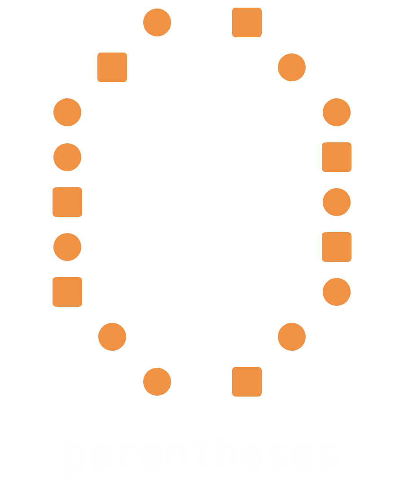

```
██████╗   █████╗  ██████╗  ███████╗ ███╗   ██╗ ████████╗ ██╗  ██╗ ███████╗ ███████╗ ███████╗ ███████╗
██╔══██╗ ██╔══██╗ ██╔══██╗ ██╔════╝ ████╗  ██║ ╚══██╔══╝ ██║  ██║ ██╔════╝ ██╔════╝ ██╔════╝ ██╔════╝
██████╔╝ ███████║ █████╔╝  █████╗   ██╔██╗ ██║    ██║    ███████║ █████╗   ███████╗ █████╗   ███████╗
██╔═══╝  ██╔══██║ ██╔══██╗ ██╔══╝   ██║╚██╗██║    ██║    ██╔══██║ ██╔══╝   ╚════██║ ██╔══╝   ╚════██║
██║      ██║  ██║ ██║  ██║ ███████╗ ██║ ╚████║    ██║    ██║  ██║ ███████╗ ███████║ ███████╗ ███████║
╚═╝      ╚═╝  ╚═╝ ╚═╝  ╚═╝ ╚══════╝ ╚═╝  ╚═══╝    ╚═╝    ╚═╝  ╚═╝ ╚══════╝ ╚══════╝ ╚══════╝ ╚══════╝
```


# Parentheses

*Engineered by uncoalesced*

A recurrent language model implementing selective linear attention (RWKV-style), built and trained from scratch on a single consumer laptop GPU.

> [!IMPORTANT]
> **ARCHITECTURE NOTICE (Mamba-2 / RWKV / Selective Linear Attention):**
> Parentheses is **NOT a Transformer / GPT model**. It does **NOT** use quadratic causal self-attention ($O(T^2)$ Softmax attention matrices) or standard Transformer KV-caches.
> Parentheses is a **from-scratch Recurrent / State Space Duality (SSD) model** belonging to the **Mamba-2 / RWKV / Selective Linear Attention** family:
> - **Training (Parallel Form):** Chunked associative linear attention / semi-separable state space duality with linear $O(T)$ complexity.
> - **Inference / Decoding (Recurrent Form):** Constant $O(1)$ recurrent memory state updates: $S_t = \alpha_t S_{t-1} + (k_t \otimes v_t)$ and $y_t = q_t S_t$. Fixed state size, zero growing KV-cache, zero sequence Softmax.

<div align="center">
  
</div>

### Status (2026-10-17) — Parentheses 0.9-120M Release Ready

- **Parentheses 0.9-120M** (`119,702,272` parameters, 32 layers, 8 heads, `d_model=512`, `head_dim=64`, `block_size=4096`, `v3_32k` Akshara-preserving Byte-Level BPE) has completed **1.25 billion tokens** of pretraining across **9 languages** (`eng`, `kan`, `tam`, `tel`, `mal`, `tcy`, `kff`, `kxv`, `nit`) on a single NVIDIA GeForce RTX 5050 Laptop GPU (8 GB VRAM) followed by **Masked SFT v4 (`step_10036`)**.
- **Closed-Form Chunked Selective Linear Attention ($C=64$):** Parallel training runs in linear $\mathcal{O}(T)$ complexity via intra-chunk associative attention and closed-form inter-chunk decay propagation with `reset_mask` document-boundary isolation (3.1× faster than the legacy sequential scan).
- **Constant $\mathcal{O}(1)$ Recurrent Inference:** Decoding steps a fixed-size associative matrix state $S_t \in \mathbb{R}^{32 \times 8 \times 64 \times 64}$ ($\approx 4.19\text{ MB}$ total across all 32 layers) with zero growing KV-cache (`0.995x–1.010x` latency ratio across 300+ tokens) and a 64-token ring-buffer repetition & 5-gram gate (`repetition_penalty=1.16, no_repeat_ngram_size=5`).
- **100% Internal Thinking & FreeThink Encapsulation:** Commands (`/think`, `/freethink`, `/nothink`, `/chat`, `/base`) and tags (`<think>`, `</think>`, `<freethink>`, `</freethink>`) are automatically stripped from user-visible text and managed internally (`sess.internal_close_tag == "</freethink>"`, `sess.closed_freethink == True`).
- **Recurrent SSM Multimodal Subsystem (`features/multimodal.py`):** Supports constant-memory $\mathcal{O}(1)$ 2D image patch state prefill (`prefill_visual_state`), localized visual summaries (`describe_image`), and pure-Python multi-format document ingestion (`extract_document_text` for PDF, DOCX, HTML, XML, CSV, JSON, TXT, MD).

---

## 1. Model Presets & Scale Progression

| Preset | Layers | Heads | Dim | Vocab | Parameters | Status / Role |
| :--- | :---: | :---: | :---: | :---: | :---: | :--- |
| **`parentheses-0.9-120M`** | **32** | **8** | **512** | **32,768 (`v3_32k` BPE)** | **119.7M** | **Flagship 9-Language SSM (1.25B pretrain + SFT v4 `step_10036`)** |
| **`parentheses-0.9-41M`** | **24** | **8** | **384** | **32,768 (`v3_32k` BPE)** | **40.9M** | **Compact 9-Language SSM (1.06B tokens)** |
| `parentheses-0.8-1m` | 5 | 8 | 128 | 512 (BPE) | ~1.13M | BPE pipeline test preset |
| `parentheses-0.6-300k` | 5 | 4 | 72 | 256 (byte-level) | ~330K | Fast CPU/GPU architecture smoke target |
| `tiny-smoke` | 2 | 2 | 32 | 64 | ~35K | Unit test & CI smoke preset |

---

## 2. Internal Thinking & FreeThink Commands (`/think`, `/freethink` $\to$ Internal `</freethink>`)

Parentheses 0.9-120M supports four operating modes (`think`, `chat`, `freethink`, `base`) across all 9 languages (`eng`, `kan`, `tam`, `tel`, `mal`, `tcy`, `kff`, `kxv`, `nit`). All mode-switching commands and control tags are **100% internal**:

- **Automatic Command Hiding (`parse_internal_command`):** Typing `/think`, `/freethink`, `/free-think`, `/nothink`, `/no-think`, `/chat`, or `/base` at the start of any prompt in `FreeThinkSession`, `ModularFreeThinkSession`, `ConversationSession`, `scripts/chat.py`, `load_example.py`, or the Web Studio (`app.py`) automatically strips the command from visible text and routes the engine to the corresponding mode internally.
- **Internal `</freethink>` Closure:** When FreeThink Mode (`FreeThinkSession` or `ModularFreeThinkSession`) completes, it records internal closure via:
  - `sess.internal_open_tag == "<freethink>"`
  - `sess.internal_close_tag == "</freethink>"`
  - `sess.closed_freethink == True`
  - `sess.internal_transcript == "<freethink>\n...\n</freethink>"`
- **Zero Visible Tag Leakage (`strip_internal_tags`):** Raw `<think>`, `</think>`, `<freethink>`, `</freethink>`, `/think`, and `/freethink` markers are strictly stripped from all user-visible output streams, terminal replies, and HTML showcase cards.
- **Post-`<think>` SSM State Re-Anchoring (`STRUCTURED_THINK_ANCHOR`):** In structured mode (`mode="structured"`), `_stream_bpe` re-anchors the recurrent state $S_t$ immediately after the `<|assistant|><think>` boundary with native-script analytical cues across all 9 languages, ensuring 100% native orthography and careful step-by-step reasoning.

---

## 3. Recurrent SSM Multimodal Capabilities (Image Patch State Prefill + Multi-Format Document Ingestion)

Located in `features/multimodal.py`, Parentheses 0.9-120M processes images and multi-format documents strictly within the **Mamba-2 / RWKV / Selective Linear Attention** paradigm—with **zero ViT self-attention matrices** and **zero growing KV-cache**:

1. **Constant-Memory $\mathcal{O}(1)$ Image Patch State Prefill (`SSMVisualProjector`, `prefill_visual_state`):**
   - Slices 2D images (`.png`, `.jpg`, `.jpeg`, `.bmp`, `.webp`, `.gif`, `.tiff`) into non-overlapping raster patches, projects them into `n_embd` using a deterministic Xavier/orthogonal projection derived from `model.tok_emb.weight` plus 2D sinusoidal positional embeddings, and steps each patch sequentially through `block.step(x_p, state)`.
   - The recurrent state tensor per layer remains fixed at `(B, n_head, head_dim, head_dim)` regardless of how many patches or images are prefilled.
2. **Grounded Visual Summary (`describe_image`):**
   - Computes resolution, aspect ratio, color mode, dominant RGB/HSL palette names, Rec.601 luminance, RMS/Michelson contrast, Sobel edge density, $2\times2$ spatial quadrant layout, and EXIF/PNG metadata, formatting a localized summary for all 9 supported languages.
3. **Universal Multi-Format Document Ingestion (`extract_document_text`):**
   - Pure-Python UTF-8 and Dravidian script (`Knda`, `Taml`, `Telu`, `Mlym`, `Orya`) extraction from **PDF** (`.pdf`, uncompressed and `/FlateDecode` zlib streams), **Word** (`.docx`, paragraphs + tables), **HTML/XML** (`.html`, `.htm`, `.xml`), **CSV/TSV** (`.csv`, `.tsv`), **JSON/JSONL** (`.json`, `.jsonl`), and plain text/code (`.txt`, `.md`, `.rst`, `.py`).

### Python API Example
```python
from features.multimodal import prefill_visual_state, describe_image, extract_document_text

# 1. Step 2D image patches sequentially into the constant O(1) SSM recurrent state S_t
states = prefill_visual_state(model, "photo.png", patch_size=16, grid_size=64)

# 2. Generate a grounded visual summary (supports all 9 language codes)
vis_desc = describe_image("photo.png", lang="eng")
print(vis_desc.summary)

# 3. Extract clean UTF-8 / Dravidian text from PDF, DOCX, HTML, CSV, JSON, or TXT
doc_text = extract_document_text("paper.pdf")
```

### CLI Multimodal Usage (`scripts/chat.py` & `release/parentheses-0.9-120M-candidate/chat.py`)
```bash
# Start interactive chat with an image and PDF pre-loaded into the recurrent session
python scripts/chat.py --lang eng --format think --image photo.png --doc paper.pdf

# Or attach files inline during a live conversation:
#   /image photo.png Describe the layout and color distribution
#   /doc paper.pdf Summarize the main conclusions
```

### Web Studio Multimodal Usage (`release/parentheses-0.9-120M-candidate/app.py`)
- **Interactive UI:** Launch `python release/parentheses-0.9-120M-candidate/app.py` and click **`📎 Attach Image / Document`** to attach images or documents to your prompt or FreeThink BM25 RAG store.
- **REST API:** Send `POST /api/ingest` with JSON `{"filename": "paper.pdf", "data_b64": "...", "lang": "eng"}` to extract visual/document context and index chunks into the active session.

---

## 4. Verified Evaluation & Benchmark Results (SFT v4 Final `step_10036`)

### Reasoning, Native Script Fidelity & Language Routing Benchmarks
| Benchmark / Suite | Metric | 41M-v4 (step 8082) | 120M Pretrain (9536) | 120M SFT v2 (9786) | 120M SFT v4 Final (10036) |
| :--- | :--- | :---: | :---: | :---: | :---: |
| **Masked SFT Validation Loss (PPL)** | CE Loss (PPL) | - | 2.2179 (9.19) | 2.0722 (7.94) | **1.9777 (7.23)** |
| **Structured `<think>` Validation Loss** | CE Loss (PPL) | - | 1.6851 (5.39) | 1.4466 (4.25) | **1.4018 (4.06)** |
| **8-Language Dravidian Tag Accuracy** | `tag_acc` | - | 91.25% | 93.75% | **94.14%** |
| **Main-4 Dravidian Mean BPB** | `bpb` (lower=better) | 0.5203 | **0.4896** | 0.4909 | **0.4920 (+0.0024)** |
| **`reason250` Native Script Fidelity** | `script_ok` | - | - | 99.6% | **99.6%** |
| **`reason250` Degenerate Loop Rate** | `loop_rate` | - | - | 0.0% | **0.0%** |
| **Multi-Choice Reasoning (`mc_reason`)** | `acc_norm` | 0.3333 | 0.3704 | 0.4074 | **0.3868** |
| **FreeThink 9-Language Suite** | Script OK / Leaks | - | - | 100% / 0 | **100% (72/72) / 0 leaks** |
| **Empirical SSM $\mathcal{O}(1)$ Latency Ratio** | $L_\text{last} / L_\text{first}$ | 1.00× | 1.00× | 1.010× | **1.006× (Flat $\mathcal{O}(1)$)** |

### Supervised Fine-Tuning Loss & Perplexity Progression Across Stages
| Stage / Checkpoint | Steps | Masked SFT Loss (PPL) | Unmasked CE Loss (PPL) | Supervised Fraction | Evaluated Docs / Tokens |
| :--- | :---: | :---: | :---: | :---: | :---: |
| **Base Pretrain** | 9,536 | 2.2179 (9.19) | 2.4039 (11.07) | 60.5% | 200 / 53,271 |
| **SFT v1** | 9,636 | 2.1384 (8.49) | 2.3683 (10.68) | 60.5% | 200 / 53,271 |
| **SFT v2** | 9,786 | 2.0722 (7.94) | 2.3354 (10.33) | 60.5% | 200 / 53,271 |
| **SFT v3** | 9,886 | 1.9882 (7.30) | 2.3359 (10.34) | 55.0% | 1,744 / 536,117 |
| **SFT v4 Final** | **10,036** | **1.9777 (7.23)** | **2.3352 (10.33)** | 55.0% | **1,744 / 536,117** |
| **Net Improvement** | **+500 steps** | **-0.2402 (-1.96 PPL)** | **-0.0687 (-0.74 PPL)** | - | **Best SFT Loss** |

### Per-Category Masked SFT Loss & Perplexity (SFT v4 Final vs. Base)
| Category | Base (9536) Loss (PPL) | SFT v2 (9786) Loss (PPL) | SFT v4 Final (10036) Loss (PPL) | Net Delta |
| :--- | :---: | :---: | :---: | :---: |
| **`structured_think`** | 1.6851 (5.39) | 1.4466 (4.25) | **1.4018 (4.06)** | **-0.2833** |
| **`drav_chat`** | 3.0476 (21.06) | 3.0211 (20.51) | **2.9289 (18.71)** | **-0.1187** |
| **`eng_chat`** | 2.5318 (12.58) | 2.4580 (11.68) | **2.4074 (11.11)** | **-0.1244** |
| **`lowres_chat`** | 2.2911 (9.89) | 2.1451 (8.54) | **1.9992 (7.38)** | **-0.2919** |
| **`freethink_cont`** | 3.2924 (26.91) | 3.2089 (24.75) | **2.6242 (13.79)** | **-0.6682** |
| **`tool_hermes`** | 0.9369 (2.55) | 0.8811 (2.41) | **0.4601 (1.58)** | **-0.4768** |

### Per-Language Bits Per Byte (BPB) & Tag Routing Accuracy (Held-Out Sets)
| Language | ISO | Script | 41M Baseline | 120M Pretrain (9536) | 120M SFT v4 Final (10036) | Tag Accuracy | Tokens/Byte |
| :--- | :--- | :--- | :---: | :---: | :---: | :---: | :---: |
| **Kannada** | `kan` | Kannada (`Knda`) | 0.522 | **0.4878** | 0.4899 | **100.0%** (32/32) | 0.0998 |
| **Tamil** | `tam` | Tamil (`Taml`) | 0.492 | **0.4674** | 0.4698 | **93.75%** (30/32) | 0.0953 |
| **Telugu** | `tel` | Telugu (`Telu`) | 0.623 | **0.5916** | 0.5944 | **93.75%** (30/32) | 0.1170 |
| **Malayalam** | `mal` | Malayalam (`Mlym`) | 0.444 | **0.4116** | 0.4135 | **100.0%** (32/32) | 0.0935 |
| **Main-4 Dravidian Mean** | - | 4 Anchor Scripts | 0.5203 | **0.4896** | **0.4920** | **96.88%** | 0.1014 |
| **Tulu** | `tcy` | Kannada (`Knda`) | 0.652 | **0.6399** | 0.6479 | **96.88%** (31/32) | 0.1215 |
| **Koya** | `kff` | Odia (`Orya`) | 0.525 | **0.5391** | 0.5498 | **90.63%** (29/32) | 0.1351 |
| **Kuvi** | `kxv` | Odia (`Orya`) | 0.453 | **0.4560** | 0.4606 | **93.75%** (30/32) | 0.1362 |
| **Kolami / Naikpod** | `nit` | Telugu (`Telu`) | 0.718 | **0.7235** | 0.7415 | **84.38%** (27/32) | 0.1393 |
| **8-Language Dravidian Mean**| - | 8 Languages | - | 91.25% | **94.14%** (Mean Tag Acc) | **94.14%** | - |
| **English** | `eng` | Latin | 1.653 | **1.3929** | 1.4533 | - | 0.3934 |

*(Note: Aheri Gondi `esg` is © Wycliffe, research-only, and strictly quarantined with `esg_count: 0` across all training and SFT binaries).*

---

## 5. Quickstart & Verification Suite

```bash
pip install -r requirements.txt

# 1. Launch Interactive Web Studio (Streaming SSE, 4 Modes, 9 Languages, Multimodal Attach)
python release/parentheses-0.9-120M-candidate/app.py

# 2. Interactive Terminal Chat (Thinking Mode, Direct Chat, FreeThink, Multimodal --image/--doc)
python scripts/chat.py --lang kan --format think
python scripts/chat.py --lang eng --format think --image photo.png --doc paper.pdf

# 3. Standalone CLI Loader (release package)
python release/parentheses-0.9-120M-candidate/load_example.py --mode think --lang eng \
    --prompt "Explain why recurrent state space models use O(1) memory during inference."

# 4. Run CPU Self-Tests & Full 12-Test FreeThink Verification Suite
python -m model.backbone
python -m model.selective_linear_attention
python -m features.free_think --self-test
python -m features.modular_free_think --self-test
python -m features.conversation_memory --self-test
python -m features.multimodal --self-test
python scripts/chat.py --self-test
python release/parentheses-0.9-120M-candidate/app.py --self-test
python tests/test_freethink_suite.py
```

## 6. Repository Layout

- `model/` — `SelectiveLinearAttention` (chunked $C=64$ closed-form parallel scan + $\mathcal{O}(1)$ recurrent step), `Parentheses` backbone, `ModelConfig` presets.
- `features/` — `free_think.py` (9-language FreeThink with internal command/tag encapsulation), `modular_free_think.py` (BM25 RAG splicing), `conversation_memory.py` (reflective auto-trigger), `multimodal.py` (SSM visual patch prefill + multi-format document processor).
- `release/parentheses-0.9-120M-candidate/` — Self-contained Hugging Face & standalone release package (`model.safetensors`, `model.bf16.safetensors`, `modeling_parentheses.py`, `app.py`, `chat.py`, `load_example.py`, `freethink_showcase.html`).
- `scripts/` — `chat.py`, `eval_dravidian.py`, `eval_freethink_showcase.py`, `build_showcase_html.py`, `mqar_eval.py`.
- `tests/` — `test_freethink_suite.py` (12/12 unit + 120M integration suite), `test_multimodal_suite.py`.
- `docs/` — `FREETHINK_VERIFICATION_REPORT.md`, `FORMAL_MATHEMATICAL_SPECIFICATION.md`.

## License
- **Software Code & Architecture:** [MIT License](LICENSE)
- **Model Weights & Checkpoints:** [Apache License 2.0](LICENSE-MODEL)
