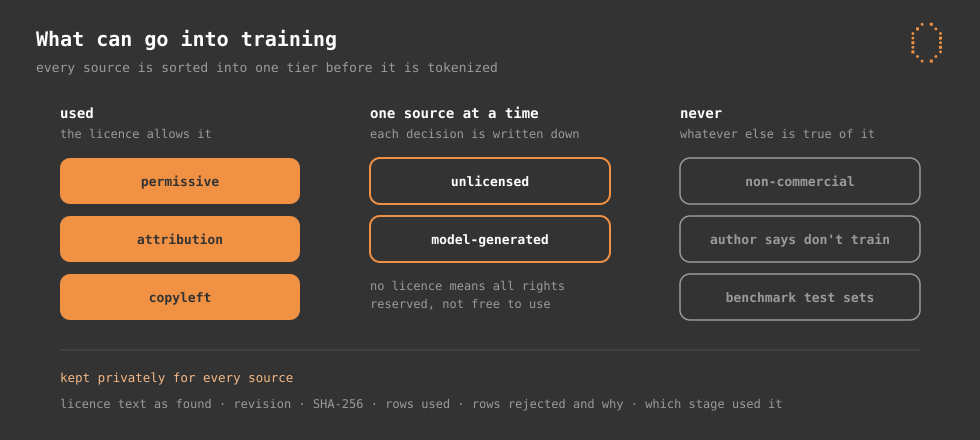
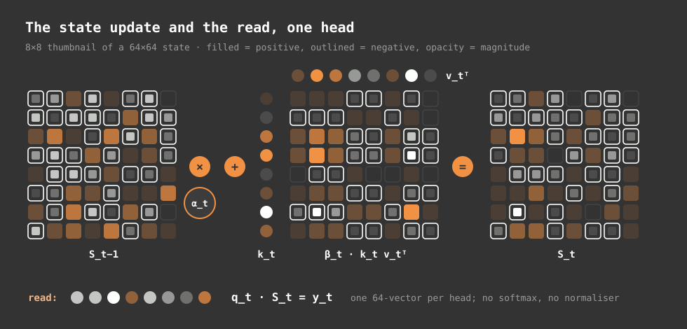
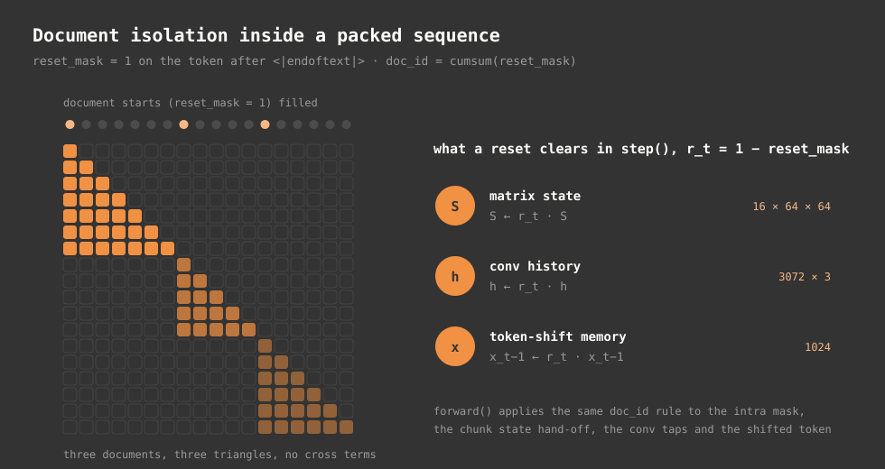

<div align="center">
  
</div>

<h3 align="center">parentheses-1.1</h3>

<p align="center">
  <b>A recurrent language model for Kannada, Tamil, Telugu, Malayalam and English, built on one 8 GB laptop GPU.</b><br>
  in development · grows the 253.54M 1.0 model past 500M · adds image input and speech · not a transformer
</p>

<p align="center">
  
  <a href="https://huggingface.co/uncoalesced-org/parentheses-1.0-240M"></a>
  
  
  <a href="LICENSE"></a>
  <a href="LICENSE-MODEL"></a>
</p>

<p align="center">
  <a href="#where-things-stand">Where things stand</a> •
  <a href="#quick-start">Quick start</a> •
  <a href="#what-11-is-for">What 1.1 is for</a> •
  <a href="#benchmarks">Benchmarks</a> •
  <a href="#training-data">Training data</a> •
  <a href="HISTORY.md">History</a> •
  <a href="docs/BENCHMARK_SPEC.md">Benchmark protocol</a>
</p>

---

parentheses is a recurrent language model from the same family as Mamba-2 and RWKV, with Kannada as its first language. We train it on an ordinary gaming laptop. Version 1.0 is released and is the model you can run today. This repository is where 1.1 is being built on top of it.

A transformer keeps a key and a value for every token it has seen, so its memory grows as it writes. parentheses keeps one 64-by-64 matrix per head instead. Each token fades that memory a little, writes itself in, and reads an answer back out:

$$S_t = \alpha_t S_{t-1} + \beta_t (k_t \otimes v_t), \qquad y_t = q_t S_t$$

Across all 16 layers of 1.0 that is 4.85 MB of state in float32, the same at token 10 as at token 16,000.

<p align="center">
  
</p>

The white line in that figure is a transformer we made up for scale, with the same depth and width as parentheses. It is there to show the shape of the curve, not to stand in for any real model.

**Languages.** Kannada, Tamil, Telugu, Malayalam and English are the main languages. Tulu, Koya, Kuvi and Kolami are experimental. The tokenizer keeps Indic syllables (aksharas) whole, so the model reads and writes Dravidian script without breaking letters into stray bytes.

<p align="center">
  
</p>

---

## Where things stand

1.1 is not trained yet. What exists is the foundation it will be trained on, and we would rather list that plainly than describe a model that isn't there.

| Piece | State |
|:---|:---|
| Rewritten model code (`python/parentheses`) | Done. Loads the 1.0 weights and matches the 1.0 code bit for bit on them |
| Reading a prompt in parallel, then generating step by step | Done, tested |
| lm-evaluation-harness adapter and runner | Done, tested |
| Honest baseline for 1.0 under the new [protocol](docs/BENCHMARK_SPEC.md) | Running; no number is published until the raw results have been read |
| Rust runtime, server and CLI | Not started |
| Growth past 500M parameters | Not started |
| Image input, text-to-speech, speech input | Not started; data is being sourced |

The git history of this repository starts in November 2026. Earlier commits were removed because they carried private names and file paths. [HISTORY.md](HISTORY.md) tells what happened before, mistakes included.

---

## Quick start

This runs the released 1.0 weights with the 1.1 code. You need Python 3.10 or newer. An NVIDIA GPU helps, but the model also runs on CPU.

```bash
git clone https://github.com/uncoalesced/parentheses.git
cd parentheses
pip install -e .
hf download uncoalesced-org/parentheses-1.0-240M model.safetensors --local-dir weights
```

```python
import torch
from tokenizers import Tokenizer
from parentheses import TOKENIZER_PATH
from parentheses.checkpoint import load_model

device = "cuda" if torch.cuda.is_available() else "cpu"
model = load_model("weights/model.safetensors", device=device)
tok = Tokenizer.from_file(str(TOKENIZER_PATH))

def ask(text, lang="eng", max_new_tokens=120):
    ids = [tok.token_to_id("<|user|>"), tok.token_to_id(f"<{lang}>")]
    ids += tok.encode(text, add_special_tokens=False).ids
    ids += [tok.token_to_id("<|assistant|>")]
    prompt = torch.tensor([ids], device=device)
    stops = (model.cfg.eot_token_id, tok.token_to_id("<|user|>"))
    out = model.stream(prompt, max_new_tokens=max_new_tokens, stop_token_ids=stops)
    return tok.decode(list(out))

print(ask("Write a Python function that returns the factorial of n."))
print(ask("ಮಳೆಗಾಲದಲ್ಲಿ ನೀರಿನ ಸಂರಕ್ಷಣೆ ಏಕೆ ಮುಖ್ಯ?", lang="kan"))
```

The first prompt returns a correct recursive factorial. The second returns Kannada that stays on topic and then starts repeating a line, which is what 1.0 does with longer Dravidian answers. Language codes are `kan`, `tam`, `tel`, `mal`, `eng`, and the experimental `tcy`, `kff`, `kxv`, `nit`.

If you would rather not clone anything, 1.0 also loads through `transformers` with `trust_remote_code=True`. The [model page](https://huggingface.co/uncoalesced-org/parentheses-1.0-240M) shows how.

---

## What 1.1 is for

1.0 showed that the architecture works at 253 million parameters on a laptop. It also showed us five things it can't do, and 1.1 is organised around them.

It doesn't know enough. At this size, world knowledge and reading comprehension are thin, and the model produces fluent, specific, wrong answers. 1.1 keeps the 1.0 weights as a spine and adds new capacity next to them, past 500 million parameters in total. During 1.0, one training stage on STEM text made every language worse within a hundred steps, so each stage of 1.1 carries replay data for every language and is checked per language before it counts.

It can't reason through a sum. 1.0 gets grade-school arithmetic wrong almost every time, and its thinking mode restates the question more than it works on it. Reasoning data written for transformers is a poor fit here: a transformer can ramble for a thousand tokens and still look back at token 12, while this model's memory is a small matrix that long filler overwrites. 1.1 needs short, dense reasoning traces that keep the givens alive in the state.

It is slow for its size, around 20 to 30 tokens a second on the laptop GPU. Most of that is overhead, not arithmetic. The first fix is already in this repository: a prompt is read in parallel blocks and the resulting state is handed to the step-by-step generator.

<p align="center">
  
</p>

It gives up too early. A clear prompt gets a decent answer. A slightly vague one, or a follow-up question, often gets "I don't know" when the model could have asked what was meant. We want three behaviours kept apart: answer what can be answered, ask when the question is unclear, and say "I don't know" only when that is true. The model has no refusal training and 1.1 keeps it that way.

It only reads text. 1.1 adds image input first (screenshots, charts, tables, scanned pages, Indic script), then read-aloud speech, then spoken prompts. The encoders for these have to follow the same rule as the backbone: no attention anywhere.

### Target layout

<p align="center">
  
</p>

| Part | Target size | Role |
|:---|---:|:---|
| Spine | ~258M to 262M | The 1.0 weights plus control tokens for image and audio |
| Experts | ~180M+ | New capacity for text, starting from zero so behaviour at step 0 equals 1.0 |
| Vision | ~50M to 85M | Convolutional or state-space reader for images and documents |
| Audio | ~45M to 85M | Codec tokens for speech in and out |
| Total | ~540M to 610M | At least 506M, with the same constant-size state in the spine |

These are design targets. They will be replaced by measured numbers as each part is built.

### What does not change

- The 1.0 weights keep loading. Every change to the model code is tested against the 1.0 outputs.
- No attention, in the backbone or in the vision and audio parts.
- A faster runtime must give the same outputs. Speed that costs accuracy is not shipped.
- It has to train and run on one 8 GB laptop GPU.

---

## Benchmarks

There are none to show yet, and that is on purpose.

The tables published with 1.0 came from a script we wrote ourselves. Readers went through it and found that each benchmark used 30 questions, several were scored by keyword matching, MBPP code was compiled but never run, the headline was the best of four runs, and the comparison tables set those numbers against other labs' full-benchmark scores. They were right, and the tables overstated the model. [HISTORY.md](HISTORY.md#the-benchmark-tables-november-2026) has the full account.

From 1.1 on, scores come from [lm-evaluation-harness](https://github.com/EleutherAI/lm-evaluation-harness) with its task definitions untouched: full test sets, greedy decoding, one run, the standard error reported, and the raw output saved. A person reads the results before a number goes anywhere public. The 1.0 model is being re-measured this way first, so 1.1 has an honest baseline to beat.

<p align="center">
  
</p>

To run it yourself:

```bash
pip install -e ".[eval]"
python -m parentheses.evaluate --checkpoint weights/model.safetensors --tasks arc_easy,hellaswag
```

The rules are in [docs/BENCHMARK_SPEC.md](docs/BENCHMARK_SPEC.md).

---

## Training data

1.1 is open weights. The weights are Apache 2.0 and the code here is MIT. The training data and the training pipeline are not published.

That is a weaker promise than 1.0 made. 1.0 was trained only on data whose licence allows commercial use, with every source listed. Keeping that list current in public turned into more bookkeeping than one small project could carry. For 1.1, every source is still logged privately with its licence text, revision and hash, and this repository publishes the totals by licence tier.

<p align="center">
  
</p>

If you need a model whose every input is permissively licensed and listed, use 1.0. Details are in [docs/LICENSE_TABLE.md](docs/LICENSE_TABLE.md).

---

## How it works

One block of the model, and the update each head performs:

<p align="center">
  
</p>

<p align="center">
  
</p>

Training does not run the recurrence one token at a time. It uses an equivalent parallel form that works on blocks of 64 tokens and passes one state matrix from block to block. Documents packed into the same sequence never see each other.

<p align="center">
  
</p>

<p align="center">
  
</p>

The whole model is in [python/parentheses/model.py](python/parentheses/model.py), about 350 lines.

| | 1.0, the base for 1.1 |
|:---|:---|
| Parameters | 253,544,176 |
| Layers / width / heads | 16 / 1024 / 16 heads of 64 |
| SwiGLU hidden width | 2752 |
| Vocabulary | 32,768 byte-level BPE (`v3_32k`), akshara-preserving |
| Training context | 4,096 tokens |
| Recurrent state | 4.85 MB in float32, constant |

---

## Repository layout

| Path | What is there |
|:---|:---|
| `python/parentheses/` | Model, checkpoint loader, tokenizer files, harness adapter and evaluation runner |
| `tests/` | Parallel and recurrent forms agree; the rewrite reproduces 1.0; the adapter returns what the model computes |
| `docs/` | Benchmark protocol, licence tiers, figures |
| `tools/` | The check that keeps private names and paths out of the repository |
| `rust/`, `eval/` | Reserved for the runtime and for reviewed benchmark results |

```bash
pip install -e ".[dev]"
pytest
```

The tests that need the released weights are skipped unless `PARENTHESES_BASE_CKPT` points at them.

---

## Roadmap

| Milestone | Status |
|:---|:---|
| parentheses-0.9-130M preview (CC BY-NC 4.0 weights) | Released |
| parentheses-1.0-240M-tanzanite (Apache 2.0 weights, MIT code) | Released, November 2026 |
| 1.0 re-measured with lm-evaluation-harness | In progress |
| parentheses-1.1 (500M+, image input, speech) | In development, aimed at mid-December 2026 |
| Parentheses family release | Planned for early 2027 |

The December date is a target. The rewrite, the growth and three new modalities are a lot for one laptop, and if something has to give it will be the date.

---

## Questions, bugs and feedback

Open an issue on [GitHub](https://github.com/uncoalesced/parentheses/issues) or start a thread in the [Hugging Face discussions](https://huggingface.co/uncoalesced-org/parentheses-1.0-240M/discussions). We read both. The benchmark rules in this repository exist because someone took the time to read our script and tell us what was wrong with it, so that kind of feedback is especially welcome. Security reports go through [SECURITY.md](SECURITY.md).

## Citation

```bibtex
@software{parentheses_2026,
  title   = {parentheses: a recurrent language model for Dravidian languages and English},
  author  = {uncoalesced},
  year    = {2026},
  url     = {https://github.com/uncoalesced/parentheses}
}
```

## Licenses

- Code: [MIT](LICENSE)
- Model weights: [Apache 2.0](LICENSE-MODEL)
- Training data: not redistributed; see [docs/LICENSE_TABLE.md](docs/LICENSE_TABLE.md)

<p align="center"><sub>Engineered by uncoalesced</sub></p>
