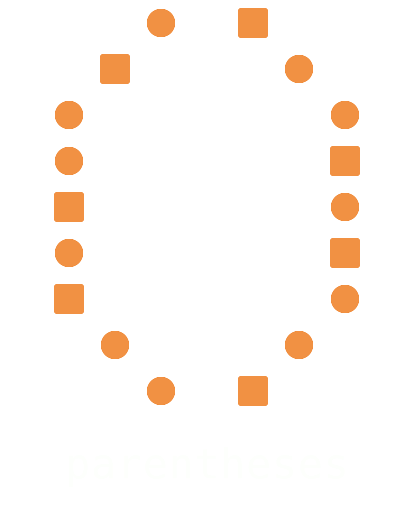
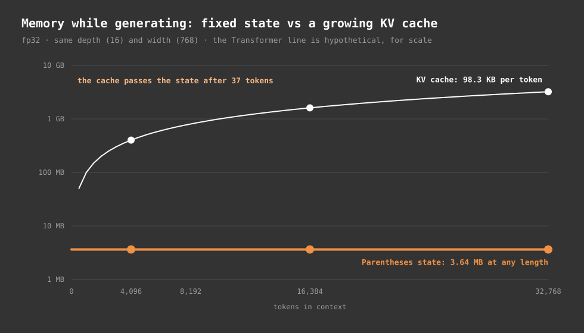

<div align="center">
  
</div>

<p align="center">
  <b>A recurrent language model for Kannada, Tamil, Telugu, Malayalam and English, trained on one 8 GB laptop GPU.</b>
</p>

<p align="center">
  <a href="https://huggingface.co/uncoalesced-org/parentheses-1.0-240M"></a>
  
  <a href="LICENSE"></a>
  <a href="LICENSE-MODEL"></a>
</p>

---

parentheses is a 253-million-parameter language model in the same family as Mamba-2 and RWKV. Kannada is its first language. Instead of a cache that grows with every token, it keeps a fixed 4.85 MB memory, so it runs the same at token 16,000 as at token 10.

## Quick start

You need Python 3.10 or newer. An NVIDIA GPU helps, but it also runs on a CPU.

```bash
git clone https://github.com/uncoalesced/parentheses.git
cd parentheses
pip install -e .
hf download uncoalesced-org/parentheses-1.0-240M model.safetensors --local-dir weights
```

```python
import torch
from tokenizers import Tokenizer
from parentheses import TOKENIZER_PATH
from parentheses.checkpoint import load_model
from parentheses.session import ChatSession

device = "cuda" if torch.cuda.is_available() else "cpu"
model = load_model("weights/model.safetensors", device=device)
tok = Tokenizer.from_file(str(TOKENIZER_PATH))

def ask(text, lang="eng", max_new_tokens=120):
    chat = ChatSession(model, tokenizer=tok, lang=lang)
    return tok.decode(chat.reply(text, max_new_tokens=max_new_tokens))

print(ask("Write a Python function that returns the factorial of n."))
print(ask("ಮಳೆಗಾಲದಲ್ಲಿ ನೀರಿನ ಸಂರಕ್ಷಣೆ ಏಕೆ ಮುಖ್ಯ?", lang="kan"))
```

Language codes are `kan`, `tam`, `tel`, `mal` and `eng`. Tulu (`tcy`), Koya (`kff`), Kuvi (`kxv`) and Kolami (`nit`) are experimental.

If you'd rather not clone anything, the model also loads through `transformers` with `trust_remote_code=True`. The [model page](https://huggingface.co/uncoalesced-org/parentheses-1.0-240M) shows how.

## What to expect

It's a small model, and it acts like one.

- Short code requests and simple questions usually come back right.
- Longer answers in the Dravidian languages stay on topic for a sentence or two, then tend to repeat a line.
- It knows less than its fluency suggests, and it can be confidently wrong.
- It was trained on one question and one answer at a time. Follow-up questions in the same chat usually just get the previous answer again, so start a new `ChatSession` for each question.

## How it works

A transformer keeps a key and a value for every token it has read. parentheses keeps one 64 by 64 matrix per head instead. Each token fades that matrix a little, writes itself in, and reads an answer back out:

$$S_t = \alpha_t S_{t-1} + \beta_t (k_t \otimes v_t), \qquad y_t = q_t S_t$$

<p align="center">
  
</p>

The white line is a made-up transformer with the same depth and width, there to show the shape of the curve. The trade-off is that a fixed-size memory can lose old facts as new text comes in.

| | |
|:---|:---|
| Parameters | 253,544,176 |
| Layers / width / heads | 16 / 1024 / 16 heads of 64 |
| Vocabulary | 32,768, byte-level BPE |
| Training context | 4,096 tokens |
| Memory | 4.85 MB in float32, constant |

The whole model is in [python/parentheses/model.py](python/parentheses/model.py).

## Benchmarks

Scores are produced with [lm-evaluation-harness](https://github.com/EleutherAI/lm-evaluation-harness) using its own task definitions, full test sets and one greedy run. Reviewed results are committed under `eval/results/`. The rules are in [docs/BENCHMARK_SPEC.md](docs/BENCHMARK_SPEC.md).

The benchmark tables published with 1.0 used small samples and keyword scoring, and overstated the model. [HISTORY.md](HISTORY.md#the-benchmark-tables-november-2026) explains what went wrong.

To run them yourself:

```bash
pip install -e ".[eval]"
python -m parentheses.evaluate --checkpoint weights/model.safetensors --tasks arc_easy,hellaswag
```

## Licences

Code is [MIT](LICENSE). Weights are [Apache 2.0](LICENSE-MODEL). Training data is not redistributed; [docs/LICENSE_TABLE.md](docs/LICENSE_TABLE.md) lists what kinds of licences it came under.

## Feedback

Open an issue on [GitHub](https://github.com/uncoalesced/parentheses/issues) or a thread in the [Hugging Face discussions](https://huggingface.co/uncoalesced-org/parentheses-1.0-240M/discussions). Security reports go through [SECURITY.md](SECURITY.md).

```bibtex
@software{parentheses_2026,
  title   = {parentheses: a recurrent language model for Dravidian languages and English},
  author  = {uncoalesced},
  year    = {2026},
  url     = {https://github.com/uncoalesced/parentheses}
}
```
