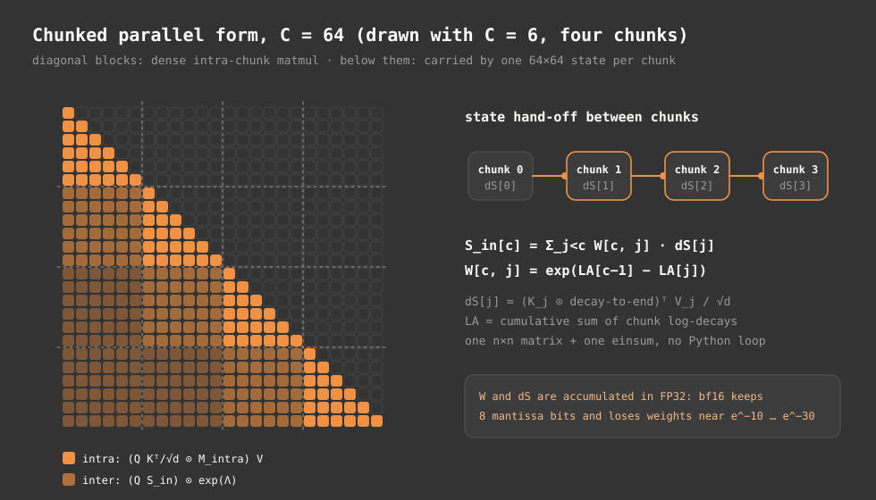
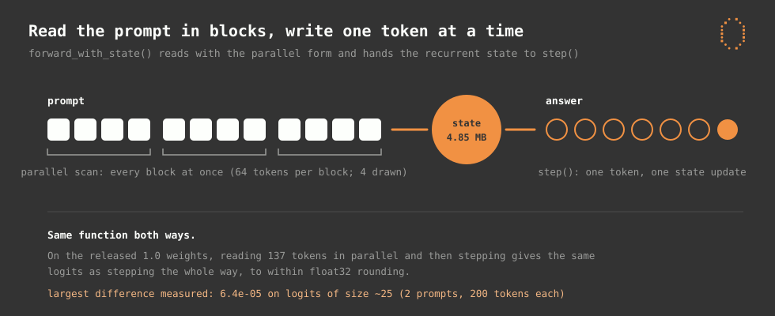
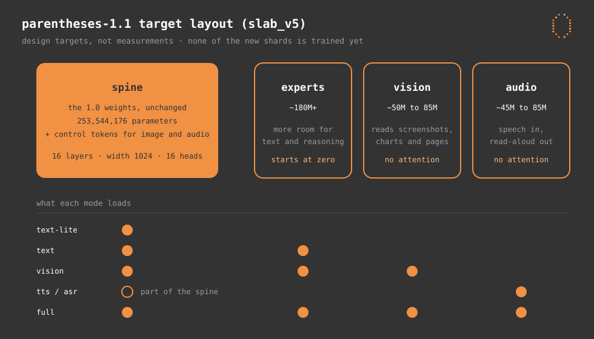
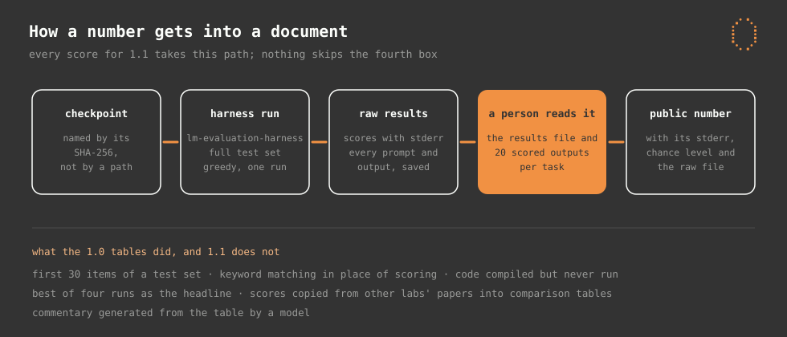

<div align="center">
  
</div>

<h3 align="center">parentheses-1.1</h3>

<p align="center">
  <b>A recurrent language model for Kannada, Tamil, Telugu, Malayalam and English, built on one 8 GB laptop GPU.</b>
</p>

<p align="center">
  
  <a href="https://huggingface.co/uncoalesced-org/parentheses-1.0-240M"></a>
  
  <a href="LICENSE"></a>
  <a href="LICENSE-MODEL"></a>
</p>

<p align="center">
  <a href="#status">Status</a> •
  <a href="#quick-start">Quick start</a> •
  <a href="#how-the-model-works">How it works</a> •
  <a href="#what-11-changes">What 1.1 changes</a> •
  <a href="#benchmarks">Benchmarks</a> •
  <a href="HISTORY.md">History</a>
</p>

---

parentheses is a language model in the same family as Mamba-2 and RWKV. Kannada is its first language, and it has never been trained on anything bigger than a gaming laptop.

Version 1.0 (253.5 million parameters) is released and is the model you can run today. This repository is where 1.1 is being built on top of it. 1.1 is not trained yet, so everything below about 1.1 is a plan or a piece of groundwork, and the text says which.

## Status

| Piece | State |
|:---|:---|
| Model code rewritten in clean Python | Done. Loads the 1.0 weights and gives the same outputs as the 1.0 code |
| Reading a prompt in parallel, then generating one token at a time | Done, tested |
| Chat that carries its memory from turn to turn | Done, tested ([`session.py`](python/parentheses/session.py)) |
| Single-token step replayed from a CUDA graph | Done, tested, same outputs as the normal step |
| lm-evaluation-harness adapter | Done, tested |
| 1.0 re-measured under the new [benchmark protocol](docs/BENCHMARK_SPEC.md) | Run finished, results not yet reviewed, so not published |
| Measuring how long 1.0 remembers things | In progress |
| Rust runtime, server and command line tool | Not started |
| Growing the model past 500M parameters | Not started |
| Image input, text-to-speech, speech input | Not started; data is being sourced |

The git history of this repository starts in November 2026. Earlier commits were removed because they contained private names and file paths. [HISTORY.md](HISTORY.md) covers what came before, mistakes included.

## Quick start

This runs the released 1.0 weights with the 1.1 code. You need Python 3.10 or newer. An NVIDIA GPU helps, but the model also runs on a CPU.

```bash
git clone https://github.com/uncoalesced/parentheses.git
cd parentheses
pip install -e .
hf download uncoalesced-org/parentheses-1.0-240M model.safetensors --local-dir weights
```

```python
import torch
from tokenizers import Tokenizer
from parentheses import TOKENIZER_PATH
from parentheses.checkpoint import load_model
from parentheses.session import ChatSession

device = "cuda" if torch.cuda.is_available() else "cpu"
model = load_model("weights/model.safetensors", device=device)
tok = Tokenizer.from_file(str(TOKENIZER_PATH))

def ask(text, lang="eng", max_new_tokens=120):
    chat = ChatSession(model, tokenizer=tok, lang=lang)
    return tok.decode(chat.reply(text, max_new_tokens=max_new_tokens))

print(ask("Write a Python function that returns the factorial of n."))
print(ask("ಮಳೆಗಾಲದಲ್ಲಿ ನೀರಿನ ಸಂರಕ್ಷಣೆ ಏಕೆ ಮುಖ್ಯ?", lang="kan"))
```

The first question gets a correct recursive factorial. The Kannada one gets an answer that stays on topic for a sentence or two and then repeats one line, which is what 1.0 does with longer Dravidian answers. Language codes are `kan`, `tam`, `tel`, `mal`, `eng`, and the experimental `tcy`, `kff`, `kxv`, `nit`.

Each `ask` starts a fresh `ChatSession`. A session keeps the model's memory between turns, so you can hold one for a whole conversation and call `reply` again, and each new message is read on top of what came before. Don't expect much from 1.0 there yet. It was trained on single-turn chats only, and in our tests a follow-up question usually just gets the previous answer again.

1.0 also loads through `transformers` with `trust_remote_code=True`, if you'd rather not clone anything. The [model page](https://huggingface.co/uncoalesced-org/parentheses-1.0-240M) shows how.

## How the model works

A transformer keeps a key and a value for every token it has read, so its memory grows with the conversation. parentheses keeps one 64 by 64 matrix per head instead. Each token fades that matrix a little, writes itself in, and reads an answer back out:

$$S_t = \alpha_t S_{t-1} + \beta_t (k_t \otimes v_t), \qquad y_t = q_t S_t$$

Across the 16 layers of 1.0 that comes to 4.85 MB of state in float32, the same at token 10 as at token 16,000.

<p align="center">
  
</p>

The white line is a made-up transformer with the same depth and width as parentheses. It shows the shape of the curve and is not meant to stand for any real model.

The fixed size is the point of the design, and also its weak spot. A transformer can always look back at token 12. parentheses only has what survived in the matrix, so anything it reads later can fade or overwrite an old fact. How far back 1.0 can reliably reach is being measured now, and the answer decides what changes in 1.1.

One block of the model, and the update each head performs:

<p align="center">
  
</p>

<p align="center">
  
</p>

Training does not run the recurrence one token at a time. It uses an equivalent parallel form that works on blocks of 64 tokens and hands one state matrix from block to block. Documents packed into the same training sequence never see each other.

<p align="center">
  
</p>

<p align="center">
  
</p>

When generating, the prompt is read in parallel blocks and the resulting state is handed to the one-token-at-a-time step. That step is the same small set of operations every time, so it can be recorded once as a CUDA graph and replayed, which removes most of the per-token launch overhead without changing a single output.

<p align="center">
  
</p>

The whole model is in [python/parentheses/model.py](python/parentheses/model.py), about 400 lines.

| | 1.0, the base for 1.1 |
|:---|:---|
| Parameters | 253,544,176 |
| Layers / width / heads | 16 / 1024 / 16 heads of 64 |
| SwiGLU hidden width | 2752 |
| Vocabulary | 32,768, byte-level BPE (`v3_32k`) |
| Training context | 4,096 tokens |
| Recurrent state | 4.85 MB in float32, constant |

### Languages and the tokenizer

Kannada, Tamil, Telugu, Malayalam and English are the main languages. Tulu, Koya, Kuvi and Kolami are experimental.

Dravidian scripts write a syllable (an akshara) as a letter plus vowel signs and viramas, which Unicode stores as separate code points. The tokenizer first splits text into words with a rule that keeps those signs in the same word as their letter, so a word is never cut apart before the byte-pair merges run.

<p align="center">
  
</p>

That rule works at the word level only. Inside a word, the merges can still put a token boundary between a letter and its vowel sign, so a common word like ಭಾಷೆಯಲ್ಲಿ comes out as ಭಾಷ + ೆಯಲ್ಲಿ. An earlier version of this README said the tokenizer keeps every akshara whole. That was wrong. We counted, and in the four Dravidian languages roughly a quarter of the token boundaries fall inside an akshara. Whether 1.1 keeps this tokenizer or moves to one built on whole aksharas is an open decision.

## What 1.1 changes

1.0 showed the architecture works at 253 million parameters on a laptop. It also showed what it can't do yet, and 1.1 is organised around that list.

**It doesn't know enough.** World knowledge and reading comprehension are thin at this size, and the model gives fluent, specific, wrong answers. 1.1 keeps the 1.0 weights as a spine and adds new capacity next to them, past 500 million parameters in total. During 1.0, one training stage on STEM text made every language worse within a hundred steps, so each 1.1 stage mixes in data from every language and is checked per language before it counts.

**It can't hold a conversation.** 1.0 only ever saw one question and one answer at a time, and the chat app we shipped with it never passed earlier turns back to the model. Part of what looked like a memory problem was a chat loop that threw the conversation away. The rest is real: the fixed-size state does lose old facts as new text arrives. 1.1 needs multi-turn training data, and whatever change to the memory the measurements call for.

**It can't reason through a sum.** 1.0 gets grade-school arithmetic wrong almost every time, and its thinking mode restates the question more than it works on it. Reasoning data written for transformers fits badly here. A transformer can ramble for a thousand tokens and still look back at the question; this model's memory gets overwritten by the ramble. 1.1 needs short, dense reasoning traces.

**It gives up too early.** A slightly vague question, or a follow-up, often gets "I don't know" when the model could have asked what was meant. We want three behaviours kept apart: answer what can be answered, ask when the question is unclear, and say "I don't know" only when it's true. The model has no refusal training, and 1.1 keeps it that way.

**It only reads text.** 1.1 adds image input first (screenshots, charts, tables, scanned pages, Indic script), then text-to-speech, then spoken prompts. The image and audio parts follow the same rule as the backbone: no attention anywhere.

### Target layout

<p align="center">
  
</p>

| Part | Target size | Role |
|:---|---:|:---|
| Spine | ~258M to 262M | The 1.0 weights plus control tokens for image and audio |
| Experts | ~180M+ | New text capacity, starting from zero so that at step 0 the model behaves exactly like 1.0 |
| Vision | ~50M to 85M | Convolutional or state-space reader for images and documents |
| Audio | ~45M to 85M | Codec tokens for speech in and out |
| Total | ~540M to 610M | At least 506M, with the same constant-size state in the spine |

These are targets. Measured numbers replace them as each part is built.

### What stays fixed

- The 1.0 weights keep loading, and every change to the model code is tested against the 1.0 outputs.
- No attention, in the backbone or in the image and audio parts.
- A faster runtime has to give the same outputs. Speed that costs accuracy doesn't ship.
- Training and inference fit on one 8 GB laptop GPU.

## Benchmarks

There are no new numbers here yet, on purpose.

The tables published with 1.0 came from a script we wrote ourselves. People who read it found that each benchmark used 30 questions, several were scored by keyword matching, MBPP code was compiled but never run, the headline was the best of four runs, and the comparison tables set those numbers against other labs' full-benchmark scores. They were right, and the tables overstated the model. [HISTORY.md](HISTORY.md#the-benchmark-tables-november-2026) has the full account.

From 1.1 on, scores come from [lm-evaluation-harness](https://github.com/EleutherAI/lm-evaluation-harness) with its task definitions untouched: full test sets, greedy decoding, one run, standard error reported, raw output saved. A person reads the results before any number goes public. 1.0 has been re-run this way so 1.1 has an honest baseline, and those results are waiting for that review.

<p align="center">
  
</p>

To run it yourself:

```bash
pip install -e ".[eval]"
python -m parentheses.evaluate --checkpoint weights/model.safetensors --tasks arc_easy,hellaswag
```

The rules are in [docs/BENCHMARK_SPEC.md](docs/BENCHMARK_SPEC.md).

## Training data and licences

The weights are Apache 2.0 and the code in this repository is MIT. The training data and the training pipeline are not published.

That is a weaker promise than 1.0 made. 1.0 used only data whose licence allows commercial use, with every source listed in public. Keeping that list current turned into more bookkeeping than one small project could carry. For 1.1, every source is still logged privately with its licence text, revision and hash, and this repository publishes the totals by licence tier.

<p align="center">
  
</p>

If you need a model whose every input is permissively licensed and listed, use 1.0. The tiers are explained in [docs/LICENSE_TABLE.md](docs/LICENSE_TABLE.md).

## Repository layout

| Path | What is there |
|:---|:---|
| `python/parentheses/` | Model, checkpoint loader, chat session, CUDA-graph step, tokenizer files, harness adapter |
| `tests/` | Parallel and recurrent forms agree, the rewrite reproduces 1.0, carried chat state matches a full re-read, the graph step matches the normal step |
| `docs/` | Benchmark protocol, licence tiers, figures |
| `tools/` | The check that keeps private names and paths out of the repository |
| `rust/`, `eval/` | Reserved for the runtime and for reviewed benchmark results |

```bash
pip install -e ".[dev]"
pytest
```

Tests that need the released weights are skipped unless `PARENTHESES_BASE_CKPT` points at them.

## Roadmap

| Milestone | Status |
|:---|:---|
| parentheses-0.9-130M preview (CC BY-NC 4.0 weights) | Released |
| parentheses-1.0-240M-tanzanite (Apache 2.0 weights, MIT code) | Released, November 2026 |
| 1.0 re-measured with lm-evaluation-harness | Run done, in review |
| parentheses-1.1 (500M+, image input, speech) | In development, aiming for mid-December 2026 |
| Parentheses family release | Planned for early 2027 |

The December date is a target. A rewrite, a bigger model and three new kinds of input are a lot for one laptop, and if something has to give it will be the date.

## Feedback

Open an issue on [GitHub](https://github.com/uncoalesced/parentheses/issues) or start a thread in the [Hugging Face discussions](https://huggingface.co/uncoalesced-org/parentheses-1.0-240M/discussions). We read both. The benchmark rules here exist because someone read our script closely and told us what was wrong with it, so that kind of feedback is especially welcome. Security reports go through [SECURITY.md](SECURITY.md).

## Citation

```bibtex
@software{parentheses_2026,
  title   = {parentheses: a recurrent language model for Dravidian languages and English},
  author  = {uncoalesced},
  year    = {2026},
  url     = {https://github.com/uncoalesced/parentheses}
}
```

<p align="center"><sub>Engineered by uncoalesced</sub></p>
