# Parentheses & Lingual_Data — Canonical Training Data & Licensing Governance Ledger

**Authority Directive:** Mandatory 100% Apache-2.0 License & Data Governance Policy  
**Effective Date:** 2026-10-30  
**Governing Standard:** `LICENSE_POLICY.md`  
**Authoring Entity:** uncoalesced / Licensing & Governance Specialist Subagent  
**Scope:** Canonical data ledger, source provenance, licensing taxonomy, and compliance verification across `E:\Parentheses\parentheses-0.9`, `F:\Lingual_Data`, and `C:\Users\Joel Anthony\Documents\Phile\Heafod\Heafod\Parentheses`.

---

## 1. Architectural Mandate & System Invariants

> [!IMPORTANT]
> **CRITICAL ARCHITECTURAL MANDATE (Mamba-2 / RWKV / Selective Linear Attention SSD):**
> Parentheses is **NOT a Transformer / GPT model**. Do **NOT** treat this codebase as a standard Transformer!
> It does **NOT** use quadratic causal self-attention ($O(T^2)$ Softmax attention matrices) or standard Transformer KV-caches.
> Parentheses is a **from-scratch Recurrent / State Space Duality (SSD) model** belonging to the **Mamba-2 / RWKV / Selective Linear Attention** family:
> - **In Training (Parallel Form):** Chunked associative linear attention / semi-separable state space duality with linear $O(T)$ complexity.
> - **In Inference / Step (Recurrent Form):** Constant $O(1)$ recurrent memory state updates:
>   $$S_t = \alpha_t S_{t-1} + \beta_t (k_t \otimes v_t), \quad y_t = q_t S_t$$
>   Fixed state size, zero growing KV-cache, zero sequence Softmax.
> Every dataset builder, boundary packer, tokenizer, annealing pool, and SFT/DPO alignment stage **MUST** strictly operate under this linear-recurrent/SSM paradigm.

---

## 2. Mandatory Licensing Governance Policy (100% Apache-2.0 Policy)

Per the **Mandatory License & Data Governance Policy (Effective 2026-10-30)**, all models, weights, tokenizers, pretraining shards, annealing pools, SFT corpora, DPO preference pairs, and runtime code under **Parentheses (`uncoalesced`)** are strictly governed under the **Apache License, Version 2.0**.

### 2.1 Whitelisted Commercial-Permissive Licenses ONLY
Every token ingested into pretraining, annealing, SFT, or DPO pipelines must originate exclusively from commercially permissive licenses compatible with Apache 2.0:
1. `Apache-2.0` (Apache License, Version 2.0)
2. `MIT` (MIT License)
3. `BSD-2-Clause` / `BSD-3-Clause` (Berkeley Software Distribution)
4. `CC0-1.0` (Creative Commons Zero / Public Domain Dedication)
5. `CC-BY-4.0` (Creative Commons Attribution 4.0 International — commercial use permitted)
6. `ODC-By` (Open Data Commons Attribution License) / `ODC-PDDL` (Public Domain Dedication and License)
7. **First-Party Synthetic & Epistemic Abstention Data** authored directly by `uncoalesced` (`Apache-2.0`)

### 2.2 Strictly Prohibited & Purged Data (ZERO TOLERANCE)
Agents, automated data builders, and training launchers are under zero-tolerance prohibitions against ingesting, tokenizing, packing, or training on any dataset or split carrying non-commercial, share-alike copyleft, or restrictive clauses:
- **`CC-BY-NC` (2.0 / 3.0 / 4.0):** Strictly prohibited and purged. Specifically:
  - **Camel-AI chemistry and physics:** Purged from release pipelines.
  - **SciQ:** Purged from release pipelines.
  - **Non-commercial Karya splits:** Strictly excluded from release corpora.
- **`CC BY-NC-SA` / `CC BY-NC-ND` / `CC BY-ND`:** Strictly prohibited.
- **`GPL` / `AGPL`:** Prohibited for all model weights, checkpoints, and export binaries.
- **Custom Research-Only / Non-Commercial EULAs:** Prohibited (including Llama Community, Gemma Terms, or proprietary API outputs carrying non-compete commercial usage restrictions).
- **Unverified Licenses:** Any dataset with missing, ambiguous, or unverified license tags is blocked.

### 2.3 Protected Research-Only Data Segregation (Aheri Gondi)
- **Aheri Gondi (`esg`):** © Wycliffe Bible Translators, all rights reserved.
- **Segregation Invariant:** Aheri Gondi text is **strictly excluded** from all pretraining, SFT, DPO, and release corpora (`esg_count: 0` verified across all production manifests).
- It is isolated in segregated, quarantined research-only storage (`F:\Lingual_Data\raw\research_only\`) and is strictly omitted from all public distributions and Apache-2.0 release artifacts.

### 2.4 Mandatory Pipeline Enforcement Gate (`scripts/license_guard.py`)
1. **Manifest Guard:** Every dataset builder or packer script (`scripts/*.py`) validates source license tags before writing binary shards (`.bin`) or parquet files, embedding `"license_compliance": "Apache-2.0-Permissive-Only"` into `manifest.json`.
2. **Launch Blocker:** All training scripts (`train.py`, `scripts/train_dpo_v2_apache.py`, `scripts/build_anneal_240m_apache.py`, `launch_*.ps1`) invoke `license_guard.verify_apache_manifest()` and immediately abort if any input data directory lacks an verified Apache-2.0-compliant manifest.

---

## 3. Model Lineage Dataset Accounting & Provenance

```mermaid
flowchart TD
    subgraph Tanzinite["Parentheses 0.9-130M-v3 (Certified Apache-2.0 Release)"]
        D1["processed_130m_v1<br/>807.9M Train Tokens<br/>(40% Dravidian, 25% MIT STEM,<br/>20% Hermes Apache-2.0, 15% Public Domain)"] --> SFT1["Clean Mask SFT v2<br/>(Zero Truncation / 100% EOT)"]
        SFT1 --> SWA1["SWA-3 Model Soup<br/>(3.4062 Val Loss / 30.15 PPL)"]
        SWA1 --> DPO1["Calibrated DPO v2<br/>(0.0% Refusals / 72/72 Think Closed)"]
    end

    subgraph SlabV4["Parentheses 1.0-240M (slab_v4 Lineage)"]
        S1["Sessions 1-2: processed_240m_apache<br/>1.076B Tokens (Steps 0..4000)"] --> S3["Session 3: Dual-Memmap Interleaving<br/>(processed_240m_apache + processed_v5)<br/>Steps 4001..6000"]
        S3 --> S5["Sessions 5-6: processed_anneal_240m_apache<br/>(Textbooks, Bitexts, Permissive STEM/Code)"]
        S5 --> S7["Session 7: processed_sft_240m_v4_apache<br/>(Dual-Mode Think, 8k Epistemic Abstentions,<br/>FFD 4096-Bin Document-Aware Packing)"]
        S7 --> S8["Session 8: On-Policy DPO v2 + SWA-3<br/>(Memory-Pinned Reference Log-Probs)"]
    end
```

### 3.1 Parentheses 0.9-130M-v3 (Project Tanzinite) — Certified Apache-2.0 Release
- **Architecture:** 148.38M parameters, wide-and-shallow 16 layers, $d_{\text{model}}=768$, 12 heads (rank 768), BPE 32k (`v3_32k`), context length 4,096.
- **Hardware Profile:** FP32 inter-chunk recurrence, Token-Shift ($\mu$-mix), $\beta$-gated write, and $V_0$ value highway.
- **Pretraining Dataset (`E:\Parentheses\parentheses-0.9\data\processed_130m_v1\`):**
  - **Total Tokens:** 818,960,136 (807,927,808 train / 11,032,328 val across 1,367,001 documents).
  - **Pillar Distribution:**
    * **40% Dravidian Core:** AI4Bharat Sangraha Kannada, Tamil, Telugu, Malayalam (CC-BY-4.0).
    * **25% STEM Reasoning:** MetaMathQA (MIT), Orca-Math 200k (MIT), with 50% explicit `<think>...</think>` reasoning priming.
    * **20% Conversational Open Data:** Hermes function calling v1 (Apache-2.0) and open dialogue traces.
    * **15% English Anchors:** Project Gutenberg Public Domain and OpenStax (CC-BY-4.0).
  - **Licensing Compliance:** Verified 100% Apache-2.0 / permissive; `esg_count: 0`; `val_leak_count: 0`; manifest `gate_status: PASS`.
- **Post-Training Alignment:**
  - **SFT v2 (Clean Mask):** `train.mask.notrunc.bin` (zero supervised truncated docs, 100% EOT termination).
  - **SWA-3 Model Soup:** Uniform average across cooldown anchors (steps 1500, 1750, 1999) $\rightarrow$ **3.4062 Val Loss / 30.15 Val PPL** (All-time project record).
  - **Calibrated DPO v2:** 100 steps on `out/dpo_pairs_v2_900.jsonl` (RTX 5050 in 39.2s) $\rightarrow$ **3.4061 Val Loss / 30.15 Val PPL**, margin $+1.9812$, 100% preference accuracy.
- **Release Verification & Benchmarks:**
  - **Refusal Rate:** 0.0% refusals across 19 probes (zero preachiness, zero corporate refusals).
  - **Reasoning Integrity:** 72/72 (100%) `<think>` closure rate in FreeThink evaluations.
  - **Edge Deployment:** Exported to DirectML NPU ONNX runtime (`out/npu/parentheses_130m_v3_dpo_v2_step.onnx`, 694.42 MB) with bitwise parity.

---

### 3.2 Parentheses 1.0-240M (`slab_v4`) — Active Pretraining & Alignment Lineage
- **Architecture:** 253.54M parameters ($d_{\text{model}}=1024, 16\text{ layers}, 16\text{ heads}, d_{\text{head}}=64$, tied `tok_emb` / `head`), BPE 32k (`v3_32k`), context length 4,096. Constant $O(1)$ recurrent memory state updates ($16 \times 64 \times 64 = 65,536$ state floats/layer).

#### Session 1 & 2: Base Pretraining (`processed_240m_apache`)
- **Dataset Path:** `E:\Parentheses\parentheses-0.9\data\processed_240m_apache\`
- **Volume:** 1,086,978,562 total tokens (1,075,946,234 train / 11,032,328 val across 1,367,001 documents; 197,248 exact 4,096-token blocks).
- **License Compliance:** Verified 100% Apache-2.0 / Commercial-Permissive (`manifest.json` gate: PASS).
- **Execution:**
  - Session 1: Steps 0 $\rightarrow$ 2,000 (131.07M tokens; Net2WiderNet warm-start from 130M-v3 with 98.4% top-1 logit agreement).
  - Session 2: Steps 2,001 $\rightarrow$ 4,000 (131.07M tokens; cumulative 262.14M tokens; peak LR `4.00e-04`).
- **Invariants:** 0% zero-blocks, `boundary_reset_mask()` enabled on `train_boundaries.npy`, `esg_count: 0`.

#### Session 3: Dual-Memmap Micro-Batch Interleaving
- **Dataset Pairing:** Dual memory-mapped streams combining `processed_240m_apache` with `processed_v5` across each 16-micro-batch step (65,536 tokens/step).
- **Curriculum:**
  - **Phase 3A (Steps 4,001 $\rightarrow$ 4,250):** 8:8 ratio (50% v5 : 50% Apache) for smooth embedding warmup on low-resource Dravidian languages (`tcy, kff, kxv, nit`).
  - **Phase 3B (Steps 4,251 $\rightarrow$ 6,000):** 10:6 ratio (62.5% v5 : 37.5% Apache) locking in multilingual syntax while maintaining Apache reasoning replay buffers.
- **Dual Validation Tracking:** Evaluated simultaneously on `val_loss_apache` and `val_loss_v5`.

#### Sessions 5 & 6: Textbook & Bitext Annealing (`processed_anneal_240m_apache`)
- **Dataset Path:** `E:\Parentheses\parentheses-0.9\data\processed_anneal_240m_apache\`
- **Builder Script:** `E:\Parentheses\parentheses-0.9\scripts\build_anneal_240m_apache.py`
- **Pillar Allocation:**
  1. **35% Indic & Dravidian Textbooks / Literature:** Sangraha (CC-BY-4.0 / CC0), Pratham Books (CC-BY-4.0), Wikisource Public Domain.
  2. **20% Cross-Script & Code-Mixed Bitexts:** Samanantar, OPUS, Aksharantar (CC-BY-4.0 / CC0).
  3. **30% Permissive STEM, Code & Reasoning:** SmolLM2, Cosmopedia-v2, MetaMathQA (MIT), Orca-Math 200k (MIT), NuminaMath-CoT (Apache-2.0).
  4. **15% Long-Range Context Primers:** Context retention and needle-in-haystack summarization primers up to 4,096 tokens.
- **Licensing Compliance:** Verified Apache-2.0 / Commercial Permissive only.

#### Session 7: Supervised Fine-Tuning (`processed_sft_240m_v4_apache`)
- **Dataset Path:** `E:\Parentheses\parentheses-0.9\data\processed_sft_240m_v4_apache\`
- **Packer Script:** `E:\Parentheses\parentheses-0.9\scripts\pack_sft_4096_v4.py`
- **Abstention Generator:** `E:\Parentheses\parentheses-0.9\scripts\generate_sft_abstention_v4.py`
- **SFT Invariants:**
  - **Dual-Mode `<think>` Conditioning:** Explicit reasoning traces paired with direct generation mode.
  - **8,000 Epistemic Abstention Traces:** 1,600 traces per language across English, Kannada, Tamil, Telugu, and Malayalam to eliminate hallucination on ungrounded counterfactual queries.
  - **First-Fit-Decreasing (FFD) Container Packing:** 11,200 bins of exact 4,096 tokens (99.972% packing efficiency across 120,625 documents).
  - **Zero Mid-Document Truncation:** 0 truncated documents; 0 unclosed `<think>` blocks.
  - **100% EOT Reset:** Every packed sequence ends with `<|endoftext|>` (token 0) to trigger recurrent boundary state resets ($\alpha_t=0$).

#### Session 8: On-Policy DPO v2 + SWA-3 Preference Alignment
- **Script:** `E:\Parentheses\parentheses-0.9\scripts\train_dpo_v2_apache.py`
- **Architectural Modes:**
  1. `--mode generate`: Samples $N=4$ on-policy completions from SFT checkpoint.
  2. `--mode precompute-ref`: Precomputes and memory-pins reference log-probabilities to disk (`.npy`), freeing 50% VRAM on 8GB GPUs.
  3. `--mode train`: Optimizes DPO preference loss augmented with $0.1 \times \text{NLL}$ anchor loss to protect recurrent state stability (`beta_write`, `v0_mix`).
  4. `--mode swa3`: Merges final 3 checkpoint anchors into SWA-3 golden weights.
  5. `--mode all`: Full automated execution pipeline.

---

### 3.3 Incoming Permissive Sourcing Repository (`F:\Lingual_Data\raw\hf_permissive_stem_code\`)

All new STEM, reasoning, code, and chat datasets harvested from Hugging Face for Parentheses 1.0 are verified against the Apache-2.0 permissive whitelist prior to download:

| Dataset Identifier | Format / Shards | Verified License | Primary Role in Parentheses 1.0 Pipeline |
|---|:---:|:---:|---|
| `bespokelabs/Bespoke-Stratos-17k` | JSONL / 120 MB | **Apache-2.0** | Explicit `<think>...</think>` step-by-step reasoning traces |
| `microsoft/orca-math-word-problems-200k` | Parquet / 80 MB | **MIT** | 200,000 verified math word problems & derivations |
| `meta-math/MetaMathQA` | Parquet / 377 MB | **MIT** | 395,000 mathematical problem-solving & reasoning steps |
| `AI-MO/NuminaMath-CoT` | Parquet / 1.18 GB | **Apache-2.0** | Olympiad, competition, and advanced algebraic math reasoning |
| `HuggingFaceTB/smoltalk` | Parquet / 3.96 GB | **Apache-2.0** | High-density conversational instruction, tool use & task chats |
| `HuggingFaceTB/smollm-corpus` (`python-edu`) | Parquet / 600 MB | **Apache-2.0** | Synthetic & educational Python code examples & explanations |
| `HuggingFaceTB/smollm-corpus` (`textbooks`) | Parquet / 25 GB | **Apache-2.0 / ODC-By** | High-tier educational textbooks (Cosmopedia-v2 + FineWeb-Edu) |

---

## 4. Cross-Workspace Storage Architecture & Shard Locations

| Drive / Path | Storage Media | Primary Function & Contents |
|---|:---:|---|
| `E:\Parentheses\parentheses-0.9\` | Fast NVMe SSD | Active code repository, tokenizer (`v3_32k`), training scripts, active SFT/pretraining bins (`data/processed_*`), and working checkpoints. |
| `F:\Lingual_Data\` | High-Capacity USB HDD | Upstream raw multilingual corpora (Kannada literature, Dravidian languages, bitexts), incoming permissive pools (`raw/hf_permissive_stem_code/`), and master ledger (`Trained-On/`). Sequential reads only. |
| `I:\parentheses\` | High-Capacity Expansion Drive | Cold archive storage holding 688+ SHA256-verified checkpoint milestones (`checkpoints/`), historical runs (41M, 120M, 130M-v3), and multi-gigabyte shard backups. |
| `C:\Users\Joel Anthony\Documents\Phile\Heafod\Heafod\Parentheses\` | Knowledge Vault (Git) | Master blueprints, handoffs, governance rules, milestone gates, benchmark evaluation reports, and operational records. |

---

## 5. Formal Licensing Compliance Verification & Certification

| Audit Checkpoint | Invariant Requirement | Empirical Status | Verification Evidence |
|---|---|:---:|---|
| **License Policy** | Mandatory 100% Apache-2.0 Policy | **CERTIFIED** | `LICENSE_POLICY.md` synchronized across repos |
| **Whitelisted Licenses** | Permissive only (Apache-2.0, MIT, BSD, CC0, CC-BY-4.0, ODC-By) | **CERTIFIED** | Verified source manifests in all data bins |
| **Purged CC-BY-NC** | Camel-AI, SciQ, non-commercial splits purged | **CERTIFIED** | `strict_exclusions: ["Camel-AI", "SciQ", "CC-BY-NC"]` |
| **Research-Only Segregation** | Aheri Gondi (`esg`) strictly excluded from release corpora | **CERTIFIED** | `esg_count: 0` verified across all production manifests |
| **Automated Pipeline Gate** | `license_guard.py` blocking unverified manifests | **ACTIVE** | `verify_apache_manifest()` integrated in training scripts |
| **0.9-130M-v3 Release** | Apache-2.0 release, record 30.15 PPL, 0.0% refusals | **CERTIFIED** | Golden checkpoint preserved and evaluated |
| **1.0-240M Lineage** | 100% Apache-2.0 lineage across Sessions 1–8 | **CERTIFIED** | Verified `processed_240m_apache`, `sft_240m_v4_apache` |

---
*Certified by uncoalesced Licensing & Governance Specialist Subagent*
