# How parentheses-1.0 works

parentheses 1.0 is a language model designed and trained from scratch on one laptop in Bengaluru. The golden release weights are `parentheses-1.0-240M-tanzanite` (Project Tanzanite). It has **253.54 million parameters** (253,544,176 unique parameters) and belongs to the family of selective linear attention models, close to Mamba-2 and RWKV. It is not a transformer. It has no softmax attention over past tokens and no key-value cache. It was trained on a single NVIDIA GeForce RTX 5050 Laptop GPU with 8 GB of VRAM, on text in Kannada, Tamil, Telugu, Malayalam and English, with experimental support for Tulu, Koya, Kuvi and Kolami.

This guide explains the architecture with words and pictures first, for a reader who knows what a transformer is but has not met a recurrent state-space model. Equations appear only where they help. Each section links to the matching part of [DOCUMENTATION.md](DOCUMENTATION.md), which has the full derivations and the source file for every formula.

**In one minute.** A transformer answers each new token by looking back at every token before it, so it stores a key and a value for each one and its memory grows with the text. parentheses keeps a fixed block of memory instead. In each of 16 layers and 16 heads, one 64-by-64 matrix holds what that head has seen. Each token fades the old contents slightly, writes its own key and value into the matrix, and reads back with a query. Training runs the same arithmetic in parallel over 64-token chunks, so a 4,096-token document does not have to be processed one step at a time. The tokenizer keeps Indic letters together, so the model sees whole syllables. Most of the weights sit in feed-forward layers that work on each position separately.

## Contents

1. [At a glance](#at-a-glance)
2. [Memory that doesn't grow](#memory-that-doesnt-grow)
3. [Inside one layer](#inside-one-layer)
4. [Why wide and shallow](#why-wide-and-shallow)
5. [Training in parallel](#training-in-parallel)
6. [The tokenizer keeps letters whole](#the-tokenizer-keeps-letters-whole)
7. [Where the parameters go](#where-the-parameters-go)
8. [From logits to text](#from-logits-to-text)
9. [How it was trained](#how-it-was-trained)
10. [How well it works](#how-well-it-works)
11. [Limits that follow from the design](#limits-that-follow-from-the-design)
12. [Further reading](#further-reading)

## At a glance

| Property | Value |
| :--- | :--- |
| Name | `parentheses-1.0-240M-tanzanite` (Project Tanzanite, Certified Golden) |
| Parameters | 253,544,176 unique parameters |
| Family | Selective linear attention, state space duality (`slab_v4`) |
| Layers | 16, each with a token-mixing branch and a SwiGLU branch |
| Heads | 16 per layer, 64 dimensions each (rank 1024) |
| Model width | 1024 |
| Vocabulary | 32,768 byte-level BPE entries, with Indic combining marks kept inside words |
| Position encoding | none |
| Embeddings | tied between input and output |
| Context in one training pass | 4,096 tokens |
| Context while generating | not fixed by the architecture, and the memory does not grow |
| Recurrent state | 1,212,416 floats, or 4.85 MB in fp32 (2.42 MB in bf16) |
| Training hardware | one RTX 5050 Laptop GPU, 8 GB VRAM |
| Code licence | MIT |
| Weights licence | Apache 2.0 |

  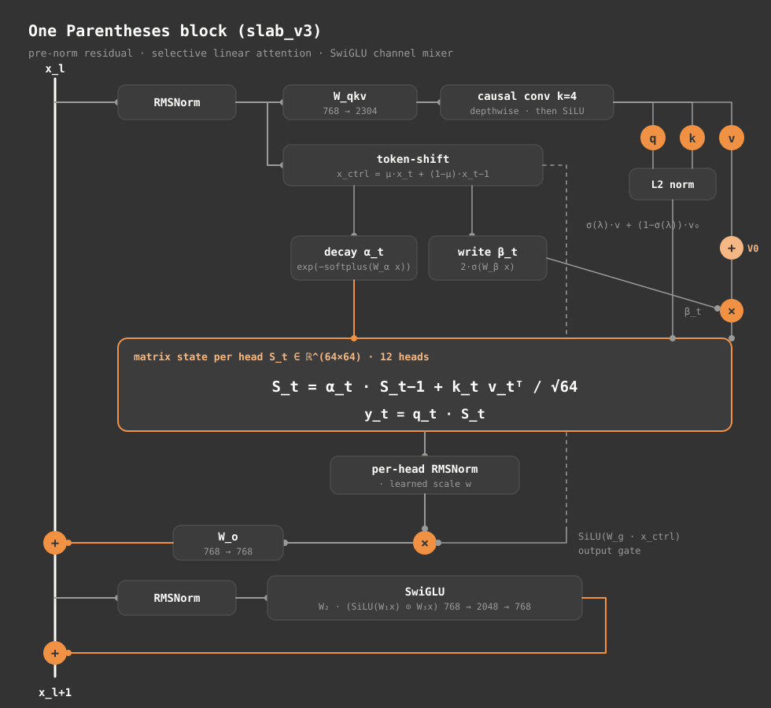

The model is a stack of 16 blocks with the same shape and their own weights. A residual stream carries one vector per token from the bottom of the network to the top, and each block adds to it twice. The first addition is the token-mixing branch, which is the only place where information moves between positions. The second is the SwiGLU branch, which transforms each position on its own. Both branches read a normalised copy of the stream, so the stream itself is never normalised until the very end. The figure shows one block with the stream running up the side.

## Memory that doesn't grow

A transformer that generates text keeps a key vector and a value vector for every token it has already seen, in every layer. That store is the KV cache. It grows by one entry per token, so a long conversation costs more memory and more time at each step. For a transformer of the same depth (16) and width (1024), the cache takes 131,072 bytes per token in fp32. That is about 537 MB at 4,096 tokens, 2.15 GB at 16,384 tokens, and about 4.29 GB at 32,768 tokens. It overtakes Parentheses' fixed state after just 38 tokens.

Parentheses keeps no growing cache. In each head it keeps one 64-by-64 matrix $S$, and that matrix is the whole of the head's memory. Each token does two things to it. It decays the old contents by a factor $\alpha_t$ between 0 and 1, and it writes its key $k_t$ and value $v_t$ into the matrix as an outer product, scaled by a write strength $\beta_t$ between 0 and 2. A query $q_t$ then reads the matrix:

$$S_t = \alpha_t\, S_{t-1} + \beta_t\, k_t^\top v_t, \qquad y_t = q_t\, S_t$$

  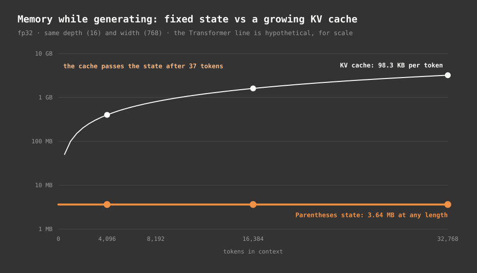

  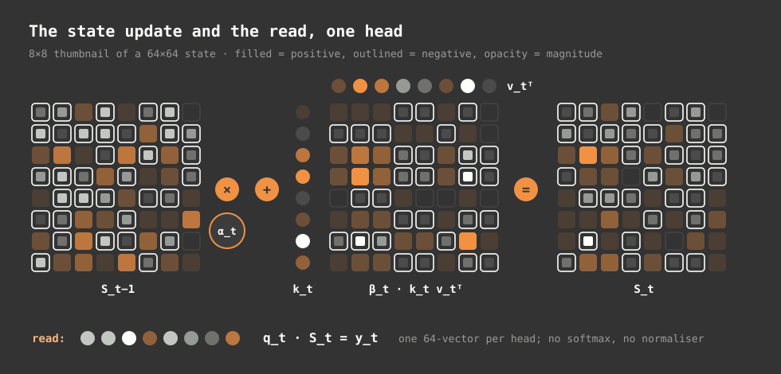

It is easiest to think of the matrix as a notebook with a fixed number of pages. Each new entry is written over a faded copy of the older text. Reading means asking a question. The entries whose keys match the question speak loudest, and the entries that have faded speak quietly. The notebook never gets longer, and the model learns how fast each head's entries fade.

A tiny example makes this concrete. Use two-number vectors and write the key $(1, 0)$ with the value $(3, 1)$. One step later the head decays by 0.5 and writes the key $(0, 1)$ with the value $(-2, 4)$. Querying with $(1, 0)$ now returns $(1.5, 0.5)$: the first value, halved once by the decay. Querying with $(0, 1)$ returns $(-2, 4)$ exactly. A query pointing between the two keys returns a blend that leans toward the key that matches it more closely. (We omit the 1/8 scaling the code applies to each write, to keep the numbers readable.) [The full worked example](DOCUMENTATION.md#61-a-small-worked-example) is in section 6.1 of the derivation.

Four properties follow from that arithmetic. The weights are signed, so a query pointing away from a stored key subtracts its value. The read is not normalised, so its size depends on how many writes match. Each head can hold at most about 64 mutually orthogonal keys before writes start to overlap. And the cost of memory does not depend on history.

The numbers are concrete. Each head stores 4,096 numbers, and the 256 head matrices in the model (16 layers times 16 heads) hold 1,048,576 numbers. In bf16 that is about 2.1 MB. The whole recurrent state, which also includes a short convolution history and the previous input kept for token-shift, is 1,212,416 numbers, or 4.85 MB in fp32 (2.42 MB in bf16). The state is the same size after ten tokens as after ten million.

Because the state never grows, generation does not slow down as the text gets longer. On the laptop GPU, the last token of a generation takes 1.025 times as long as the first. Prompts are read the same way, one token at a time, so a long prompt costs a fixed amount per token. The matrix arithmetic is also small. A decoding step needs about 2.1 million multiply-adds for the recurrence, against roughly 253 million for the dense layers, so the recurrence is under 1% of the work. What sets the model apart is how it stores memory, and that is cheap.

## Inside one layer

The token-mixing branch has several small parts, and each one does a specific job. The walk-through below follows the order the code runs them.

### Token shift

After the input norm, the layer blends each token with the token before it. For each channel, a learned mix $\mu$ decides how much of the current input and how much of the previous input to keep:

$$\tilde{x}_t = \mu \odot x_t + (1 - \mu) \odot x_{t-1}$$

The blend feeds only the three control signals: the decay, the write strength and the output gate. Queries, keys and values come from the current token alone. This lets the gates see the transition from the previous token at no recurrent cost. Whether to forget, and how hard to write, can depend on the move from "the" to "cat" rather than on "cat" alone. At the start of a document the previous input is set to zero.

### Projections and the short convolution

One matrix multiplication turns the normalised input into 2,304 numbers, which split into 12 queries, 12 keys and 12 values of 64 numbers each. Before the split, a depthwise convolution with four taps runs along time on each channel, followed by SiLU. The convolution gives the layer exact local order. Affixes, sandhi and words split over several tokens fit inside four tokens, so the layer sees those patterns directly instead of through the blurred, decaying state. The taps start as a pass-through, so training begins with plain SiLU and learns to mix in the three previous tokens.

Queries and keys are then scaled to unit length. A query-key score becomes a cosine similarity, which keeps the size of the writes and reads under the control of the gates rather than of the vector norms. The model has no positional encoding. Order comes from the convolution, the token shift and the decay.

### Decay: how long a head remembers

Each head computes one decay per token:

$$\alpha_t = \exp\big(-\mathrm{softplus}(W_\alpha \tilde{x}_t + b_\alpha)\big)$$

Softplus is always positive, so $\alpha_t$ always lies strictly between 0 and 1. A head can never amplify its memory, and it never wipes it in one step except at a document boundary. The decay depends on the input, which is what "selective" means here. A head can hold its memory through a stretch of filler text, then drop most of it in one step when the topic changes. Each head makes that choice separately at every token.

The bias $b_\alpha$ starts at a different value in each head, so the 16 heads begin with different memory lengths. Head 0 starts with a half-life of about 7 tokens, and head 15 starts with one of about 22,000 tokens. The heads in between are spaced on a log scale, so each one covers its own range of distances. Training moves these values, and a trained head's horizon can change from token to token.

  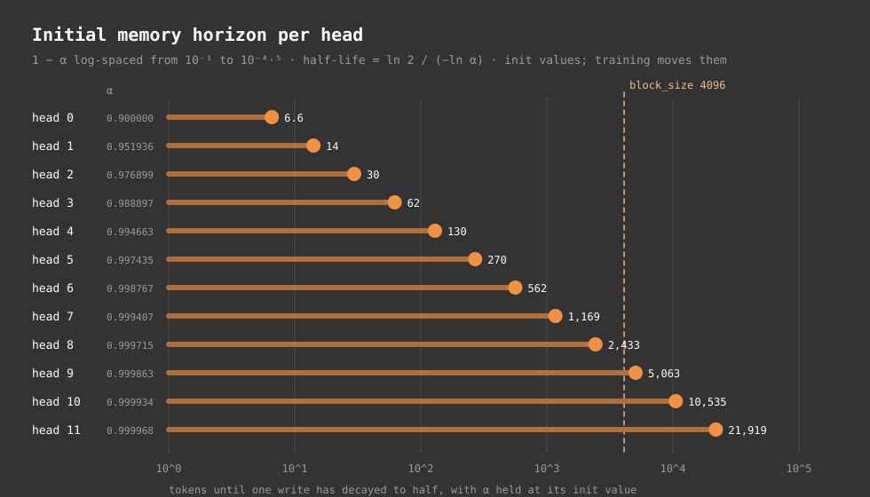

The full table of starting values, and the reason the softplus parametrisation makes learning the timescales even, is in [section 10](DOCUMENTATION.md#10-memory-timescales) and [section 7.5](DOCUMENTATION.md#75-why-the-softplus-parametrisation).

### Write strength

The write strength is

$$\beta_t = 2\,\sigma\big(W_\beta \tilde{x}_t + b_\beta\big) \in (0, 2)$$

and it scales the value before the value is written. A token that carries little, such as punctuation or a very common function word, can be written softly. An informative token can be written at up to twice the base strength. At initialisation the write strength averages about 1, so the layer starts out close to plain linear attention and adds a little per-token variation.

### The value highway

Layer 0 keeps its value vectors and passes them up the stack. Every later layer mixes its own values with layer 0's through one learned sigmoid weight per head, which starts at an even split. Two things come from this. Every layer has a direct route to near-token content, so a deep layer does not have to rely on the stream carrying that content intact through every layer below. And layer 0's value projection collects gradient from all 16 layers, which keeps the bottom of the network learning at a pace closer to the top.

### Reading and output

The read $q_t S_t$ is a signed sum over everything written, and its size changes with how many writes match. Each head's read is therefore normalised by its own RMSNorm before anything else sees it. The 16 heads are then joined, multiplied by a SiLU gate computed from the shifted input, and projected back to 1024 numbers. The gate lets the model choose, channel by channel, how much of the normalised read gets through.

### The SwiGLU channel mixer

The second branch in each block is a SwiGLU feed-forward network, $W_2\big(\mathrm{SiLU}(W_1 x) \odot W_3 x\big)$, with a hidden width of 2,752. It works on each position alone. Most of the parameters and most of what the model stores about words, morphology and facts live here. Token mixing moves information between positions, and SwiGLU transforms it within a position.

## Why wide and shallow

Earlier deep-narrow models (32 layers, each 512 wide with 8 heads) suffered from two problems. The first was depth: the layer-0 to layer-15 gradient ratio reached 23.5, causing different parts of the network to learn at very different speeds. The second was capacity: each layer's total recurrent rank was only 512.

In parentheses-1.0-240M (`slab_v4`), the depth is fixed at a shallow 16 layers and the width expands to 1024, with 16 heads of 64. Each layer's recurrent rank doubles to 1024, and the backward path through the recurrence is half as long. The slab_v4 design maintains the convolution, normalised queries and keys, per-head norm, output gate, token shift, learned write strength, layer-0 value highway, and a float32 accumulator for the decay scan. The gradient ratio between layer 0 and layer 15 remains stable around 16.29.

The float32 accumulator needs a short explanation. Decay weights in the parallel scan can become very small. After 30 chunks in a fast-decaying head, a weight can be near $e^{-30}$, which is about $10^{-13}$. bfloat16 keeps only a few significant digits, so adding such terms in bf16 rounds the small ones to zero. The early part of a 4,096-token document would then quietly drop out of the state. The inter-chunk accumulation therefore runs in float32, even though the rest of training uses bfloat16.

Two smaller initialisation choices belong here too. The two projections that write into the residual stream start with a smaller standard deviation, $0.02/\sqrt{2L}$, so the variance of the stream stays roughly flat with depth at the start of training. And the decay bias is set deliberately after the generic weight initialisation. A zero bias would give every head a decay of 0.5, and the state would be wiped every few tokens.

## Training in parallel

Training is where a recurrence would be slowest. A straight loop over 4,096 tokens needs 4,096 steps, each waiting on the one before. Unrolling the recurrence removes the wait. Each output becomes a weighted sum over earlier tokens, where the weight for an earlier token is the product of the decays between the two positions:

$$y_t = \sum_{s \le t} e^{\Lambda_t - \Lambda_s}\, \frac{q_t \cdot k_s}{\sqrt{d_h}}\, v_s, \qquad \Lambda_t = \sum_{r \le t} \log \alpha_r$$

This has the shape of causal attention with the softmax swapped for a decay mask. Entry $(t, s)$ of the mask is the decay accumulated between positions $s$ and $t$. The figure shows what a selective decay does to the mask. One forgetting event cuts every path that crosses it, which means the head has effectively started over at that point, with no explicit reset.

  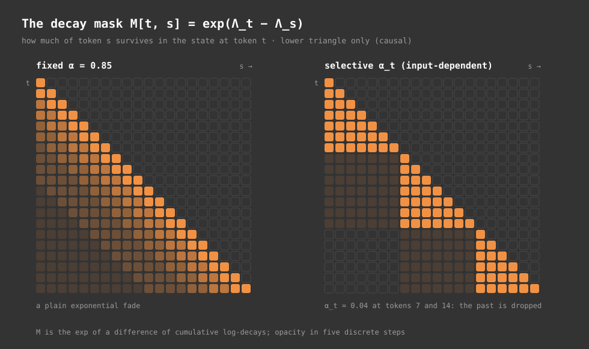

The full mask is quadratic in length, so the model does not build it for a whole document. Instead the sequence is cut into chunks of 64 tokens. Inside a chunk, the computation is a small dense 64-by-64 block. Across chunks, each chunk contributes one 64-by-64 state update. The state entering each chunk is then a weighted sum of those contributions. Because the decay is one number per head, the weights form one matrix that can be written in closed form, and one einsum does the whole hand-off. There is no Python loop over chunks, so the number of GPU launches does not grow with the length of the sequence.

  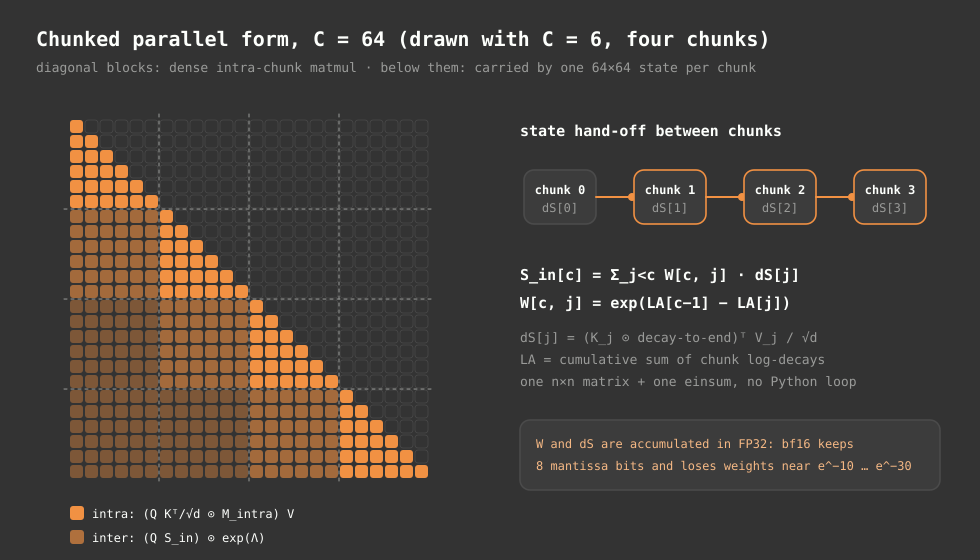

The chunked form used in training, the dense form and the step-by-step recurrence used for generation compute the same function. In the float64 verification checks on the slab_v4 path, the three agree to between $10^{-16}$ and $10^{-13}$; the largest gap comes from the dense form clamping tiny weights at $e^{-30}$. The parallel form also explains how the decays learn. The gradient for the decay at a position is a sum over pairs of an earlier writer and a later reader that span that position. There is no chain of 4,096 multiplications for the gradient to vanish through, which is the usual problem with backpropagation through a long nonlinear RNN.

Training packs several documents into each 4,096-token window. Without care, the end of one document would leak into the start of the next. A reset mask sets the state to zero at each document's first token. In the parallel form this becomes a block-diagonal pattern, with each document as its own triangle and no path allowed to cross a boundary. The convolution and the token shift are cut the same way, so the first few tokens of a document see nothing from the previous one.

  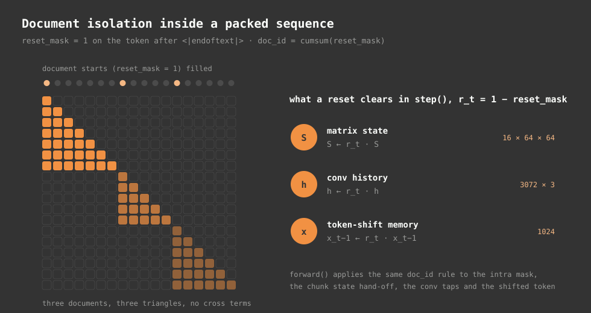

## The tokenizer keeps letters whole

Kannada, Tamil, Telugu and Malayalam are abugida scripts. The unit a reader sees is an akshara, which is a consonant together with its vowel. Each consonant carries an inherent vowel. A vowel sign, called a matra, replaces that vowel. A virama removes it, which lets consonants stack into conjuncts.

Take ಕನ್ನಡ, the Kannada word for the language. It is five code points: ಕ, ನ, the virama ್, ನ and ಡ. The virama between the two ನ is what makes the conjunct ನ್ನ. In Unicode, the virama and the vowel signs are combining marks in category M. Many word-splitting patterns, including the one GPT-2 uses, match letters with `\p{L}` and treat marks as punctuation. Applied to Kannada, such a pattern cuts the word at every virama and vowel sign, and the tokenizer then has to rebuild each syllable from scattered pieces.

The pre-tokenizer in parentheses adds `\p{M}`, the zero-width non-joiner and the zero-width joiner to the word class. A word stays in one piece before byte-pair merges run. This does not guarantee one token per word. BPE can apply only the merges it learned in training, so a rare word can still split, sometimes at a mark. The figure shows real output: the phrase ಕನ್ನಡ ಭಾಷೆ is 10 code points and 28 UTF-8 bytes, a letters-only split produces seven fragments, and the 32k tokenizer encodes it as two tokens.

  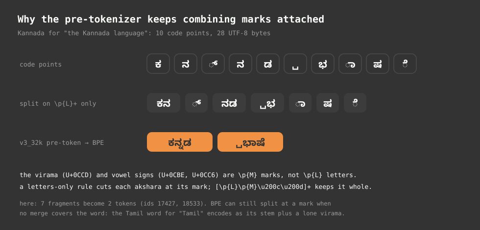

After pre-tokenization, byte-level BPE turns each piece into its UTF-8 bytes. Every byte is one of 256 base symbols, so any string can be represented and the tokenizer has no unknown token. The 32,768 entries are 256 special tokens and 32,512 byte and merge symbols. The special tokens cover end of document, padding, one tag per language, and the chat and reasoning markers. A language tag such as `<kan>` is an ordinary token with its own embedding. It conditions the model from the start of the sequence, and nothing in the network routes on it.

Bytes per token is a rough measure of how much text each token carries. On Indic text the shipped 32k tokenizer averages 9.94 bytes per token. At the 48k size, the mark-preserving pattern averages 10.76 bytes per token, against 3.67 for a GPT-style pattern, which is about 2.9 times as many. Encoding round-trips every validation document exactly.

  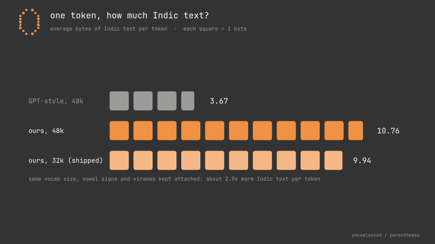

## Where the parameters go

Half the model is feed-forward. The table shows where the 253,544,176 parameters sit.

| Component | Parameters | Share |
| :--- | ---: | ---: |
| SwiGLU, three matrices in each of 16 layers | 135.3M | 53.35% |
| `qkv` projection | 50.3M | 19.85% |
| Token embedding, shared with the output head | 33.6M | 13.23% |
| Output projection and output gate | 33.6M | 13.24% |
| Recurrence-specific parts (decay, write gate, convolution, token-shift mix, highway, norms) | about 0.84M | 0.33% |

The recurrence itself costs very little in parameters. The decay gate, the write gate, the convolution taps and the mixing vectors together are about 837,360 numbers (0.33%), so most of the model's capacity goes into the projections and the feed-forward layers. The embedding is tied, which means the same 33.55 million numbers serve twice. A token enters the network along the direction its embedding points, and the output head scores each candidate along that same direction. At a 32,768-token vocabulary, the embedding would otherwise be a large share of the model, and tying it halves that cost.

  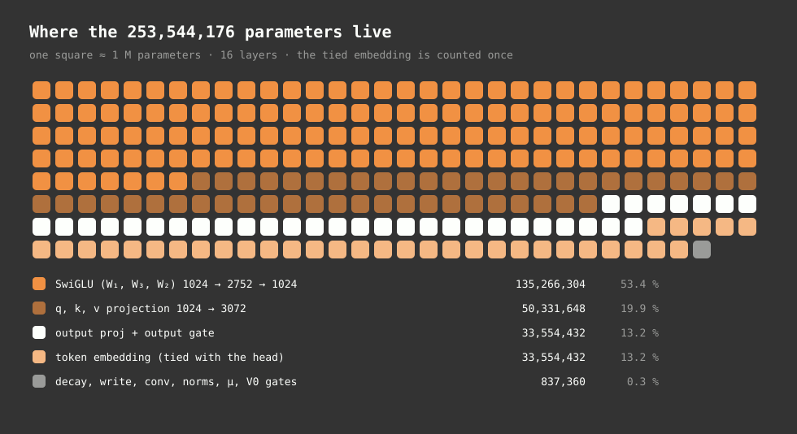

## From logits to text

The network ends with a vector of 32,768 scores, one for each token, which the model calls logits. Turning those scores into a single token is a short pipeline, and the order of its stages matters.

  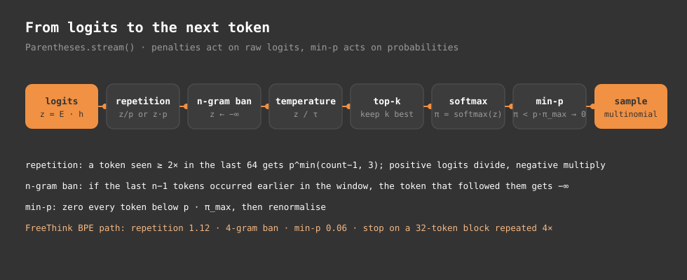

The repetition penalty acts on raw logits. It looks at the last 64 generated tokens and lowers the score of any token that has already appeared. It stops growing after four occurrences, and it ignores the prompt, so words from the user's message are not penalised. The n-gram ban goes further. In the web studio, no five-token sequence may repeat inside the same 64-token window. Temperature then rescales the logits, top-k keeps only the highest candidates, and softmax turns the rest into probabilities. Min-p drops every candidate whose probability is below a fixed fraction of the best one, which lets the cutoff move with the model's confidence. The next token is drawn at random from what remains.

The defaults are settings, not laws. The chat script starts with temperature 0.7 and top-k 40. The web studio also uses min-p 0.06, a repetition penalty of 1.16 and the five-token ban. FreeThink uses a slightly higher temperature of 0.75, a smaller top-k of 35 and a four-token ban. Plain `stream()` in the library uses temperature 1.0 and none of the rest.

Generation stops on the end-of-document token, or when the model starts a new user or system turn. A loop detector ends the output when the last 128 tokens are one 32-token block repeated four times. Byte-level BPE can split a single character across several tokens, so the FreeThink decoder holds tokens back until they form whole characters. A Kannada or Tamil letter never appears half-formed on screen.

Each generation mode is a different prefix fed to the same network. Nothing in the weights switches.

| Mode | What the model sees before it generates | What comes out |
| :--- | :--- | :--- |
| `chat` | a user turn with a language tag, the prompt, then an assistant turn | a direct answer, and the better first choice |
| `think` | the same, with the assistant turn opened on a reasoning tag | reasoning inside a span, then an answer |
| `base` | a language tag and the text | a plain continuation |
| `freethink` | a language tag, the statement, and a short continuation cue in the target script | an open-ended continuation |

FreeThink takes a statement rather than a question, and its cue ends without a trailing space, because a lone space token nudges the next token toward digits and punctuation. The cue is the only thing that differs from a normal prompt. [Section 15](DOCUMENTATION.md#15-operating-modes-and-prompt-grammar) has the exact token sequences.

FreeThink can also consult a document store. The model's state cannot grow, so retrieval works by rewriting the prompt. Every 64 generated tokens, the loop builds a query from the prompt and the last 1,024 bytes of the thought. It scores the stored chunks with BM25, keeps up to three that match, and up to 2,048 bytes of them in total. It then restarts the state on a new context made of the retrieved chunks, the prompt and the tail, and decodes another 64 tokens. The state is rebuilt each time, and only the tail text carries over. The [retrieval details](DOCUMENTATION.md#16-freethink-and-retrieval) are in section 16.

  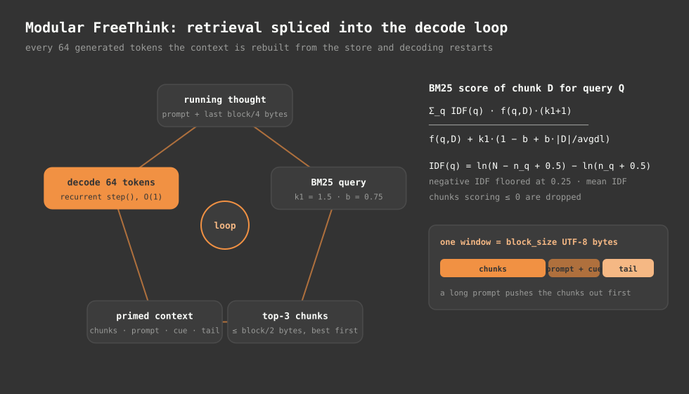

## How it was trained

Training ran in five steps. The first step was pretraining on an 808-million-token corpus. The run took 22,888 steps of 65,536 tokens each, about 1.5 billion token positions in all, which is a little under two passes over the corpus. Each step took about 10.5 seconds, so the whole run came to roughly 67 hours. The learning rate peaked at 3e-4 after a 500-step warmup. The corpus mix was 40% Dravidian core text, 25% STEM and reasoning, 20% conversational and open text, and 15% English anchors.

The second step averaged the weights of the checkpoints at steps 22,000, 22,500 and 22,887 into a single checkpoint, which people call a soup. The third step was supervised fine-tuning on 131 million tokens over 2,000 steps. The corpus for that step was a separate STEM and open-text mix, and truncated documents were masked out of the loss so the model was not trained to predict the cut-off ends. About 20% of each batch was replayed pretraining text, to limit forgetting. The fourth step soup-averaged the checkpoints at steps 1,500, 1,750 and 1,999 of that fine-tune.

The fifth step was preference tuning with DPO over 100 steps and 900 pairs. Of those pairs, 400 teach the model to say "I don't know" across five languages, 250 cover facts, 100 cover persona, 78 cover maths and 72 cover logic. On the whole set, the average preference margin came out at +0.3507 and the model preferred the chosen answer in 84.2% of pairs.

  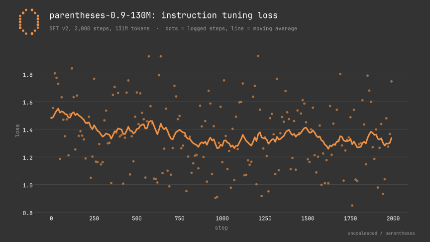

The fine-tuning loss chart is the only training curve for this model. We did not log the per-step pretraining loss to a file, so there is no pretraining chart to show.

## How well it works

  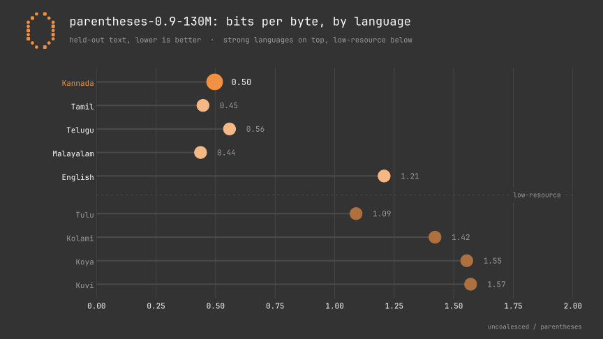

The chart reports bits per byte on held-out text. The measure is the total information the model needs to predict the text, in bits, divided by the number of UTF-8 bytes in the text. Lower is better. Because it counts bytes instead of tokens, it can compare models with different tokenizers on the same text:

$$\mathrm{BPB} = \frac{\sum_t -\ln p(y_t \mid y_{<t})}{\ln 2 \cdot N_{\text{bytes}}}$$

| Language | Bits per byte | Maturity |
| :--- | ---: | :--- |
| Malayalam | 0.44 | main |
| Tamil | 0.45 | main |
| Kannada | 0.50 | main |
| Telugu | 0.56 | main |
| Tulu | 1.09 | experimental |
| English | 1.21 | main, and the most fluent in chat |
| Kolami | 1.42 | experimental, 12 validation documents |
| Koya | 1.55 | experimental, 12 validation documents |
| Kuvi | 1.57 | experimental, 12 validation documents |

The four main Indic languages look lower than English for a reason that has little to do with quality. Bits per byte divides by bytes, and an Indic character takes three UTF-8 bytes where an English letter takes one. The first byte of every character in these scripts is the same, and the second mostly just names the script block, so a character spreads its information over three bytes while a Latin letter packs it into one. Dividing by more bytes gives a smaller number. The table is useful for comparing one language across models, not for ranking languages against each other. Koya, Kuvi and Kolami have just 12 validation documents each, so treat those figures as rough.

Other measured results are narrower. The model produced script-correct output in 40 of 40 checks across the five main languages, and in 53 of 72 (73.6%) across all nine. It leaked no control tokens in 72 runs, and it declined none of 19 sensitive but legitimate technical prompts. A single-step ONNX export is 694 MB and runs on ONNX Runtime with DirectML, and it matches the PyTorch output to within about $2 \times 10^{-5}$.

On a fresh set of 24 reasoning prompts, the model solved 5. An earlier score of 15 of 24 was inflated, because 18 of those prompts had been copied from training data. The honest score is the low one.

The model hallucinates with confidence. Asked about a Martian colony, it invented one "founded in 1842." Asked for the capital of Karnataka, it sometimes answers Bengaluru and sometimes produces nonsense, and one answer read "Bengaluru is a city in the United States." A 240M model will produce fluent, specific, wrong answers, and the fluency makes them easy to believe.

The reasoning tag misbehaves too. The model opened a `<think>` span in 36 of 72 runs and closed it on its own in only 4 of those 36. Kannada conversation and multi-step arithmetic degrade, and a Kannada greeting such as "ನಿನ್ನ ಹೆಸರು ಏನು?" is often echoed back or answered in English. Simple arithmetic such as "What is 17 x 6?" is answered by a built-in exact calculator in the chat script, not by the model.

## Limits that follow from the design

These limits come from the architecture, not from any one training run.

Recall is lossy. Each head keeps everything in one 64-by-64 matrix, so exact recall of one item among many needs nearly orthogonal keys, and at most about 64 fit. Asking for a phone number mentioned 2,000 tokens earlier, or copying a long passage word for word, is exactly the kind of task a fixed associative memory does worst. A transformer can attend back to the exact earlier tokens. This model can only read the blend of them that survived in its state.

Old information fades unless a head keeps it. Even the slowest head starts with a half-life of about 22,000 tokens, and training decides how quickly each head forgets from there. Whatever a head chooses to forget is gone, and nothing brings it back.

Reads are signed and unnormalised. The per-head RMSNorm controls the scale of the output, but within one head many weak matches can add up to look like one strong match, and a key pointing the other way subtracts content. That is the cost of removing softmax.

Order is held by short mechanisms. With no positional encoding, the model knows order through the four-tap convolution, the one-step token shift and the recency built into the decay. Beyond a few tokens the state holds content weighted by recency, not an ordered list. Tasks that need an exact long-range position, such as "the seventh word of the third sentence", are hard by construction.

Retrieval restarts the state. In FreeThink with retrieval, each splice rebuilds the state from a fresh context, so continuity across splices is limited to the tail text carried forward.

Context beyond training is untested. The architecture sets no cutoff, and the state carries whatever the trained decays let through. Training used windows of up to 4,096 tokens, and this repo does not measure quality far beyond that length.

A small model knows little. At 253.54M parameters, with most of them in feed-forward layers, the model holds limited world knowledge and produces fluent but wrong specifics. No change to the architecture described here alters that.

## Further reading

The full derivations, with every formula traced to a file and function, are in [DOCUMENTATION.md](DOCUMENTATION.md). The model code is in [model/selective_linear_attention.py](../model/selective_linear_attention.py) and [model/backbone.py](../model/backbone.py), and the presets are in [model/config.py](../model/config.py). The [project README](../README.md) describes the repository, and the [model card](../MODEL_CARD.md) covers the release. [SETUP.md](SETUP.md) walks through installing and running the model, and [ROADMAP.md](ROADMAP.md) covers what is weak today and what comes next.

The next model, Parentheses 1.0 at 240M parameters with 1,024-wide layers, is work in progress on the same laptop ([roadmap](ROADMAP.md)). Its planned licence is Apache 2.0, with training data limited to text whose licence allows commercial use. Finding enough licensed Kannada and Dravidian text is the main obstacle.
