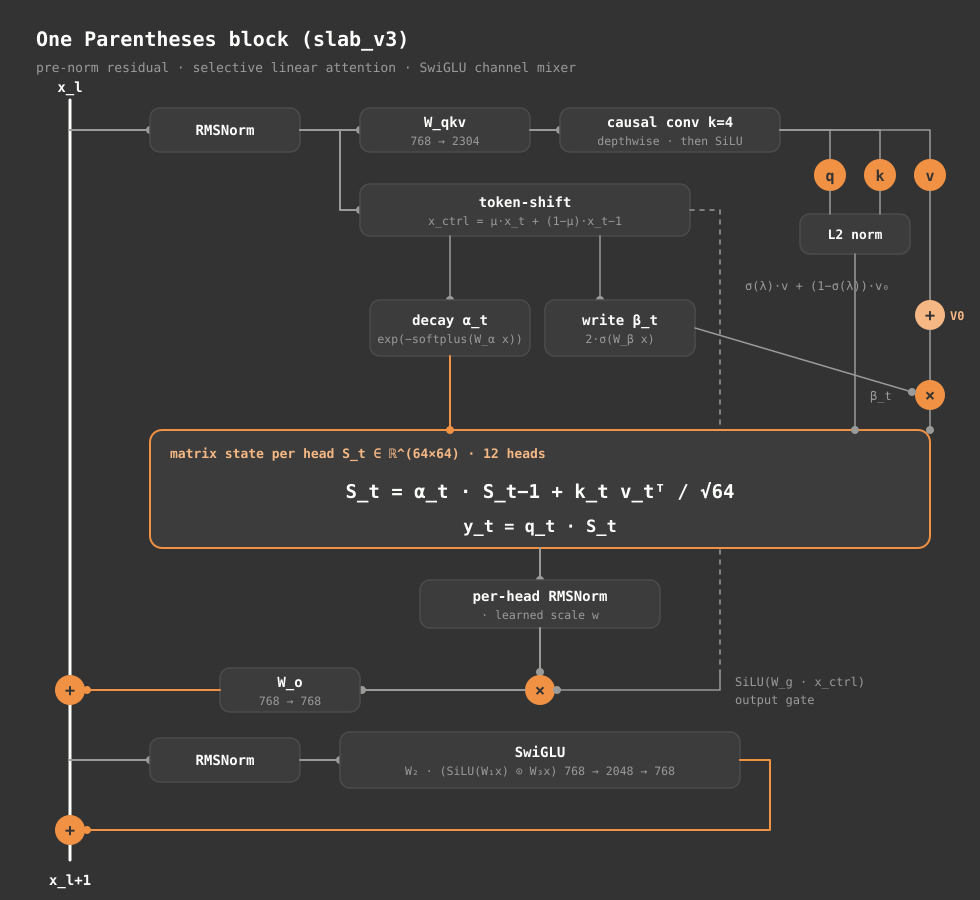
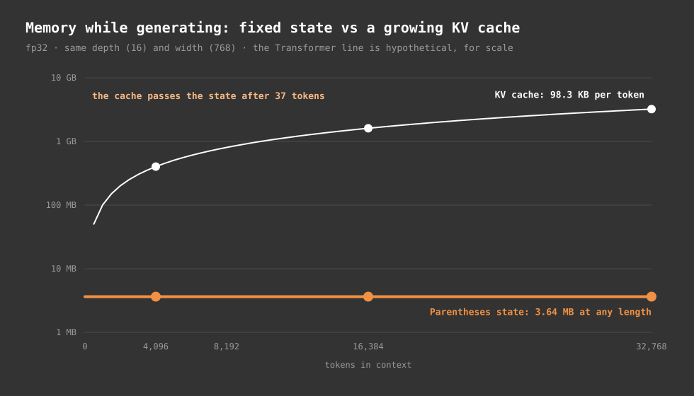
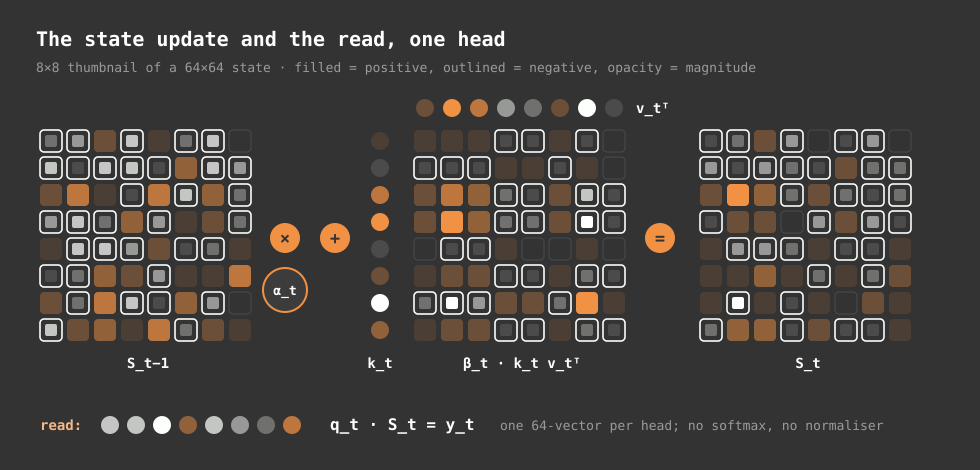
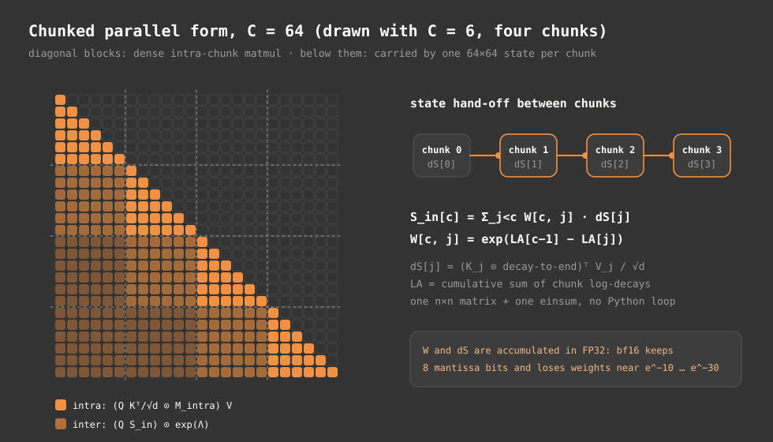
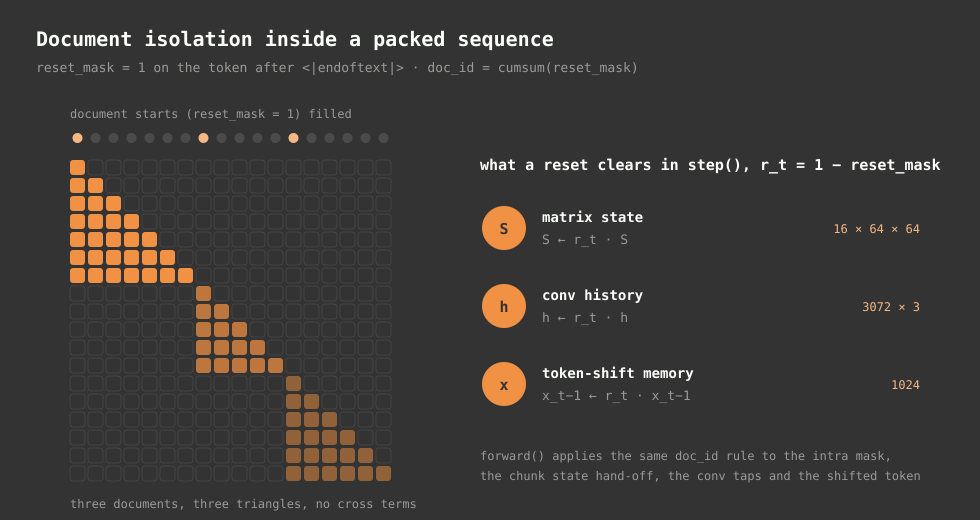
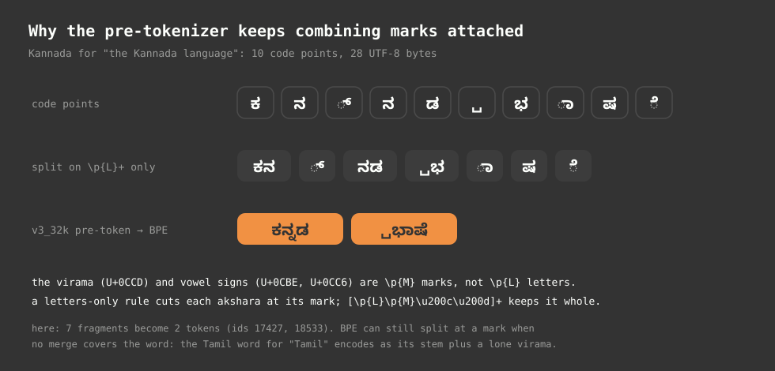
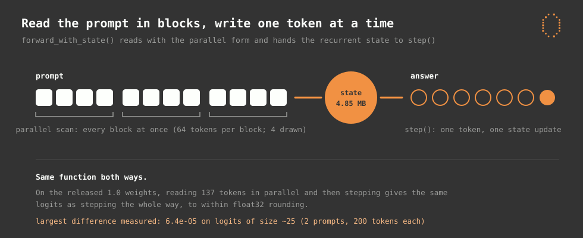

# How parentheses works

parentheses is a language model with 253,544,176 parameters (253.54 million), designed and trained from scratch on one laptop. The released 1.0 weights are `parentheses-1.0-240M-tanzanite`. The model belongs to the family of selective linear attention models, close to Mamba-2 and RWKV. It is not a transformer. It has no softmax attention over past tokens and no key-value cache. It covers Kannada, Tamil, Telugu, Malayalam and English.

This guide explains the architecture with words and pictures first, for a reader who knows what a transformer is but has not met a recurrent state-space model. Equations appear only where they help. Each section points to the code that implements it. The model code in this repository is `python/parentheses/model.py`, and the sections below use its real names.

**In one minute.** A transformer answers each new token by looking back at every token before it, so it stores a key and a value for each one, and its memory grows with the text. parentheses keeps a fixed block of memory instead. In each of 16 layers and 16 heads, one 64-by-64 matrix holds what that head has seen. Each token fades the old contents slightly, writes its own key and value into the matrix, and reads back with a query. Training runs the same arithmetic in parallel over 64-token chunks, so a 4,096-token document does not have to be processed one token at a time. The tokenizer keeps most Indic letters together, but not all of them, so the model sees many whole syllables and some split ones. Most of the weights sit in feed-forward layers that work on each position separately.

## Contents

1. [At a glance](#at-a-glance)
2. [Memory that doesn't grow](#memory-that-doesnt-grow)
3. [Inside one layer](#inside-one-layer)
4. [Why wide and shallow](#why-wide-and-shallow)
5. [Training in parallel](#training-in-parallel)
6. [How the tokenizer treats aksharas](#how-the-tokenizer-treats-aksharas)
7. [Where the parameters go](#where-the-parameters-go)
8. [Generation and sessions](#generation-and-sessions)
9. [How it was trained](#how-it-was-trained)
10. [How well it works](#how-well-it-works)
11. [Limits that follow from the design](#limits-that-follow-from-the-design)
12. [Code map and further reading](#code-map-and-further-reading)

## At a glance

| Property | Value |
| :--- | :--- |
| Name | `parentheses-1.0-240M-tanzanite` (Project Tanzanite) |
| Parameters | 253,544,176 unique parameters |
| Family | Selective linear attention, state space duality (`slab_v4`) |
| Layers | 16, each with a token-mixing branch and a SwiGLU branch |
| Heads | 16 per layer, 64 dimensions each (rank 1024) |
| Model width | 1024 |
| Vocabulary | 32,768 byte-level BPE entries, with Indic combining marks kept inside words where possible |
| Position encoding | none |
| Embeddings | tied between input and output |
| Context in one training pass | 4,096 tokens (`block_size` in `SlabConfig`) |
| Context while generating | not fixed by the architecture, and the memory does not grow |
| Recurrent state | 1,212,416 floats, or 4.85 MB in fp32 (2.42 MB in bf16) |
| Code licence | MIT |
| Weights licence | Apache 2.0 |

  

The model is a stack of 16 blocks with the same shape and their own weights. A residual stream carries one vector per token from the bottom of the network to the top, and each block adds to it twice. The first addition is the token-mixing branch, which is the only place where information moves between positions. The second is the SwiGLU branch, which transforms each position on its own. Both branches read a normalised copy of the stream, so the stream itself is never normalised until the very end. In `Block.forward` this is `ln1`, then the attention branch, then `ln2`, then `mlp`.

## Memory that doesn't grow

A transformer that generates text keeps a key vector and a value vector for every token it has already seen, in every layer. That store is the KV cache. It grows by one entry per token, so a long conversation costs more memory and more time at each step. For a transformer of the same depth (16) and width (1024), the cache takes 131,072 bytes per token in fp32. That is about 537 MB at 4,096 tokens, and it overtakes the fixed state of parentheses after about 37 tokens.

parentheses keeps no growing cache. In each head it keeps one 64-by-64 matrix $S$, and that matrix is the whole of the head's memory. Each token does two things to it. It decays the old contents by a factor $\alpha_t$ between 0 and 1, and it writes its key $k_t$ and value $v_t$ into the matrix as an outer product, scaled by a write strength $\beta_t$ between 0 and 2. A query $q_t$ then reads the matrix:

$$S_t = \alpha_t\, S_{t-1} + \beta_t\, k_t^\top v_t, \qquad y_t = q_t\, S_t$$

This is the recurrence in `SelectiveLinearAttention.step`, where `memory = alpha * memory + write` and `y = q1 @ memory`.

  

  

It is easiest to think of the matrix as a notebook with a fixed number of pages. Each new entry is written over a faded copy of the older text. Reading means asking a question. The entries whose keys match the question speak loudest, and the entries that have faded speak quietly. The notebook never gets longer, and the model learns how fast each head's entries fade.

A tiny example makes this concrete. Use two-number vectors and write the key $(1, 0)$ with the value $(3, 1)$. One step later the head decays by 0.5 and writes the key $(0, 1)$ with the value $(-2, 4)$. Querying with $(1, 0)$ now returns $(1.5, 0.5)$: the first value, halved once by the decay. Querying with $(0, 1)$ returns $(-2, 4)$ exactly. A query pointing between the two keys returns a blend that leans toward the key that matches it more closely. (The code also scales each write by $\beta_t$ and normalises queries and keys, which this example leaves out to keep the numbers readable.)

Four properties follow from that arithmetic. The weights are signed, so a query pointing away from a stored key subtracts its value. The read is not normalised, so its size depends on how many writes match. Each head can hold at most about 64 mutually orthogonal keys before writes start to overlap. And the cost of memory does not depend on history.

The numbers are concrete. Each head stores 4,096 numbers, and the 256 head matrices in the model (16 layers times 16 heads) hold 1,048,576 numbers. In bf16 that is about 2.1 MB. The whole recurrent state also includes a short convolution history for each layer (3 times 1024 channels, 3 rows, 16 layers) and the previous layer input kept for the token shift. Together these come to 1,212,416 numbers, or 4.85 MB in fp32 (2.42 MB in bf16). The state is the same size after ten tokens as after ten million.

The per-token work is also small. A decoding step needs about 2.1 million multiply-adds for the recurrence, against roughly 253 million for the dense layers, so the recurrence is under 1% of the arithmetic. The state never grows, so generation does not slow down as the text gets longer. Timing on the laptop GPU is reported in [HISTORY.md](../HISTORY.md) and in the benchmark protocol, not here.

## Inside one layer

The token-mixing branch has several small parts, and each one does a specific job. The walk-through below follows the order the code runs them, inside `SelectiveLinearAttention.forward` and `_split`, `_gates` and `_emit`.

### Token shift

After the input norm, the layer blends each token with the token before it. For each channel, a learned mix $\mu$ (the `mu` parameter) decides how much of the current input and how much of the previous input to keep:

$$\tilde{x}_t = \mu \odot x_t + (1 - \mu) \odot x_{t-1}$$

The blend feeds only the three control signals: the decay, the write strength and the output gate. Queries, keys and values come from the current token alone. This lets the gates see the transition from the previous token at no recurrent cost. Whether to forget, and how hard to write, can depend on the move from "the" to "cat" rather than on "cat" alone. At the start of a document the previous input is set to zero.

### Projections and the short convolution

One matrix multiplication (`qkv`, with no bias) turns the normalised input into 3,072 numbers, which split into 16 queries, 16 keys and 16 values of 64 numbers each. Before the split, a depthwise convolution with four taps (`CONV_KERNEL = 4`) runs along time on each channel, followed by SiLU. The convolution gives the layer exact local order. Affixes, sandhi and words split over several tokens fit inside four tokens, so the layer sees those patterns directly instead of through the blurred, decaying state. The taps start as a pass-through, so training begins with plain SiLU and learns to mix in the three previous tokens.

Queries and keys are then scaled to unit length. A query-key score becomes a cosine similarity, which keeps the size of the writes and reads under the control of the gates rather than of the vector norms. The queries also carry a $1/\sqrt{d_h}$ factor. The model has no positional encoding. Order comes from the convolution, the token shift and the decay.

### Decay: how long a head remembers

Each head computes one decay per token:

$$\alpha_t = \exp\big(-\mathrm{softplus}(W_\alpha \tilde{x}_t + b_\alpha)\big)$$

Softplus is always positive, so $\alpha_t$ always lies strictly between 0 and 1. A head can never amplify its memory, and it never wipes it in one step except at a document boundary. The decay depends on the input, which is what "selective" means here. A head can hold its memory through a stretch of filler text, then drop most of it in one step when the topic changes. Each head makes that choice separately at every token.

The bias $b_\alpha$ (`alpha_proj.bias`) is set at initialisation so that each head starts with a different memory length. In `Parentheses.reset_parameters` the starting forgetting rates run on a log scale from 0.1 in head 0 to about $3\times10^{-5}$ in head 15, so $\alpha$ starts at $1 - $ that rate. Head 0 starts with a half-life of about 7 tokens, and head 15 starts with one of about 22,000 tokens. The heads in between are spaced on a log scale, so each one covers its own range of distances. Training moves these values, and a trained head's horizon can change from token to token.

### Write strength

The write strength is

$$\beta_t = 2\,\sigma\big(W_\beta \tilde{x}_t + b_\beta\big) \in (0, 2)$$

and it scales the value before the value is written. A token that carries little, such as punctuation or a very common function word, can be written softly. An informative token can be written at up to twice the base strength. The `beta_proj` weights start at zero, so at initialisation the write strength is 1 everywhere. The layer starts out close to plain linear attention and adds a little per-token variation as it trains.

### The value highway

Layer 0 keeps its value vectors and passes them up the stack. Every later layer mixes its own values with layer 0's through one learned sigmoid weight per head (`v_residual_lamb`), which starts at an even split. Two things come from this. Every layer has a direct route to near-token content, so a deep layer does not have to rely on the stream carrying that content intact through every layer below. And layer 0's value projection collects gradient from all 16 layers, which keeps the bottom of the network learning at a pace closer to the top.

### Reading and output

The read $q_t S_t$ is a signed sum over everything written, and its size changes with how many writes match. Each head's read is therefore normalised by its own RMSNorm (`_emit`, with `y_norm` as the learned scale) before anything else sees it. The 16 heads are then joined, multiplied by a SiLU gate computed from the shifted input (`gate`), and projected back to 1024 numbers (`proj`). The gate lets the model choose, channel by channel, how much of the normalised read gets through.

## Why wide and shallow

Earlier deep-narrow designs (32 layers, each 512 wide with 8 heads) suffered from two problems. The first was depth: the gradient ratio between the bottom and top layers was large, so different parts of the network learned at very different speeds. The second was capacity: each layer's total recurrent rank was only 512.

parentheses 1.0 fixes depth at 16 layers and widens the model to 1024, with 16 heads of 64. Each layer's recurrent rank doubles to 1024, and the backward path through the recurrence is half as long. The design keeps the convolution, normalised queries and keys, per-head norm, output gate, token shift, learned write strength, layer-0 value highway, and a float32 accumulator for the decay scan. The gradient ratio between layer 0 and layer 15 stayed stable through training.

The float32 accumulator needs a short explanation. Decay weights in the parallel scan can become very small. After 30 chunks in a fast-decaying head, a weight can be near $e^{-30}$, which is about $10^{-13}$. bfloat16 keeps only a few significant digits, so adding such terms in bf16 rounds the small ones to zero. The early part of a long document would then quietly drop out of the state. The `_wide` helper in `model.py` therefore picks float32 (or float64 for float64 inputs) for the scan, even when the rest of the network runs in bfloat16.

Two smaller initialisation choices belong here too. The two projections that write into the residual stream (`proj` and the SwiGLU `w2`) start with a standard deviation of $0.02/\sqrt{2L}$, so the variance of the stream stays roughly flat with depth at the start of training. And the decay bias is set deliberately after the generic weight initialisation. A zero bias would give every head a decay of 0.5, and the state would be wiped every few tokens.

## Training in parallel

Training is where a recurrence would be slowest. A straight loop over 4,096 tokens needs 4,096 steps, each waiting on the one before. Unrolling the recurrence removes most of that wait. Each output becomes a weighted sum over earlier tokens, where the weight for an earlier token is the product of the decays between the two positions:

$$y_t = \sum_{s \le t} e^{\Lambda_t - \Lambda_s}\, (q_t \cdot k_s)\, v_s\beta_s, \qquad \Lambda_t = \sum_{r \le t} \log \alpha_r$$

This has the shape of causal attention with the softmax swapped for a decay mask. Entry $(t, s)$ of the mask is the decay accumulated between positions $s$ and $t$. The mask is quadratic in the length of the block, so the model never builds it for a whole document.

Instead, `chunk_scan` cuts the sequence into blocks of `chunk_size` tokens (64 by default). Inside a block, the computation is a small dense 64-by-64 masked product, and all blocks are computed together in one batched operation. Across blocks, each block contributes one 64-by-64 state update, and the state entering each block is carried forward from the one before. That hand-off is the only sequential part. In the code it is a Python loop over the $T/64$ blocks, with one matrix product per block, so a 4,096-token window has 64 hand-offs. The work inside each block does not wait on the others.

  

The chunked form used in training, and the step-by-step recurrence used for generation, compute the same function. The parity checks for that claim live under `tests/`. The parallel form also explains how the decays learn. The gradient for the decay at a position is a sum over pairs of an earlier writer and a later reader that span that position. There is no chain of 4,096 multiplications for the gradient to vanish through, which is the usual problem with backpropagation through a long nonlinear RNN.

Training packs several documents into each 4,096-token window. Without care, the end of one document would leak into the start of the next. The model marks document starts with `find_documents`: a token that follows `<|endoftext|>` (token id 0) begins a new document. In the parallel form this becomes a block-diagonal pattern, with each document as its own triangle and no path allowed to cross a boundary (`same_doc` in `chunk_scan`). The state is cleared at the boundary, and the convolution and the token shift are cut the same way, so the first few tokens of a document see nothing from the previous one.

  

## How the tokenizer treats aksharas

Kannada, Tamil, Telugu and Malayalam are abugida scripts. The unit a reader sees is an akshara, which is a consonant together with its vowel. Each consonant carries an inherent vowel. A vowel sign, called a matra, replaces that vowel. A virama removes it, which lets consonants stack into conjuncts.

Take ಕನ್ನಡ, the Kannada word for the language. It is five code points: ಕ, ನ, the virama ್, ನ and ಡ. The virama between the two ನ is what makes the conjunct ನ್ನ. In Unicode, the virama and the vowel signs are combining marks in category M. Many word-splitting patterns, including the one GPT-2 uses, match letters with `\p{L}` and treat marks as separators. Applied to Kannada, such a pattern cuts the word at every virama and vowel sign, and the tokenizer then has to rebuild each syllable from scattered pieces.

The pre-tokenizer in parentheses adds `\p{M}`, the zero-width non-joiner and the zero-width joiner to the word class. A vowel sign or virama therefore stays in the same pre-token as its letter, before byte-pair merges run. This does not keep every akshara whole. BPE applies only the merges it learned in training, and it can still split an akshara before a vowel sign inside a word. For example, ಭಾಷೆಯಲ್ಲಿ ("in the language") becomes ಭಾಷ + ೆಯಲ್ಲಿ, where the split falls between the consonant and the vowel sign ೆ. Roughly a quarter of token boundaries in the Dravidian languages fall inside an akshara.

  

After pre-tokenization, byte-level BPE turns each piece into its UTF-8 bytes. Every byte is one of 256 base symbols, so any string can be represented and the tokenizer has no unknown token. The 32,768 entries are 256 special tokens and 32,512 byte and merge symbols. The special tokens include `<|endoftext|>` (id 0), padding (id 1), the chat markers `<|user|>`, `<|system|>` and `<|assistant|>`, and one tag per language. A language tag such as `<kan>` is an ordinary token with its own embedding. It conditions the model from the start of the sequence, and nothing in the network routes on it.

Bytes per token is a rough measure of how much text each token carries. On Indic text the shipped 32k tokenizer averages about 9.9 bytes per token. The tokenizer files are in `python/parentheses/tokenizer_data/`.

## Where the parameters go

Most of the model is feed-forward. The table shows where the 253,544,176 parameters sit.

| Component | Parameters | Share |
| :--- | ---: | ---: |
| SwiGLU, three matrices in each of 16 layers (hidden width 2,752) | 135.3M | 53.35% |
| `qkv` projection | 50.3M | 19.85% |
| Token embedding, shared with the output head | 33.6M | 13.23% |
| Output projection and output gate | 33.6M | 13.24% |
| Recurrence-specific parts (decay, write gate, convolution, token-shift mix, highway, norms) | about 0.84M | 0.33% |

The recurrence itself costs very little in parameters. The decay gate, the write gate, the convolution taps and the mixing vectors together are about 837,360 numbers (0.33%), so most of the model's capacity goes into the projections and the feed-forward layers. The embedding is tied, which means the same 33.55 million numbers serve twice. A token enters the network along the direction its embedding points, and the output head scores each candidate along that same direction. At a 32,768-token vocabulary, the embedding would otherwise be a large share of the model, and tying it halves that cost. In code, `self.head.weight = self.tok_emb.weight` in `Parentheses.__init__`.

The SwiGLU hidden width comes from `SlabConfig.mlp_hidden`, which rounds $8d/3$ up to a multiple of 64, giving 2,752 for width 1024.

## Generation and sessions

The network ends with a vector of 32,768 scores, one for each token. Each generation step has two parts: the model computes those scores, and a sampler turns them into one token. The model part is `Parentheses.step`, which takes one token and the per-layer states and returns next-token logits and the new states. Multi-turn chat is handled by `ChatSession` in `python/parentheses/session.py`, which carries the states from one turn to the next, so a later message does not re-read the whole conversation.

  

A prompt is read once with the parallel form (`forward_with_state`), which returns the state after its last token. Generation then continues token by token with `step`. `Parentheses.stream` shows the whole loop: greedy decoding when the temperature is zero, otherwise temperature scaling, optional top-k, and a multinomial draw. `GraphStepper` in `python/parentheses/graph_step.py` replays the same one-token step from a CUDA graph, with identical outputs, to cut the per-token launch overhead.

The chat defaults in `session.py` (`RELEASE_SAMPLING`) are a temperature of 0.2, top-k 40, min-p 0.1, and a ban on repeated 8-token sequences (`no_repeat_ngram_size`). `ChatSession` stops on `<|endoftext|>`, `<|user|>`, `<|system|>`, `<|assistant|>` and `<|pad|>`. Calling `stream()` directly uses temperature 0 (greedy) unless told otherwise. These are settings, not laws, and callers can override them.

Each chat turn is a different prefix fed to the same network. The user turn is wrapped in its markers and a language tag, and the assistant turn is opened for the model to continue. Nothing in the weights switches between modes. The FreeThink and retrieval modes described in earlier versions are not implemented in this repository.

## How it was trained

The 1.0 model did not start from random weights. It was grown from an earlier 120M checkpoint (Apache 2.0) with Net2WiderNet width expansion: the wider network starts out computing what the narrower one computed, then keeps training. (A 130M branch that included CC BY-NC data was abandoned before this grow.) The same laptop GPU with 8 GB of VRAM ran every session. From the grow onward, the run took 14,173 optimizer steps across ten sessions:

| Steps | What happened |
| :--- | :--- |
| 1 to 6,000 | Warm-up after widening, then multilingual pretraining (393.2M tokens) |
| 6,001 to 8,000 | STEM, maths and Python code. Training loss fell sharply, but held-out bits per byte got worse in all nine languages |
| 8,001 to 10,000 | Textbook text mixed half-and-half with multilingual replay, which recovered the per-language scores |
| 10,001 to 12,000 | Learning-rate anneal on cleaned, commercially licensed corpora |
| 12,001 to 13,000 | Supervised fine-tuning on whole conversations packed into 4,096-token containers, with Dravidian replay, then an average of the last three checkpoints |
| DPO branch | Preference tuning on 805 pairs, which was then averaged with the annealed model |
| 13,081 to 14,173 | Full fine-tune, a decontaminated Dravidian and abstention repair, and a final short calibration of format and abstention |

The main lesson of the run is about measurement. A falling training loss on easier, low-entropy text can hide a model that is getting worse at the languages it is for. The step at 6,001 is where the code-heavy mix began, and the per-language held-out scores are what caught it. Per-session metrics and the evaluation protocol are in [BENCHMARK_SPEC.md](BENCHMARK_SPEC.md), and the run history is in [HISTORY.md](../HISTORY.md).

## How well it works

This guide does not restate benchmark results. Scores from the 1.0 suite were taken on small samples, and several were not comparable with the peer models they were set against, so they are not reproduced here. The benchmark definitions, the sampling protocol (greedy and sampled runs, and how the best and average scores are reported) and the raw results are in [BENCHMARK_SPEC.md](BENCHMARK_SPEC.md). Version history, including what changed between 1.0 and 1.1, is in [HISTORY.md](../HISTORY.md).

Qualitatively, the model does well where the training put its effort. Short Python functions such as factorial, palindrome and Fibonacci come out correct in hands-on use. Kannada, Tamil, Telugu and Malayalam answers mostly stay in script and on topic, but they are shallow and sometimes repeat a line. English factual answers are weak. A model of this size produces fluent, specific, wrong answers, and the fluency makes them easy to believe. The `<think>` format is experimental on this checkpoint and tends to restate the question instead of reasoning, so the chat format is the one to use.

## Limits that follow from the design

These limits come from the architecture, not from any one training run.

Recall is lossy. Each head keeps everything in one 64-by-64 matrix, so exact recall of one item among many needs nearly orthogonal keys, and at most about 64 fit. Asking for a phone number mentioned 2,000 tokens earlier, or copying a long passage word for word, is exactly the kind of task a fixed associative memory does worst. A transformer can attend back to the exact earlier tokens. This model can only read the blend of them that survived in its state.

Old information fades unless a head keeps it. Even the slowest head starts with a half-life of about 22,000 tokens, and training decides how quickly each head forgets from there. Whatever a head chooses to forget is gone, and nothing brings it back.

Reads are signed and unnormalised. The per-head RMSNorm controls the scale of the output, but within one head many weak matches can add up to look like one strong match, and a key pointing the other way subtracts content. That is the cost of removing softmax.

Order is held by short mechanisms. With no positional encoding, the model knows order through the four-tap convolution, the one-step token shift and the recency built into the decay. Beyond a few tokens the state holds content weighted by recency, not an ordered list. Tasks that need an exact long-range position, such as "the seventh word of the third sentence", are hard by construction.

Context beyond training is untested. The architecture sets no cutoff, and the state carries whatever the trained decays let through. Training used windows of up to 4,096 tokens (`SlabConfig.block_size`), and this repository does not measure quality far beyond that length.

A small model knows little. At 253.54M parameters, with most of them in feed-forward layers, the model holds limited world knowledge and produces fluent but wrong specifics. No change to the architecture described here alters that.

## Code map and further reading

| Topic | Where |
| :--- | :--- |
| Recurrent layer, chunked scan, document resets, full model | `python/parentheses/model.py` (`SelectiveLinearAttention`, `chunk_scan`, `find_documents`, `Parentheses`, `LayerState`) |
| Shapes and presets (`SLAB_V4_240M`) | `python/parentheses/config.py` |
| Chat state and sampling defaults | `python/parentheses/session.py` (`ChatSession`) |
| CUDA graph replay of the one-token step | `python/parentheses/graph_step.py` (`GraphStepper`) |
| Tokenizer files | `python/parentheses/tokenizer_data/` |
| Benchmark definitions and raw results | [BENCHMARK_SPEC.md](BENCHMARK_SPEC.md) and `eval/` |
| Setup and running the model | [SETUP.md](SETUP.md), Mac: [APPLE_SILICON.md](APPLE_SILICON.md) |
| Full technical reference | [DOCUMENTATION.md](DOCUMENTATION.md) |
| Model card | [MODEL_CARD.md](../MODEL_CARD.md) |
| Plans and progress | [ROADMAP.md](ROADMAP.md), [RELEASE_NOTES.md](../RELEASE_NOTES.md) |
| Version history and what changed | [HISTORY.md](../HISTORY.md) |
| Project goals and target architecture | [README.md](../README.md) |
| Licences of the training data | [LICENSE_TABLE.md](LICENSE_TABLE.md) |
| Repository operating rules | [AGENTS.md](../AGENTS.md) |

The model code in this repository is the reference for every formula above. The released weights are Apache 2.0 and the code is MIT. Training data was limited to text whose licence allows commercial use, and finding enough of it in Kannada and the other Dravidian languages remains the main obstacle for the next model.
