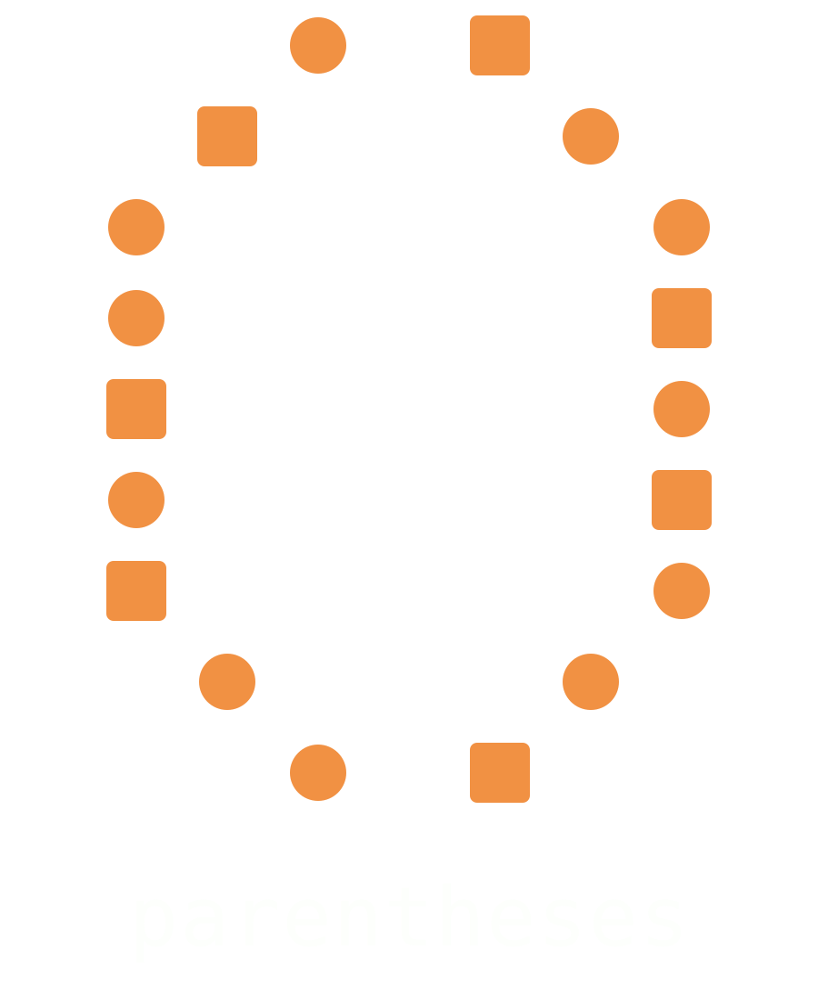
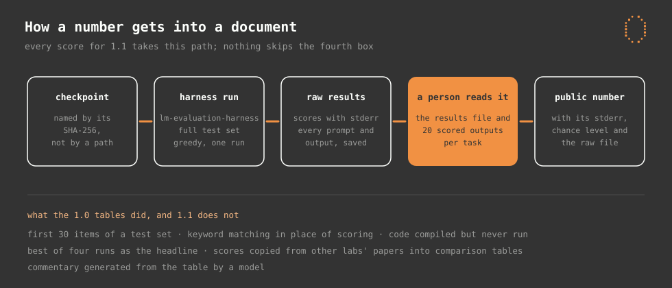

<div align="center">
  
</div>

<h3 align="center">Benchmark protocol</h3>

<p align="center">
  How every published number for parentheses 1.1 is produced.<br>
  If a number can't be produced this way, it doesn't get published.
</p>

<p align="center">
  <a href="../README.md">README</a> •
  <a href="../HISTORY.md">History</a> •
  <a href="LICENSE_TABLE.md">Licence tiers</a>
</p>

---

## Why this file exists

The 1.0 release tables came from a script we wrote ourselves. Readers went through it and found real problems. Each benchmark used 30 items. Several were scored by keyword matching. MBPP code was compiled and never run. The headline was the best of four runs, three of them sampled. The comparison tables set those numbers against other labs' full-benchmark scores. The readers were right: the tables measured much less than they appeared to.

So from 1.1 the model is scored by [lm-evaluation-harness](https://github.com/EleutherAI/lm-evaluation-harness), not by code written in this repository. Our code hands the harness log-probabilities and generated text. The harness decides what is correct.

<p align="center">
  
</p>

## Rules

1. Tasks come from lm-evaluation-harness with their definitions unmodified. No custom scorers.
2. Full test sets. A run with `--limit` is a smoke test and is never reported.
3. Greedy decoding, one run. No best-of-N, and no sampled run as a headline.
4. The harness's standard error is reported next to every score.
5. Multiple-choice tasks are shown next to their chance level. A score under chance is published as a score under chance.
6. Code tasks (MBPP, HumanEval) execute the tests, inside a sandbox with no network access.
7. MMLU means all 57 subjects. One subject is not MMLU.
8. Belebele is reported per language: English, Kannada, Tamil, Telugu, Malayalam.
9. The raw results for every published number are committed under `eval/results/<checkpoint sha256>/`, with the harness version and the exact command.
10. Comparison tables only include models that were run locally through the same harness, the same task versions and the same settings. Numbers are not copied from papers or model cards.
11. Any sentence that interprets a table is written by a person looking at that table.
12. No metric enters a public file until the maintainer has read the raw results and at least 20 scored outputs for each task.

## Our own prompt suite is not a benchmark

We keep a few hundred held-out prompts for checking things the public benchmarks don't cover, like whether a Kannada answer stays in Kannada script. They are useful to us. They were also written by the people who trained the model, and checkpoints were chosen by how they did on them. Wherever results from that suite appear, they are labelled as internal and are never placed in the same table as harness scores.

## Prompt format

Prompts reach the model exactly as the harness builds them. No chat markers and no language tags are added, even though 1.0 was tuned on a chat format. That probably costs the model some points. It is also what every other model on these benchmarks gets, and a number that needs a special wrapper to look good is the kind of number this file is meant to prevent. If a chat-format run is ever published, it will be labelled as one and shown beside the plain run.

## Task list for the baseline

| Area | Harness tasks | Chance |
|:---|:---|:---:|
| General knowledge | `mmlu` | 25% |
| Reading and commonsense | `hellaswag`, `arc_easy`, `arc_challenge` | 25% |
| Word prediction | `lambada_openai` | |
| Truthfulness | `truthfulqa_mc1`, `truthfulqa_mc2` | varies by question |
| Reading in five languages | `belebele_eng_Latn`, `belebele_kan_Knda`, `belebele_tam_Taml`, `belebele_tel_Telu`, `belebele_mal_Mlym` | 25% |
| Maths | `gsm8k` | |
| Code | `mbpp`, `humaneval` | |

Task names are checked against the installed harness before each run. A task the harness does not define is dropped, not reimplemented. That is why HaluEval and Terminal-Bench, which appeared in the 1.0 tables, are not here.

## Running it

```bash
pip install -e ".[eval]"
python -m parentheses.evaluate --checkpoint weights/model.safetensors --tasks arc_easy,hellaswag
```

The runner writes one results file and one samples file per task, in a folder named after the checkpoint's SHA-256. With `--limit N` the file name starts with `SMOKE` and the runner prints a reminder that the numbers are not results.

## Not measured yet

Speech and image tasks have no protocol here. One will be added to this file before any audio or vision number is published.

<p align="center"><sub>Engineered by uncoalesced</sub></p>
