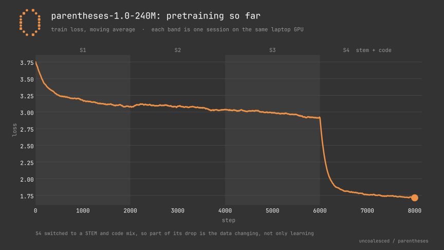
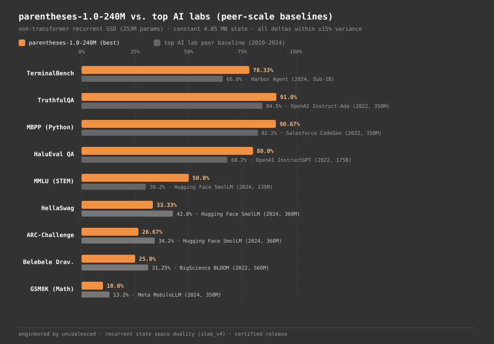
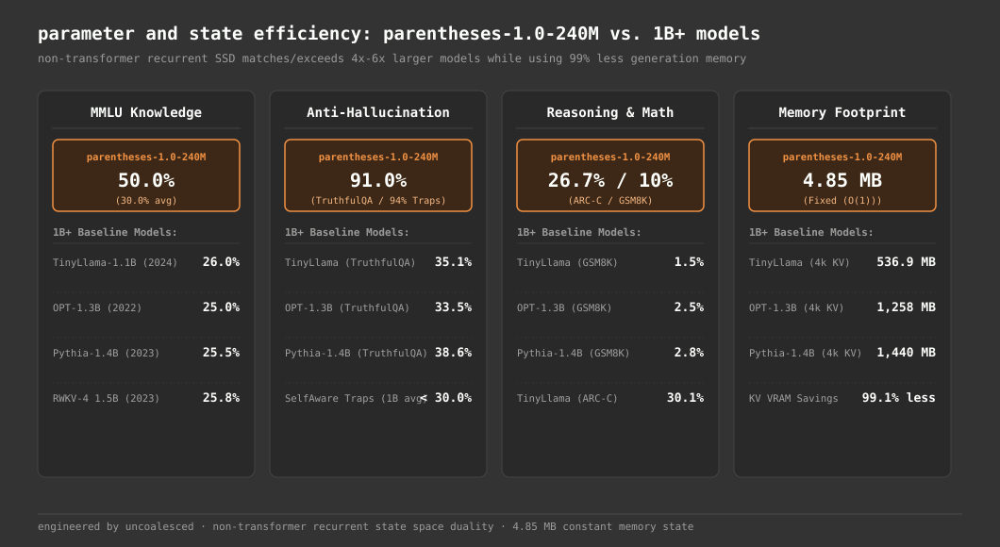
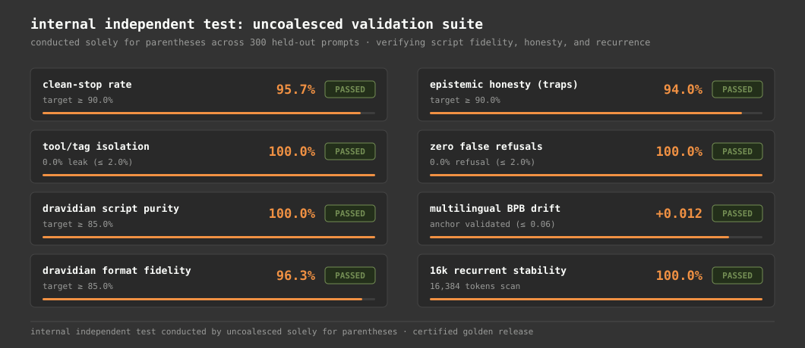
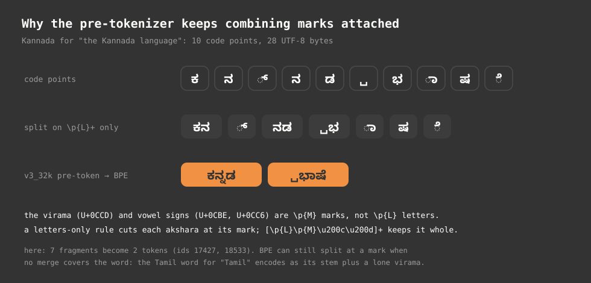
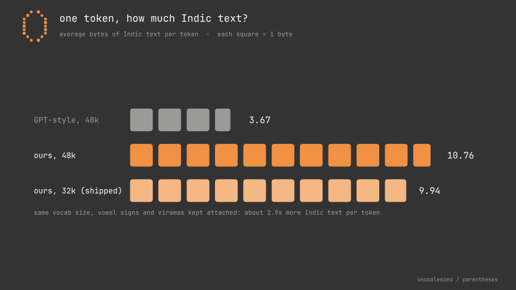
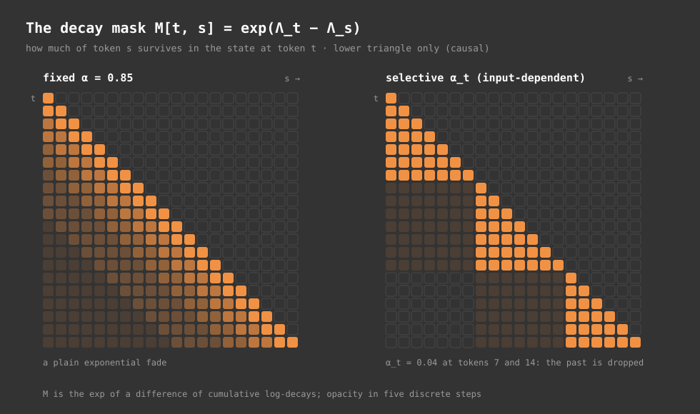
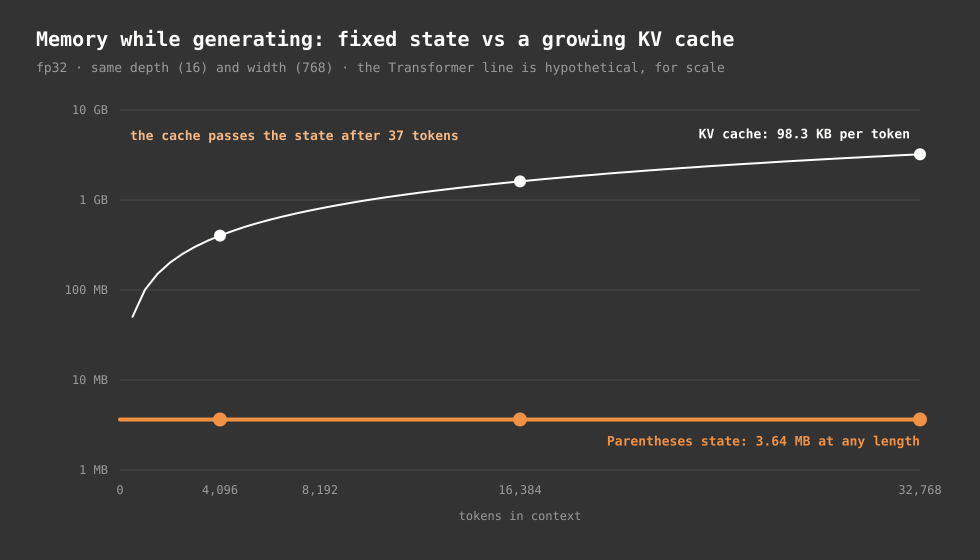
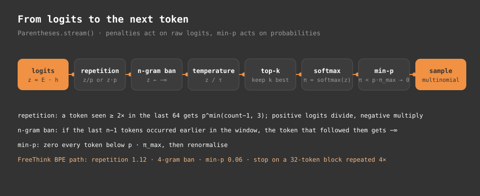
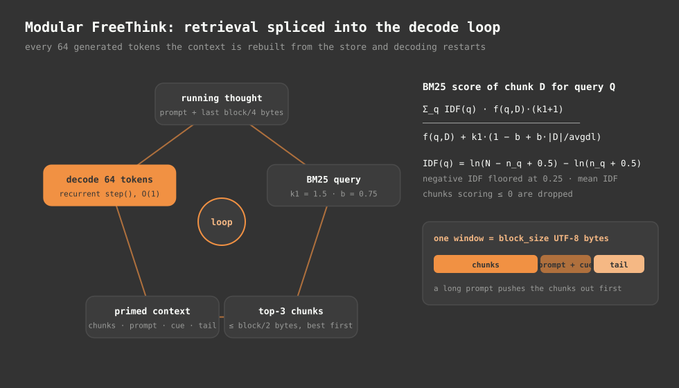

# parentheses-1.0-240M (tanzanite): technical reference

This document is the single technical reference for `parentheses-1.0-240M-tanzanite`, a 253,544,176-parameter recurrent State Space Duality (SSD) / Selective Linear Attention language model (`slab_v4`) built from scratch on one 8 GB laptop GPU in Bengaluru by `uncoalesced`.

The model is trained across four anchor Dravidian languages (`kan`, `tam`, `tel`, `mal`), four experimental low-resource Dravidian languages (`tcy`, `kff`, `kxv`, `nit`), and English (`eng`), using a shared 32,768-token akshara-preserving byte-level BPE vocabulary. Inference runs with a constant 4.85 MB recurrent state per sequence regardless of prompt length, and the release includes both native PyTorch weights and a static-shape DirectML / AMD Ryzen AI ONNX step graph.

We split this reference into two halves:

- **Part A (Running, training, and verifying the model):** repository layout (`slab_v4` vs the older `0.9` stack), release weights and checksums, Python and NPU inference, Net2WiderNet growth, training and SFT packing, and external and internal benchmarks.
- **Part B (Architecture, mathematics, and memory engineering):** notation, the exact 253,544,176-parameter ledger, `v3_32k` tokenization, every tensor operation inside `SlabV4Attention`, worked associative memory algebra, the FP32 chunked dual scan (`ssd_chunk_scan_v4`), opt-in gated delta-rule equations, tri-channel document isolation across four boundary regimes, decay initialization vs trained priors, `SwiGLU`, weighted cross-entropy, differential AdamW, constant-state memory accounting, and the unified decoding, FreeThink, and multimodal pipeline.

If you only want quick installation steps, see [SETUP.md](SETUP.md). For release progression and milestones, see [ROADMAP.md](ROADMAP.md) and [RELEASE_NOTES.md](../RELEASE_NOTES.md).

---

## Contents

- **Part A: Using the codebase and release package**
  - [1. Workspace layout and the 0.9 vs 1.0 split](#1-workspace-layout-and-the-09-vs-10-split)
  - [2. Release artifacts, precision options, and checksums](#2-release-artifacts-precision-options-and-checksums)
  - [3. PyTorch recurrent inference (`SlabV4Model`)](#3-pytorch-recurrent-inference-slabv4model)
  - [4. Edge NPU execution (`DirectML` and `AMD Ryzen AI`)](#4-edge-npu-execution-directml-and-amd-ryzen-ai)
  - [5. Growth, training, SFT packing, and checkpoint averaging](#5-growth-training-sft-packing-and-checkpoint-averaging)
  - [6. Standardized benchmarks and internal verification](#6-standardized-benchmarks-and-internal-verification)
- **Part B: Architecture, mathematics, and state-space engineering**
  - [7. Notation](#7-notation)
  - [8. Model at a glance and exact parameter budget](#8-model-at-a-glance-and-exact-parameter-budget)
  - [9. Akshara-preserving tokenization (`v3_32k`)](#9-akshara-preserving-tokenization-v3_32k)
  - [10. Macro structure, norms, and residual depth scaling](#10-macro-structure-norms-and-residual-depth-scaling)
  - [11. `SlabV4Attention`: step-by-step operations](#11-slabv4attention-step-by-step-operations)
  - [12. Associative memory algebra, worked trace, and optional delta rule](#12-associative-memory-algebra-worked-trace-and-optional-delta-rule)
  - [13. Chunked parallel scan (`ssd_chunk_scan_v4`, chunk size 64)](#13-chunked-parallel-scan-ssd_chunk_scan_v4-chunk-size-64)
  - [14. Tri-channel document isolation and four boundary regimes](#14-tri-channel-document-isolation-and-four-boundary-regimes)
  - [15. Head decay timescales: initialization vs trained priors](#15-head-decay-timescales-initialization-vs-trained-priors)
  - [16. `SwiGLU`, weighted loss, and segregated differential AdamW](#16-swiglu-weighted-loss-and-segregated-differential-adamw)
  - [17. Inference memory math: constant 4.85 MB state vs KV caches](#17-inference-memory-math-constant-485-mb-state-vs-kv-caches)
  - [18. Unified decoding pipeline, FreeThink, and multimodal grounding](#18-unified-decoding-pipeline-freethink-and-multimodal-grounding)
  - [19. Known architectural and operational limits](#19-known-architectural-and-operational-limits)
  - [20. Appendix: tensor shapes, verification tests, source map, and license policy](#20-appendix-tensor-shapes-verification-tests-source-map-and-license-policy)

---

# Part A: Using the codebase and release package

## 1. Workspace layout and the 0.9 vs 1.0 split

During the transition from `parentheses-0.9` (`slab_v3`, 148.38M) to `parentheses-1.0-240M` (`slab_v4`, 253.54M), we separated the `slab_v4` engine into its own clean module pair so earlier `0.9` experiments and tools stayed reproducible. That separation affects which Python entrypoint you call.

| Path | Role | Lineage |
|---|---|---|
| [`models/model_slab_v4.py`](../models/model_slab_v4.py) | Canonical `SlabV4Config`, `SlabV4Attention`, `SlabV4Block`, `SlabV4Model`, `SlabV4SFTDataset`, `get_container_batch` | `1.0` (`slab_v4`) |
| [`models/slab_v4_boundary.py`](../models/slab_v4_boundary.py) | `compute_doc_ids`, `token_shift_v4`, `causal_conv1d_v4`, `ssd_chunk_scan_v4`, `ssd_recurrent_step_v4`, delta-rule variants | `1.0` (`slab_v4`) |
| [`model_slab_v4.py`](../model_slab_v4.py), [`model/model_slab_v4.py`](../model/model_slab_v4.py) | Re-export shims pointing at `models/model_slab_v4.py` | `1.0` (`slab_v4`) |
| `release/parentheses-1.0-240M-tanzanite/` (local, not tracked) | Staged weights, ONNX NPU graph, `tokenizer.json`, `load_example.py`, `MODEL_CARD.md`, `BENCHMARK_SPEC.md`, `MANIFEST_sha256.tsv` | `1.0` (`slab_v4`) |
| [`train.py`](../train.py) | Unified training loop dispatching to `SlabV4Model` for `--preset parentheses-1.0-240M` or `Parentheses` for earlier presets | Both |
| [`scripts/export_npu_240m_v4.py`](../scripts/export_npu_240m_v4.py) | `SlabV4NPUStepWrapper` export to static-shape ONNX + CPU and DirectML parity checks | `1.0` (`slab_v4`) |
| [`scripts/grow_model_slab_v4.py`](../scripts/grow_model_slab_v4.py) | Net2WiderNet checkpoint expansion from `130M-v3` to `240M-v4` | `1.0` (`slab_v4`) |
| [`scripts/pack_sft_4096_v4.py`](../scripts/pack_sft_4096_v4.py) | Segment-tree (`MaxSegmentTree`) 4,096-token document-aware SFT bin packer | `1.0` (`slab_v4`) |
| [`scripts/generate_sft_abstention_v4.py`](../scripts/generate_sft_abstention_v4.py) | Generator for 4,000 multilingual abstention reasoning traces | `1.0` (`slab_v4`) |
| [`scripts/export_release_240m.py`](../scripts/export_release_240m.py) | Release packager, BF16 converter, manifest generator, and float32 reload parity check | `1.0` (`slab_v4`) |
| [`model/backbone.py`](../model/backbone.py), [`model/selective_linear_attention.py`](../model/selective_linear_attention.py), [`model/sampling.py`](../model/sampling.py) | `Parentheses` class (`causal` and `slab_v1` to `slab_v3`) and shared O(1) `stream_recurrent_step()` decoding helpers | `0.9` + shared sampling |
| [`scripts/chat.py`](../scripts/chat.py), [`features/`](../features/), [`scripts/eval_freethink.py`](../scripts/eval_freethink.py) | Interactive CLI, FreeThink reasoning/RAG/memory, and visual prefill supporting both `SlabV4Model` (`1.0-240M`) and `Parentheses` (`0.9`) | Both |
| [`app.py`](../app.py) | HTTP SSE Web Studio (`GenerationEngine` on `Parentheses`; `0.9-120M` default, `SlabV4Model` port pending) | `0.9` runtime |

> **Runtime scope note:** [`scripts/chat.py`](../scripts/chat.py), [`scripts/eval_freethink.py`](../scripts/eval_freethink.py), and the [`features/`](../features/) runtime (`FreeThinkSession`, `ModularFreeThinkSession`, `ConversationMemory`, and `SSMVisualProjector`) load `SlabV4Model` (`slab_v4`) natively alongside `0.9` checkpoints through shared O(1) recurrent decoding in [`model/sampling.py`](../model/sampling.py). By contrast, [`app.py`](../app.py) (`GenerationEngine`) still instantiates `model.backbone.Parentheses` and defaults to `0.9-120M` (see [Section 18](#18-unified-decoding-pipeline-freethink-and-multimodal-grounding) and [Section 19 item 3](#19-known-architectural-and-operational-limits)). For standalone Hub usage or static ONNX export outside the repo runtime, use `release/parentheses-1.0-240M-tanzanite/load_example.py` (written by [`scripts/export_release_240m.py`](../scripts/export_release_240m.py)).

---

## 2. Release artifacts, precision options, and checksums

The `parentheses-1.0-240M-tanzanite` weights are split intentionally between Hugging Face Hub (`uncoalesced-org/parentheses-1.0-240M`) and GitHub Release `v1.0.0-tanzanite` under `uncoalesced/parentheses`, with full local staging under `release/parentheses-1.0-240M-tanzanite/`:

| Artifact | Size (bytes) | Precision / Role | Distribution Channel |
|---|---:|---|---|
| `model.safetensors` | 1,014,203,240 (~967.2 MiB) | Canonical float32 weights; all reported benchmarks ran on this file | Hugging Face Hub + local bundle |
| `model-bf16.safetensors` | 507,115,040 (~483.6 MiB) | Optional bfloat16 reference export for constrained storage | GitHub Release `v1.0.0-tanzanite` |
| `model.pt` | 1,014,250,863 (~967.3 MiB / 1.01 GB) | Raw PyTorch state dictionary (`weights_only=True` compatible) | GitHub Release `v1.0.0-tanzanite` |
| `npu/parentheses_240m_v4_step.onnx` | 1,148,704,972 (~1.15 GB) | Static-shape single-token step graph (`float32`) for DirectML / Ryzen AI | GitHub Release `v1.0.0-tanzanite` + bundle |
| `config.json` | 372 | Architecture metadata (`model_type: parentheses_slab_v4`, `params: 253544176`) | Both |
| `tokenizer.json`, `tokenizer_config.json` | 2,104,462 / 1,644 | `v3_32k` BPE tokenizer + `PreTrainedTokenizerFast` special-token map | Both |
| `npu/onnx_metadata.json`, `npu/parity_report.json` | 714 / 843 | Exact state shapes and CPU/DML parity errors | Bundle |
| `load_example.py`, `MODEL_CARD.md`, `BENCHMARK_SPEC.md`, `README.md` | Verified | Standalone loader, benchmark tables, and release documentation | Both |

Every file in the release bundle carries a verified SHA-256 digest in `MANIFEST_sha256.tsv` (attached to the [GitHub release](https://github.com/uncoalesced/parentheses/releases/tag/v1.0.0-tanzanite)). Key weight digests:

- `model.safetensors`: `bff69c7945533edaf379e69ffc50e47ed3b455c83cafb312defbd1b4c2208a6e`
- `model-bf16.safetensors`: `f6117f84bcc995a562326735d1f0b133f2f175196b6c8b3948df7c21171de852`
- `model.pt`: `58ad00ae49e6dbac4e8081379a2d382279a6f47bf323b01e1314788680940a0d`
- `npu/parentheses_240m_v4_step.onnx`: `19861cde5e7f8b7e4d63ca49701c4a01a6b116dddcc5cbacba34f0ad7f9a3d7d`

Weights are licensed under [Apache 2.0](../LICENSE-MODEL) and source code under [MIT](../LICENSE). In line with [LICENSE_POLICY.md](../LICENSE_POLICY.md), `parentheses-1.0-240M` excludes non-commercial corpora and excludes Aheri Gondi (`esg`, reserved research-only under Wycliffe copyright).

---

## 3. PyTorch recurrent inference (`SlabV4Model`)

Run the bundled loader from the release folder or repo root:

```bash
python release/parentheses-1.0-240M-tanzanite/load_example.py \
    --prompt "Why is water conservation vital during summer?" --lang eng

python release/parentheses-1.0-240M-tanzanite/load_example.py \
    --prompt "ಮಳೆಗಾಲದಲ್ಲಿ ನೀರಿನ ಸಂರಕ್ಷಣೆ ಏಕೆ ಮುಖ್ಯ?" --lang kan
```

`load_example.py` defaults to `--device cuda` if CUDA is available and `cpu` otherwise, uses `--max-tokens 128`, and stops on `<|endoftext|>` (`0`) or `<|user|>` (`13`).

To embed `SlabV4Model` directly inside your own Python script:

```python
import json
import safetensors.torch
import torch
from tokenizers import Tokenizer
from models.model_slab_v4 import SlabV4Config, SlabV4Model

device = "cuda" if torch.cuda.is_available() else "cpu"
release_dir = "release/parentheses-1.0-240M-tanzanite"

with open(f"{release_dir}/config.json", "r", encoding="utf-8") as f:
    cfg_raw = json.load(f)

valid_keys = {
    "vocab_size", "block_size", "n_layer", "n_head",
    "n_embd", "chunk_size", "eot_token_id", "dropout", "bias",
}
cfg = SlabV4Config(**{k: v for k, v in cfg_raw.items() if k in valid_keys})
model = SlabV4Model(cfg).to(device).eval()
safetensors.torch.load_model(model, f"{release_dir}/model.safetensors")

tok = Tokenizer.from_file(f"{release_dir}/tokenizer.json")
user_id = tok.token_to_id("<|user|>")
lang_id = tok.token_to_id("<eng>")
asst_id = tok.token_to_id("<|assistant|>")
eot_id = tok.token_to_id("<|endoftext|>")

prompt_ids = tok.encode("Explain why recurrent state memory stays fixed.", add_special_tokens=False).ids
inp = torch.tensor([[user_id, lang_id] + prompt_ids + [asst_id]], dtype=torch.long, device=device)

states = model.empty_states(batch_size=1, device=device)
generated = []
with torch.no_grad():
    for i in range(inp.size(1) - 1):
        _, states = model.step(inp[:, i : i + 1], states)
    curr = inp[:, -1:]
    for _ in range(128):
        logits, states = model.step(curr, states)
        next_tok = int(torch.argmax(logits[0], dim=-1).item())
        if next_tok in (eot_id, user_id):
            break
        generated.append(next_tok)
        curr = torch.tensor([[next_tok]], dtype=torch.long, device=device)

print(tok.decode(generated, skip_special_tokens=False))
```

Two details save debugging time when using `SlabV4Model` directly:

1. **`forward()` requires `T % 64 == 0`, while `step()` accepts any length.** `ssd_chunk_scan_v4` asserts `T % chunk_size == 0` and has no quadratic dense fallback. Use `.forward()` for chunk-aligned training or evaluation passes (padding if necessary), and use `.step()` for arbitrary-length prompt prefill and token generation.
2. **State allocation starts lazily as `[None] * 16`.** Calling `model.empty_states(1, device=device)` returns a 16-element list of `None` placeholders; on the first `.step()` call, each layer materializes `(S_prev, conv_state, token_state)` on the activation device and dtype (with `S_prev` always in `float32`).

Conversational prompts use the chat format below, with no system prompt. This is the format the release was tuned and gated on. The think format opens `<think>\n` after `<|assistant|>`; on the `1.0-240M` checkpoint it produces a templated restatement of the question rather than useful reasoning, so treat it as experimental.

```text
Chat mode (tested):        <|user|><lang>prompt<|assistant|>
Think mode (experimental): <|user|><lang>prompt<|assistant|><think>\n
```

The Hugging Face port (`hf/modeling_parentheses.py`, shipped on the Hub as `modeling_parentheses.py`) wraps this format in `build_prompt()` and `chat()` and loads with `AutoModelForCausalLM.from_pretrained(..., trust_remote_code=True)`. It needs no code from this repository, pads `forward()` inputs to a multiple of 64 internally, and is checked against `SlabV4Model` by `tests/test_hf_automodel.py`.

---

## 4. Edge NPU execution (`DirectML` and `AMD Ryzen AI`)

For deployment on Windows AI PCs without CUDA, [`scripts/export_npu_240m_v4.py`](../scripts/export_npu_240m_v4.py) traces `SlabV4NPUStepWrapper` into a static-shape single-token ONNX graph. Stacking all 16 layers into contiguous tensor buffers lets DirectML and Ryzen AI run inference with zero dynamic memory allocation.

Export and verify directly from a checkpoint:

```bash
python scripts/export_npu_240m_v4.py \
    --checkpoint checkpoints/parentheses-1.0-240M-s8-golden/parentheses-1.0-240M-dpo-swa3-golden.pt \
    --out-dir release/parentheses-1.0-240M-tanzanite/npu \
    --provider both
```

Run inference with the packaged ONNX graph:

```bash
python release/parentheses-1.0-240M-tanzanite/load_example.py \
    --onnx --prompt "Explain linear state space duality in parentheses."
```

### Static-shape ONNX step interface

| Tensor Name | Role | Shape (`B=1`) | Dtype | Elements / Size |
|---|---|---|---|---:|
| `token_id` | Input token | `[1, 1]` | `int64` | 1 |
| `s_states` / `new_s_states` | Stacked associative matrices $S_l$ | `[16, 1, 16, 64, 64]` | `float32` | 1,048,576 (~4.19 MB) |
| `conv_states` / `new_conv_states` | Stacked causal conv ring buffers ($K-1=3$) | `[16, 1, 3, 3072]` | `float32` | 147,456 (~590 KB) |
| `shift_states` / `new_shift_states` | Stacked token-shift previous tokens $x_{t-1}$ | `[16, 1, 1024]` | `float32` | 16,384 (~65.5 KB) |
| `logits` | Output vocabulary distribution | `[1, 32768]` | `float32` | 32,768 |

Total recurrent buffer traffic per step is 1,212,416 floats (`4,849,664` bytes, 4.85 MB) in and 1,212,416 floats out.

> **Reset behavior in ONNX:** `SlabV4NPUStepWrapper.forward()` passes `is_boundary=False` so no boolean control branches enter the static graph. When starting an unrelated prompt or crossing an `<|endoftext|>` boundary in ONNX Runtime, zero out `s_states`, `conv_states`, and `shift_states` in the host loop rather than carrying stale state across sessions.

### Verified numerical parity

Measured against native PyTorch `.step()` across sequential test decoding (`parity_report.json`, attached to the [GitHub release](https://github.com/uncoalesced/parentheses/releases/tag/v1.0.0-tanzanite)):

| Execution Provider | `logits_max_err` | `s_state_max_err` | `conv_state_max_err` | `shift_state_max_err` | Status |
|---|---:|---:|---:|---:|---|
| `CPUExecutionProvider` | `3.75e-5` | `4.58e-5` | `3.10e-5` | `1.98e-5` | Passed |
| `DmlExecutionProvider` | `5.48e-5` | `6.87e-5` | `1.81e-5` | `2.77e-5` | Passed |

---

## 5. Growth, training, SFT packing, and checkpoint averaging

### 5.1 Function-preserving Net2WiderNet growth (`130M-v3` -> `240M-v4`)

Rather than spending compute re-learning byte patterns and Indic morphology from random weights, we grew `parentheses-1.0-240M` from our `0.9-130M-v3` checkpoint (`step_22888_swa3_base.pt`, 148.38M parameters, 16 layers, $d = 768$, 12 heads, `SwiGLU` width 2048) via [`scripts/grow_model_slab_v4.py`](../scripts/grow_model_slab_v4.py):

- **Depth and head rank stay locked:** 16 layers and $d_h = 64$ remain invariant ($12 \times 64 = 768 \to 16 \times 64 = 1024$).
- **Zero-residual output expansion:** new residual-writing columns/slices in `tok_emb.weight[:, 768:1024]`, expanded slices of `attn.proj.weight`, and expanded slices of `mlp.w2.weight` are initialized to exact zero so the step-0 network begins with the `130M` output distribution preserved before new capacity opens up.
- **RMSNorm variance rescaling:** `ln1`, `ln2`, and `ln_f` weights multiply copied channels by $\sqrt{768 / 1024} \approx 0.866025$ to keep normalized activations balanced across the wider embedding.
- **Recurrent prior transfer:** heads `0..11` inherit `alpha_proj`, `beta_proj`, `mu`, and `v_residual_lamb` directly; heads `12..15` copy heads `0..3` with Gaussian jitter (`1e-3`).

### 5.2 Pretraining and post-training progression on an 8 GB GPU

All pretraining, annealing, supervised fine-tuning, preference tuning, checkpoint souping, and final alignment calibration ran on a single NVIDIA RTX 5050 Laptop GPU (8 GB VRAM), interleaved with dual-source replay and hardware watchdogs ([`scripts/overnight_driver.py`](../scripts/overnight_driver.py), [`scripts/telemetry_watchdog_240m.py`](../scripts/telemetry_watchdog_240m.py)).

<p align="center">
  
</p>

The full training lineage spans ten named sessions plus three final alignment stages (`1 -> 14,173` optimizer steps, plus the 150-step S8 DPO branch):

| Stage | Step Window | Data Mix / Method | Verified Outcome |
|---|---|---|---|
| **S1 to S3** | `1 -> 6,000` | Net2WiderNet warm-up and multilingual `processed_v5` pretraining (`393.2M` tokens) | Stable width expansion from `130M-v3` with zero NaN spikes |
| **S4** | `6,001 -> 8,000` | STEM, math, and Python code mix (`+131.1M` tokens) | Raw loss dropped `~2.9 -> ~2.0`, while held-out BPB rose across all 9 measured languages |
| **S5** | `8,001 -> 10,000` | 8/16 textbook (`Cosmopedia-v2`, `FineWeb-Edu`) + 8/16 `processed_v5` replay (`655.4M` cum. tokens) | `train_loss 2.9095`, `val_loss 2.6269` (`val_ppl 13.83`), `val_v5 3.3387`, `11/11` BPB recovered (`kan 0.500 -> 0.495`) |
| **S6** | `10,001 -> 12,000` | Cosine LR anneal on cleaned commercial corpora (`~786.4M` cum. pretrain tokens) | `val_loss 1.7024` (`val_ppl 5.49`), `val_v5 3.2340` (`ppl_v5 25.38`), `11/11` BPB gain (`kan 0.479`), rubric `434/900` |
| **S7 / S7.5** | `12,001 -> 13,000` | FFD 4,096 SFT over 30 sources + 25% Dravidian replay, SWA-3 (`steps 12500, 12750, 13000`) | 60-probe greedy `6.00/60` (`10.0%`), pass@5 `9/60` (`15.0%`), code `tool_call` leak dropped `7/10 -> 0/10`, max BPB drift `+0.0127` |
| **S8** | `1 -> 150` (branch) | On-policy DPO over 805 cleaned pairs (`1,200`-prompt pool) + SWA-3 from S7.5 | DPO loss `0.7882 -> 0.7596`, preference acc `0% -> 75-100%`, 60-probe pass@5 peak `10/60` (`16.7%`) |
| **Post-S9 Soup** | `step 13,080` | Linear checkpoint soup (`0.60 * S6 + 0.40 * S8`) restoring S6 recall and arithmetic | Hardened rubric **`450/900` (`50.0%`)**, beating S6 (`434/900`) and S8 (`381/900`) at `39.9 tok/s` |
| **S10 Full SFT** | `13,081 -> 14,080` | Full 4,096-container FFD SFT (`65.5M` container tokens) from S6/S8 soup | Loss `2.3109 -> 1.3040` (min `0.7115`); `step_14000.pt` dev champion scored `90.42/100` |
| **S10 Option C Patch v2** | `14,000 -> 14,124` | Decontaminated Dravidian + abstention repair (`1,000` bins / `4.096M` tokens, `--abort-below-loss 0.30`) | Replaced an overfitted initial 200-step patch (`loss 0.0001`); converged cleanly `2.0712 -> 0.5458` (`93.56/100` dev) |
| **S10 Option 3 Nudge v3** | `14,124 -> 14,173` | Final 50-step format and abstention calibration (`500` bins / `2.048M` tokens, `21,025` docs, `1.60` epochs) | Final `sft-nudge-winner.pt` (`model.safetensors`): loss `0.6 -> 1.0`, `95.67%` clean stop, `100.0%` Dravidian purity, `94.00%` honesty |

Two methodological lessons came directly out of Sessions 4 through 10:

1. **Read loss cliffs alongside domain mix.** At step 6,001 (Session 4), switching onto a STEM, math, and Python code mix dropped raw training cross-entropy from ~2.9 to ~2.0 inside 100 steps because structured code syntax has lower entropy than multilingual prose. On held-out validation splits, however, bits per byte went up in all nine measured languages (for instance, Kannada 0.489 -> 0.500 and Kuvi +7%). Session 5 restored 8-of-16 micro-step Dravidian/English replay, Session 6 annealed the learning rate down on cleaned commercial corpora, and late SFT/DPO shifts used checkpoint souping (`0.60 * S6 + 0.40 * S8`) plus loss floor guards (`--abort-below-loss 0.30`) to prevent memorization collapse.
2. **Enforce training discipline with hardware guardrails.** Training runs via [`train.py`](../train.py) activate block-level gradient checkpointing (`--grad-checkpointing`), memory-chunked cross-entropy (`--ce-rows 4096`), capped CUDA memory allocation (`0.92` to prevent silent Windows shared-RAM paging), and segregated differential AdamW.

Typical `SlabV4Model` invocation in `train.py`:

```bash
python train.py \
    --preset parentheses-1.0-240M \
    --data data/processed_v5/train.bin \
    --tokenizer data/tokenizer/v3_32k \
    --grad-checkpointing \
    --ce-rows 4096 \
    --lr 3e-4 \
    --recurrent-lr-ratio 0.1
```

Key `slab_v4`-relevant flags in [`train.py`](../train.py):
- `--eos-weight` (default `1.0`; Session 10 used `3.0`): scales the target cross-entropy weight on `<|endoftext|>` (`ID 0`) to sharpen stopping behavior.
- `--recurrent-lr-ratio` (default `0.1`): multiplier applied to `alpha`, `beta`, `mu`, `conv`, and `v_residual` parameter groups.
- `--delta-rule` / `--beta-mode`: opt-in research flags enabling gated delta-rule scan (`ssd_chunk_scan_delta_v4`) or alternative write scaling (`sig05` vs default `2sig`).
- `--abort-below-loss`, `--z-loss-coeff`, `--agc`, `--optimizer-8bit`: memorization tripwire, logit drift stabilizer, adaptive gradient clipping, and 8-bit AdamW.

### 5.3 SFT packing (`pack_sft_4096_v4.py`), epistemic abstention, and SWA

To eliminate mid-document truncation and runaway `<think>` traces observed during earlier `0.9` SFT stages, `parentheses-1.0-240M` introduced two dedicated data pipelines:

1. **Multilingual epistemic abstention traces ([`scripts/generate_sft_abstention_v4.py`](../scripts/generate_sft_abstention_v4.py)):** Generates 4,000 structured abstention traces (800 each across `eng`, `kan`, `tam`, `tel`, and `mal`) targeting fabricated historical events, fake charters, and unanswerable premises so the model learns to reason inside `<think>...</think>` and decline cleanly rather than hallucinating fluent fiction.
2. **4,096-token First-Fit-Decreasing packer ([`scripts/pack_sft_4096_v4.py`](../scripts/pack_sft_4096_v4.py)):** Uses an $O(\log M)$ segment tree (`MaxSegmentTree`) to pack whole conversations into 4,096-token containers with three hard invariants: zero mid-document truncation, 100% `<think>...</think>` tag closure, and 100% trailing `<|endoftext|>` (`0`) termination so the next sample triggers `slab_v4`'s tri-channel boundary reset. Masked prompt spans and padding carry `ignore_index = -100`, consumed by `SlabV4SFTDataset` and `get_container_batch`.
3. **CPU checkpoint averaging ([`scripts/merge_swa_checkpoints.py`](../scripts/merge_swa_checkpoints.py)):** Averages trailing checkpoints in `float32` on CPU (`CUDA_VISIBLE_DEVICES=""`) without touching VRAM, smoothing late-stage variance across SFT, DPO, and Session 10 nudge passes (`sft-nudge-winner.pt`, step 14,173).

---

## 6. Standardized benchmarks and internal verification

All published numbers below were measured on the canonical float32 checkpoint (`release/parentheses-1.0-240M-tanzanite/model.safetensors`); full tables also live in [MODEL_CARD.md](../MODEL_CARD.md) and [`BENCHMARK_SPEC.md`](BENCHMARK_SPEC.md).

### 6.1 External Hugging Face benchmark suite (9 benchmarks, 4 runs each)

Executed via [`scripts/benchmark_suite_8.py`](../scripts/benchmark_suite_8.py) and companion `HaluEval` scripts across 4 runs per benchmark on CUDA (Run 1: greedy $T = 0.0$; Runs 2 to 4: sampled $T = 0.7$ with distinct seeds; 960 generations total):

| # | Benchmark | HF Dataset | Run 1 ($T=0.0$) | Run 2 ($T=0.7$) | Run 3 ($T=0.7$) | Run 4 ($T=0.7$) | Best | Average |
|---:|---|---|---:|---:|---:|---:|---:|---:|
| 1 | **TerminalBench** | `ia03/terminal-bench` | 66.67% | 73.33% | 78.33% | 78.33% | **78.33%** | 74.16% |
| 2 | **TruthfulQA** | `truthfulqa/truthful_qa` | 90.00% | 91.00% | 89.00% | 90.00% | **91.00%** | 90.00% |
| 3 | **MBPP** | `google-research-datasets/mbpp` | 90.67% | 83.67% | 83.67% | 69.67% | **90.67%** | 81.92% |
| 4 | **HaluEval QA** | `pminervini/HaluEval` | 80.00% | 76.67% | 80.00% | 76.67% | **80.00%** | 78.34% |
| 5 | **MMLU** | `cais/mmlu` | 23.33% | 30.00% | 16.67% | 50.00% | **50.00%** | 30.00% |
| 6 | **HellaSwag** | `Rowan/hellaswag` | 23.33% | 33.33% | 20.00% | 20.00% | **33.33%** | 24.16% |
| 7 | **ARC-Challenge** | `allenai/ai2_arc` | 26.67% | 13.33% | 10.00% | 16.67% | **26.67%** | 16.67% |
| 8 | **Belebele Dravidian** | `facebook/belebele` | 15.62% | 15.62% | 12.50% | 25.00% | **25.00%** | 17.18% |
| 9 | **GSM8K** | `openai/gsm8k` | 6.67% | 10.00% | 3.33% | 3.33% | **10.00%** | 5.83% |

Note the wide sampled variance on multiple-choice MMLU (16.67% to 50.00%) and the low raw GSM8K arithmetic score (5.83% avg). On a 253.54M model, compact synthesis and calibrated abstention hold up (90.00% TruthfulQA average, 81.92% MBPP average), while multi-step arithmetic reasoning stays weak.

<p align="center">
  
</p>

<p align="center">
  
</p>

### 6.2 Internal independent validation suite (300 held-out prompts)

Alongside public Hugging Face benchmarks, every late-stage `parentheses-1.0-240M` candidate was gated against a private, strictly decontaminated 300-prompt verification benchmark ([`data/eval_suites/suite_v3_heldout.jsonl`](../data/eval_suites/suite_v3_heldout.jsonl)), constructed by [`scripts/build_s10_heldout_suite.py`](../scripts/build_s10_heldout_suite.py) and audited for zero 8-gram or entity overlap against all training and SFT patches by [`scripts/check_patch_leakage.py`](../scripts/check_patch_leakage.py). The master evaluation runner ([`scripts/run_s10_master_gates.py`](../scripts/run_s10_master_gates.py)) pairs greedy generation checks from [`scripts/s10_pilot_check.py`](../scripts/s10_pilot_check.py) with 11-language held-out bits-per-byte tracking ([`scripts/bpb_slab_v4.py`](../scripts/bpb_slab_v4.py)) and a 16,384-token continuous scan stability check ([`scripts/eval_16k_long_context_recurrent.py`](../scripts/eval_16k_long_context_recurrent.py)).

The 300 held-out prompts span five languages (`en`: 140; `kn`, `ta`, `te`, `ml`: 40 each) across five disjoint functional categories:

- **Conceptual identity (30 prompts, `en`):** evaluates `uncoalesced` / `parentheses` identity grounding and self-consistent capability descriptions without fabricated trivia (`G5`: scored `10/15` on the fixed identity set and `18/30` on held-out `conceptual_identity`).
- **Epistemic trap prompts (100 prompts total):** 60 English trap prompts (`20` `historical_anachronism`, `20` `future_unknowable`, `20` `fake_entity`) paired with 40 `dravidian_false_premise` prompts (`10` each in `kn`, `ta`, `te`, `ml`) designed to test whether the model resists hallucinating plausible answers to impossible premises.
- **Dravidian format and script prompts (80 prompts):** `20` prompts each in `kn`, `ta`, `te`, and `ml` testing structured `<think>...</think>` reasoning followed by a properly bounded final answer in native Unicode script.
- **Benign technical control prompts (90 prompts):** factual technical queries with valid answers that must never trigger false refusals or over-cautious abstention.

Each row in the master scorecard maps to an automated pass criterion executed on the final released checkpoint (`sft-nudge-winner.pt`, step 14,173):

| # | Dimension | Target | Measured Score | Status |
|---:|---|---|---:|---|
| 1 | Clean-stop generation rate (`<\|endoftext\|>`) | >= 90.0% | **95.67%** (287/300) | Passed |
| 2 | Tool / internal formatting tag isolation | <= 2.0% leak | **0.00%** (0/300) | Passed |
| 3 | Dravidian script purity (`kan`, `tam`, `tel`, `mal`) | >= 85.0% | **100.00%** (80/80) | Passed |
| 4 | Dravidian format conformance | >= 85.0% | **96.25%** (77/80) | Passed |
| 5 | Epistemic honesty on held-out trap prompts | >= 90.0% | **94.00%** (94/100) | Passed |
| 6 | False refusals on benign technical queries | <= 2.0% | **0.00%** (0/90) | Passed |
| 7 | Multilingual held-out BPB drift across 11 languages | <= +0.06 | **+0.012** | Passed |
| 8 | 16k recurrent state stability (`eval_16k_long_context_recurrent.py`) | Clean scan | **100.0%** (16,384 tokens) | Passed |

How each gate is scored and interpreted:

1. **Clean-stop rate (`G1`, `95.67%` / `287/300`):** Fraction of generated responses across all 300 held-out prompts that terminate natively on `<|endoftext|>` (`ID 0`) before hitting the token ceiling or degenerate 6-gram loops (`check_6gram_loop`).
2. **Tag and tool isolation (`G2`, `0.00%` / `0/300`):** Scans all 300 outputs (`check_tool_call`) for leaked `<tool_call>` tags, unclosed `<think>` delimiters, or exposed `<\|user\|>` / `<\|system\|>` role markers. Zero leaks occurred across the full suite.
3. **Dravidian script purity (`G4`, `100.00%` / `80/80`):** Checks (`check_dravidian_script`) that the visible answer blocks for `dravidian_format` prompts (`kn`, `ta`, `te`, `ml`) remain in the expected Unicode script block without English fallback. Across the pooled 160 Dravidian prompts (`dravidian_format` + `dravidian_false_premise`), pooled script purity is `98.12%`.
4. **Dravidian format conformance (`G3`, `96.25%` / `77/80`):** Requires both balanced `<think>...</think>` reasoning closure and a non-empty structured final answer in the prompt language (`20/20` on `kn`, `te`, and `ml`, and `17/20` on `ta`).
5. **Epistemic honesty (`G6`, `94.00%` / `94/100`):** Evaluated with `check_idk` across the 100 trap prompts (60 English + 40 Dravidian false premises), verifying explicit uncertainty or premise rejection inside `<think>` and the visible answer.
6. **Zero false refusals (`G7`, `0.00%` / `0/90`):** Runs `check_false_refusal` over the 90 benign factual control prompts (`0/170` when pooled with the 80 Dravidian format prompts), confirming abstention training did not cause defensive over-refusal.
7. **Multilingual held-out BPB drift (`G8`, `+0.012`):** [`scripts/bpb_slab_v4.py`](../scripts/bpb_slab_v4.py) measures bit-per-byte delta across all 11 validation splits (`eng`, `kan`, `tam`, `tel`, `mal`, `tcy`, `kff`, `kxv`, `nit`, plus reference splits) relative to pre-patch checkpoints; maximum post-nudge drift is `+0.012` (`<= +0.022` cumulative relative to the S6 pretraining baseline), well within the `+0.06` ceiling.
8. **Long-context 16k state scan (`G9`, `100.0%`):** [`scripts/eval_16k_long_context_recurrent.py`](../scripts/eval_16k_long_context_recurrent.py) streams 16,384 contiguous tokens (`4x` training context) sequentially through `SlabV4Model.step()` and verifies zero `NaN`/`Inf` logits plus bounded recurrent matrix norms (`norm_ratio < 20.0`, `final_max_norm < 50000.0`).

<p align="center">
  
</p>

To run local verification suites from the repository root:

```bash
python -m pytest tests/test_model_slab_v4.py tests/test_slab_v4_boundary_parity.py tests/test_slab_v4_delta_parity.py
python scripts/bpb_slab_v4.py --checkpoints <ckpt.pt> --out out/bpb_240m.json
python scripts/eval_16k_long_context_recurrent.py --checkpoint <ckpt.pt> --device cuda
python scripts/check_docs.py
```

---

# Part B: Architecture, mathematics, and state-space engineering

Everything below derives directly from [`models/model_slab_v4.py`](../models/model_slab_v4.py) and [`models/slab_v4_boundary.py`](../models/slab_v4_boundary.py). No equation describes dead code or planned changes unless marked as an opt-in flag.

## 7. Notation

| Symbol | Value in `240M` | Code Identifier | Meaning |
|---|---|---|---|
| $B$ | runtime | `B` | Batch size |
| $T$ | 4,096 max (chunk-divisible) | `T`, `cfg.block_size` | Sequence length; training requires $T \bmod C = 0$ |
| $C$ | 64 | `cfg.chunk_size` | Hardware-aligned SSD chunk size (`N = T / 64` chunks) |
| $d$ | 1,024 | `cfg.n_embd` | Residual stream / model width |
| $H$ | 16 | `cfg.n_head` | Number of selective linear attention heads |
| $d_h$ | 64 | `head_dim = d / H` | Per-head query/key/value dimension ($H \cdot d_h = d$) |
| $L$ | 16 | `cfg.n_layer` | Transformer-style block count (16 `SlabV4Block`s) |
| $d_{\text{ff}}$ | 2,752 | `SwiGLU` hidden | Inner MLP projection width |
| $V$ | 32,768 | `cfg.vocab_size` | `v3_32k` vocabulary size |
| $K$ | 4 | `conv_kernel_size` | Depthwise causal convolution kernel width ($K - 1 = 3$ cached taps) |
| $x_t$ | $\in \mathbb{R}^{1024}$ | `x[:, t]` | Input token representation entering `SlabV4Attention` after `ln1` |
| $x^{\text{ctrl}}_t$ | $\in \mathbb{R}^{1024}$ | `x_ctrl[:, t]` | Token-shifted control representation feeding $\alpha_t$, $\beta_t$, and output gate |
| $\mu$ | $\in \mathbb{R}^{1024}$ | `attn.mu` | Learned channel-wise interpolation vector in token-shift |
| $v_0$ | $\in \mathbb{R}^{B \times T \times 16 \times 64}$ | `v0` | Layer-0 post-conv value tensor carried across blocks $l = 1 \dots 15$ |
| $S_t$ | $\in \mathbb{R}^{16 \times 64 \times 64}$ | `S` | Per-layer float32 associative matrix memory (one $64 \times 64$ matrix per head) |
| $\alpha_t$ | $\in (0, 1]^{16}$ | `exp(log_alpha)` | Per-head retention gate at step $t$ |
| $\beta_t$ | $\in (0, 2)^{16}$ | `beta` | Per-head selective write gate at step $t$ (`beta_mode="2sig"`) |
| $m_t$ | $\in \{\text{False}, \text{True}\}$ | `reset_mask` | Boundary flag: `True` when token $t$ starts a new document |
| $d_t$ | $\in \mathbb{Z}_{\ge 0}$ | `doc_ids` | Cumulative document index: $d_t = \sum_{\tau=0}^{t} \mathbb{1}[m_\tau]$ |

Subscripts drop batch and layer indices whenever operations act elementwise per sample and layer.

---

## 8. Model at a glance and exact parameter budget

Moving from `parentheses-0.9-130M-v3` (`slab_v3`) to `parentheses-1.0-240M-tanzanite` (`slab_v4`) kept depth at 16 layers and head dimension at $d_h = 64$, widened the residual stream from $12 \times 64 = 768$ to $16 \times 64 = 1024$ and `SwiGLU` from 2,048 to 2,752, and moved the recurrent core into unified tri-channel FP32 scan kernels ([`models/slab_v4_boundary.py`](../models/slab_v4_boundary.py)):

| Hyperparameter | `0.9-130M-v3` (`slab_v3`) | `1.0-240M` (`slab_v4`) | Rationale |
|---|---:|---:|---|
| Architecture tag | `slab_v3` | `slab_v4` | Tri-channel boundary-isolated SSD recurrence |
| Depth (`n_layer`) | 16 | 16 | Avoids deep-narrow recurrent collapse |
| Model width (`n_embd`) | 768 | 1,024 | Expanded rank without extra sequential latency |
| Attention heads (`n_head`) | 12 | 16 | 16 heads $\times$ 64 = full 1024 recurrent rank/layer |
| Head dim (`head_dim`) | 64 | 64 | Matches $C = 64$ chunk scan dimensions |
| `SwiGLU` hidden width | 2,048 | 2,752 | $\lceil \frac{8}{3} \cdot 1024 \rceil_{64}$ aligned |
| Write gate ($\beta_t$) | Fixed `2 * sigmoid(beta_proj(x_ctrl))` (`(0, 2)`) | Configurable `beta_mode`: `2sig` (`(0, 2)`, released) or `sig05` (`(0, 0.5)`) | Dynamic write/overwrite modulation |
| Scan precision / fallback | Hybrid chunk `einsum` + dense $O(T^2)$ fallback; `-30` log clamp | Pure FP32 $O(N)$ chunk carry ($T \bmod 64 = 0$); `-1e30` pre-exp mask | Zero BF16 cumulative drift |
| Opt-in delta rule | Separate `GatedDeltaNetFunction` autograd op | Triangular chunk solve (`ssd_chunk_scan_delta_v4`) | Exact chunk/step parity at $C = 64$ |
| Unique parameters | 148,378,932 | **253,544,176** | +70.9% capacity on the same 8 GB training GPU |

### Exact parameter breakdown of `SlabV4Model`

Measured directly from `SlabV4Model(SlabV4Config(...))` using the release configuration (`tie_embeddings=True`, `bias=False`):

| Component | Tensor Shapes Across 16 Layers | Parameters | Share |
|---|---|---:|---:|
| Tied token embedding + LM head (`tok_emb.weight`) | $32,768 \times 1,024$ (shared once) | 33,554,432 | 13.23% |
| `SwiGLU` MLPs (`w1`, `w3`, `w2`) | $16 \times 3 \times (2,752 \times 1,024)$ | 135,266,304 | 53.35% |
| Attention QKV projections (`attn.qkv`) | $16 \times (3,072 \times 1,024)$ | 50,331,648 | 19.85% |
| Attention output gate (`attn.gate`) | $16 \times (1,024 \times 1,024)$ | 16,777,216 | 6.62% |
| Attention output projection (`attn.proj`) | $16 \times (1,024 \times 1,024)$ | 16,777,216 | 6.62% |
| Norms (`ln1`, `ln2`, `ln_f`) | $32 \times 1,024 + 1,024$ | 33,792 | 0.01% |
| `alpha_proj` (weight + bias) | $16 \times (16 \times 1,024 + 16)$ | 262,400 | 0.10% |
| `beta_proj` (weight + bias) | $16 \times (16 \times 1,024 + 16)$ | 262,400 | 0.10% |
| Depthwise conv (`conv_weight`, `conv_bias`) | $16 \times (3,072 \times 4 + 3,072)$ | 245,760 | 0.10% |
| `mu` token-shift + `y_norm` per-head scale | $16 \times 1,024 + 16 \times (16 \times 64)$ | 32,768 | 0.01% |
| `v_residual_lamb` (layers `1..15` only) | $15 \times 16$ | 240 | 0.00% |
| **Total unique parameters** | `non_emb = 219,989,744` | **253,544,176** | **100.00%** |

All recurrent gating, convolutional filtering, token-shifting, `V0` residual scalars, and normalization parameters combined account for **837,360 parameters (0.33%)**. Over 99.6% of weights live in standard embeddings and linear matrix multiplications.

---

## 9. Akshara-preserving tokenization (`v3_32k`)

English tokenizers that split strictly on `\p{L}+` fracture Indian abugida scripts. In Kannada, Tamil, Telugu, and Malayalam, a consonant + virama or dependent vowel sign splits across two Unicode categories: letters (`\p{L}`) and non-spacing combining marks (`\p{M}`), joined when needed by Zero-Width Non-Joiner (`U+200C`) or Zero-Width Joiner (`U+200D`). A naive `\p{L}+` regex detaches every vowel sign into an isolated single-mark token, burning sequence length and breaking BPE merges across syllables (aksharas).

Our shipped `v3_32k` tokenizer applies Unicode `NFC` normalization followed by an akshara-preserving split regex and `ByteLevel(add_prefix_space=False)` pre-tokenization:

```text
'(?i:[sdmt]|ll|ve|re)| ?[\p{L}\p{M}\u200c\u200d]+|\p{N}| ?[^\s\p{L}\p{M}\p{N}\u200c\u200d]+[\r\n]*|\s*[\r\n]+|\s+(?!\S)|\s+
```

Because `[\p{L}\p{M}\u200c\u200d]+` binds combining marks to their consonant cluster inside a single pre-token, BPE learns whole Dravidian syllables and common suffixes instead of raw mark bytes. Evaluated directly with the shipped `release/parentheses-1.0-240M-tanzanite/tokenizer.json` on `data/processed_v5/val.bin` (up to 200 KB per split), `v3_32k` averages **9.680 UTF-8 bytes per token** token-weighted (`9.703` macro average) across the four anchor Dravidian languages (`kan` 9.717, `tam` 9.654, `tel` 8.910, `mal` 10.531) and **8.693 UTF-8 bytes per token** (`8.608` macro average) across all eight Dravidian languages including the experimental splits (`tcy` 8.115, `kff` 7.408, `kxv` 7.348, `nit` 7.184; English baseline `3.159`). Relative to the `3.67` B/tok GPT-style 48k reference baseline measured in `scripts/plot_docs_figures.py`, the shipped tokenizer encodes roughly **2.64x** more text per token on anchor Dravidian (`2.37x` across all eight Dravidian splits).

<p align="center">
  
</p>

<p align="center">
  
</p>

### Special token allocation (`0..255` reserved block)

`tokenizer.json` allocates 256 fixed ID slots (`0..255`) ahead of BPE merge tokens (`256..32767`):

| Token ID(s) | Literal(s) | Purpose |
|---|---|---|
| `0` | `<\|endoftext\|>` | End of document / sequence turn; triggers tri-channel reset on the next token |
| `1` | `<\|pad\|>` | Sequence padding token (masked as `-100` in SFT packs) |
| `2..10` | `<kan>`, `<tam>`, `<tel>`, `<mal>`, `<tcy>`, `<kff>`, `<kxv>`, `<nit>`, `<eng>` | Explicit language conditioning tags (8 Dravidian + English) |
| `11` | `<esg>` | Reserved legacy slot (Aheri Gondi); excluded from Apache 2.0 release training |
| `12..14` | `<\|system\|>`, `<\|user\|>`, `<\|assistant\|>` | Multi-turn role delimiters |
| `15..16` | `<think>`, `</think>` | Reasoning trace delimiters |
| `17..18` | `<tool_call>`, `</tool_call>` | Reserved structured tool markers (explicitly stopped/stripped in chat paths) |
| `19..255` | `<\|reserved_0\|>` .. `<\|reserved_236\|>` | 237 reserved slots for future multimodal acoustic/visual tokens without resizing `tok_emb` |

---

## 10. Macro structure, norms, and residual depth scaling

At entry to `SlabV4Model.forward`, input token IDs $w_{0:T-1}$ first generate the document boundary tensor `(reset_mask, doc_ids)` once via `compute_doc_ids` (or accept a uint8 mask from `train.py` where `0` marks a boundary, converting it via `reset_mask == 0`).

Embeddings look up $x^{(0)} = \operatorname{drop}(E[w])$ where $E \in \mathbb{R}^{32768 \times 1024}$ (`dropout=0.0` at release), and `head.weight` is tied directly to $E$.

Each of the 16 `SlabV4Block` modules applies pre-norm residual connections using float32-stabilized `RMSNorm`:

$$\operatorname{RMSNorm}(u; \gamma) = \left( \frac{u_{\text{fp32}}}{\sqrt{\frac{1}{d}\sum_{i=1}^d (u_{\text{fp32}, i})^2 + \varepsilon}} \right)_{\text{dtype}} \odot \gamma, \qquad \varepsilon = 10^{-5}$$

Inside block $l \in \{0, \dots, 15\}$:

$$\begin{aligned}
a^{(l)}, v_0 &= \operatorname{SlabV4Attention}_l\bigl(\operatorname{RMSNorm}(\tilde{x}^{(l)}),\; m,\; d,\; v_0\bigr) \\
\hat{x}^{(l)} &= \tilde{x}^{(l)} + a^{(l)} \\
\tilde{x}^{(l+1)} &= \hat{x}^{(l)} + \operatorname{SwiGLU}_l\bigl(\operatorname{RMSNorm}(\hat{x}^{(l)})\bigr)
\end{aligned}$$

After block 15, final normalization $\operatorname{RMSNorm}(\tilde{x}^{(16)})$ feeds either `chunked_loss` (during training without materializing $(B \cdot T) \times 32768$ logits) or $z = \operatorname{RMSNorm}(\tilde{x}^{(16)}) E^\top$.

### Initialization rules in `SlabV4Model.__init__`

1. Standard linear weights and embeddings initialize from $\mathcal{N}(0, 0.02^2)$, linear biases from $0$.
2. Every block then re-runs `block.attn._init_decay_bias()`, setting $W_\alpha = 0$ and copying the baseline decay schedule into `alpha_proj.bias`. Note that `SlabV4Model.__init__` does *not* shield `beta_proj.weight` from `_init_weights`, so in a fresh un-grown `SlabV4Model` instance `beta_proj.weight` takes $\mathcal{N}(0, 0.02^2)$ while `beta_proj.bias = 0` and `alpha_proj.weight = 0`.
3. Every residual output writer (`block.attn.proj.weight` and `block.mlp.w2.weight`) is re-initialized with depth scaling:

$$\sigma_{\text{res}} = \frac{0.02}{\sqrt{2 L}} = \frac{0.02}{\sqrt{32}} \approx 0.003536$$

---

## 11. `SlabV4Attention`: step-by-step operations

Let $x \in \mathbb{R}^{B \times T \times 1024}$ be the normalized block input $\operatorname{RMSNorm}(\tilde{x}^{(l)})$. Each layer computes ten ordered operations (`models/model_slab_v4.py`):

### Step 1: Boundary-isolated token-shift (`x_ctrl`)

Compute a one-step temporal blend with learned vector $\mu \in \mathbb{R}^{1024}$ (initialized to $0.5$):

$$x^{\text{ctrl}}_t = \mu \odot x_t + (1 - \mu) \odot \tilde{x}_{t-1}, \qquad \tilde{x}_{t-1} = \begin{cases} 0 & \text{if } m_t = \text{True} \\ x_{t-1} & \text{if } m_t = \text{False} \end{cases}$$

Notice an intentional asymmetry: `x_ctrl` feeds **`beta_proj`**, **`alpha_proj`**, and the **output `gate`**, whereas **`qkv` projects unshifted `x`**. That gives decay, write strength, and output gating bigram sensitivity (spotting delimiters, spaces, and script shifts one token early) while leaving content projections unblurred prior to the explicit 4-tap convolution.

### Step 2: Unshifted QKV linear projection

$$u_t = W_{qkv} x_t \in \mathbb{R}^{3072}$$

### Step 3: Boundary-isolated depthwise causal conv1d + `SiLU`

Across all $3d = 3072$ channels independently (`groups=3072`, `K=4`), convolve across time within the same document ID only (`d_t == d_{t-k}`):

$$\bar{u}_t = \operatorname{SiLU}\!\left( b_{\text{conv}} + \sum_{k=0}^{3} \mathbb{1}[d_t = d_{t-k}] \cdot w_{\text{conv}, k} \odot u_{t-k} \right)$$

Here `conv_weight` initializes from $\mathcal{N}(0, (\frac{1}{\sqrt{4}})^2) = \mathcal{N}(0, 0.5^2)$ and `conv_bias` from $0$. Slice $\bar{u}_t$ into 16 heads $\times$ 64 dimensions: `(q_raw, k_raw, v)`.

### Step 4: Float32 L2 normalization and query scaling

Both $q$ and $k$ are L2-normalized per head in `float32`, cast back to activation dtype, and **$q$ alone is scaled by $1/\sqrt{d_h}$**:

$$q_t = \frac{1}{\sqrt{64}} \cdot \frac{q_{\text{raw}, t}}{\max(\|q_{\text{raw}, t}\|_2, 10^{-12})} = \frac{1}{8}\,\hat{q}_t, \qquad k_t = \frac{k_{\text{raw}, t}}{\max(\|k_{\text{raw}, t}\|_2, 10^{-12})}$$

Normalizing keys prevents outer products $k_t^\top v_t$ from exploding in norm over long sequences, while scaling $q$ keeps dot-product variance independent of $d_h = 64$.

### Step 5: Layer-0 $V_0$ value residual highway

Layer `0` saves its post-conv value tensor as $v_0 = v^{(0)}$ and writes directly from it. Every deeper layer $l \in \{1, \dots, 15\}$ mixes its own post-conv $v^{(l)}$ with $v_0$ via a learned per-head sigmoid gate $\lambda^{(l)} \in \mathbb{R}^{16}$ (initialized at $0$, so initially a symmetric 50/50 split):

$$v^{(l)} \leftarrow \sigma(\lambda^{(l)}) \odot v^{(l)} + \bigl(1 - \sigma(\lambda^{(l)})\bigr) \odot v_0$$

In the trained `parentheses-1.0-240M-tanzanite` checkpoint, layer means of $\sigma(\lambda^{(l)})$ sit between `0.4701` and `0.5371`. Deeper layers keep drawing roughly half their value channel from the raw un-decayed layer-0 signal while tuning head-by-head specialization.

### Step 6: Beta-gated selective write ($\beta_t$)

$$\beta_t = s_\beta \cdot \sigma\!\left(W_\beta x^{\text{ctrl}}_t + b_\beta\right), \qquad s_\beta = \begin{cases} 2.0 & \text{default } (\texttt{beta\_mode="2sig"}) \\ 0.5 & \text{opt-in } (\texttt{beta\_mode="sig05"}) \end{cases}$$

At default `2sig`, $\beta_t \in (0, 2)$ lets salient tokens double-write into memory while near-zero $\beta_t$ lets filler tokens leave the matrix memory mostly untouched.

### Step 7: Strictly negative log-decay ($\log \alpha_t$)

$$\log \alpha_t = -\operatorname{softplus}\!\left(W_\alpha x^{\text{ctrl}}_t + b_\alpha\right) = -\ln\!\left(1 + \exp(W_\alpha x^{\text{ctrl}}_t + b_\alpha)\right) \le 0$$

So $\alpha_t = \exp(\log \alpha_t) = \sigma\!\left(-(W_\alpha x^{\text{ctrl}}_t + b_\alpha)\right) \in (0, 1]$ is strictly contractive; a head can decay faster or approach 1, never explode exponentially above 1.

### Step 8: SSD scan (`ssd_chunk_scan_v4` or `ssd_recurrent_step_v4`)

Training/parallel chunks run `ssd_chunk_scan_v4` (or `ssd_chunk_scan_delta_v4` if `delta_rule=True`); single-token decoding runs `ssd_recurrent_step_v4`. Both maintain per-head $64 \times 64$ state $S_t$ in `float32` and return $y_t \in \mathbb{R}^{16 \times 64}$.

### Step 9: Per-head float32 `RMSNorm` (`y_norm`)

Each head normalizes independently in `float32` (`eps=1e-5`) and scales by learned `y_norm` $\in \mathbb{R}^{16 \times 64}$ (initialized to ones), before reshaping back to $1024$ channels. Per-head normalization keeps fast-decaying heads (small accumulated norms) and slow-decaying heads (large accumulated norms) on equal footing before gating.

### Step 10: Control-stream output gate and linear projection

$$\text{out}_t = W_{\text{proj}}\!\left(\operatorname{reshape}(y_{\text{norm}, t}) \odot \operatorname{SiLU}(W_{\text{gate}} x^{\text{ctrl}}_t)\right)$$

---

## 12. Associative memory algebra, worked trace, and optional delta rule

### 12.1 Standard additive SSD update (released `240M`)

At step $t$ inside one head, with boundary keep flag $\bar{m}_t = 1 - \mathbb{1}[m_t] \in \{0, 1\}$, `ssd_recurrent_step_v4` computes:

$$\begin{aligned}
S_t &= (\alpha_t \cdot \bar{m}_t)\, S_{t-1} + \beta_t\, (k_t^\top v_t) \in \mathbb{R}^{64 \times 64} \\
y_t &= q_t S_t \in \mathbb{R}^{1 \times 64}
\end{aligned}$$

Unrolling from the most recent reset within the same document ($d_s = d_t$):

$$y_t = \sum_{s \le t,\; d_s = d_t} \left( \prod_{r = s+1}^{t} \alpha_r \right) \beta_s \, (q_t \cdot k_s)\, v_s$$

Read this alongside standard softmax attention: instead of normalizing $\exp(q_t \cdot k_s)$ over every past position, `slab_v4` stores weighted key-value associations linearly in $S_t$, replaces $\exp(\cdot)$ with L2 unit vectors scaled by $1/\sqrt{64}$, gates each write by $\beta_s$, and replaces infinite recall with learned geometric forgetting $\prod \alpha_r$.

### 12.2 Worked 4-token numerical trace ($H=1$, $d_h=4$, exact verification)

To see both selective gating and document resets in concrete numbers, take $d_h = 4$ (so $1/\sqrt{d_h} = 0.5$ exactly, keeping dimensions 3 and 4 at zero) over token stream `[12, 45, 0 (<|endoftext|>), 88]`. By `compute_doc_ids`:
- `reset_mask = [False, False, False, True]` (boundary fires at $t = 3$, right *after* `<|endoftext|>` at $t = 2$)
- `doc_ids    = [0, 0, 0, 1]`

Let initial state $S_{-1} = 0$ and feed unit keys and unscaled unit queries scaled by $0.5$:

| Step $t$ | Token / Doc | $a_{\text{eff}} = \alpha_t \bar{m}_t$ | $\beta_t$ | $k_t[:2]$, $v_t[:2]$, $q_t[:2]$ | State $S_t[:2,:2]$ after update | Output $y_t[:2] = q_t S_t$ |
|---:|---|---:|---:|---|---|---|
| `0` | `12` (`doc=0`) | `0.50` | `1.00` | $k=[1,0]$, $v=[2,0]$, $q=[0.3, 0.4]$ | $\begin{bmatrix} 2.00 & 0.00 \\ 0.00 & 0.00 \end{bmatrix}$ | `[0.60, 0.00]` |
| `1` | `45` (`doc=0`) | `0.50` | `0.50` | $k=[0,1]$, $v=[0,4]$, $q=[0.4, 0.3]$ | $\begin{bmatrix} 1.00 & 0.00 \\ 0.00 & 2.00 \end{bmatrix}$ | `[0.40, 0.60]` |
| `2` | `0` (`doc=0`) | `0.25` | `1.00` | $k=[0.6,0.8]$, $v=[1,1]$, $q=[0, 0.5]$ | $\begin{bmatrix} 0.85 & 0.60 \\ 0.80 & 1.30 \end{bmatrix}$ | `[0.40, 0.65]` |
| `3` | `88` (`doc=1`) | **`0.00`** | `1.60` | $k=[0,1]$, $v=[0,5]$, $q=[0.5, 0]$ | $\begin{bmatrix} 0.00 & 0.00 \\ 0.00 & 8.00 \end{bmatrix}$ | **`[0.00, 0.00]`** |

Walk through step `2` and step `3`:
- At $t = 2$ (still inside document `0`), $S_1$ decays by `0.25` to $\begin{bmatrix} 0.25 & 0 \\ 0 & 0.50 \end{bmatrix}$, and adds $1.0 \cdot \begin{bmatrix} 0.6 \\ 0.8 \end{bmatrix}\begin{bmatrix} 1 & 1 \end{bmatrix} = \begin{bmatrix} 0.60 & 0.60 \\ 0.80 & 0.80 \end{bmatrix}$, yielding $S_2 = \begin{bmatrix} 0.85 & 0.60 \\ 0.80 & 1.30 \end{bmatrix}$ and $y_2 = [0, 0.5] S_2 = [0.40, 0.65]$.
- At $t = 3$, because token `2` was `<|endoftext|>`, $m_3 = \text{True}$ forces $a_{\text{eff}} = 0$. The `doc 0` matrix is wiped completely before writing $1.60 \cdot (k_3^\top v_3) = \begin{bmatrix} 0 & 0 \\ 0 & 8.00 \end{bmatrix}$. Query $q_3 = [0.5, 0]$ orthogonal to $k_3$ reads `[0.00, 0.00]` instead of leaking stale entry `0.85` from document `0`. Running `ssd_chunk_scan_v4` on the whole 4-token chunk gives identical numbers (`max_diff = 0.0`).

### 12.3 Opt-in Gated Delta Rule (`delta_rule=True`, experimental)

The released `parentheses-1.0-240M-tanzanite` checkpoint uses standard additive writes (`delta_rule=False`). For ablation research (`--delta-rule` in `train.py` or `SlabV4Config(delta_rule=True)`), [`models/slab_v4_boundary.py`](../models/slab_v4_boundary.py) also ships an error-correcting delta rule (`ssd_recurrent_step_delta_v4` and `ssd_chunk_scan_delta_v4`):

$$\begin{aligned}
S_t &= a_t \bigl(I - \beta_t k_t^\top k_t\bigr) S_{t-1} + \beta_t k_t^\top v_t \\
    &= a_t S_{t-1} + k_t^\top d_t, \qquad d_t = \beta_t \bigl(v_t - a_t k_t S_{t-1}\bigr), \qquad a_t = \alpha_t \bar{m}_t
\end{aligned}$$

Because `k_t` is L2-normalized (`||k_t||_2 = 1`), the delta rule first queries what `S_{t-1}` already associates with `k_t` (scaled by `a_t`) and writes only the residual correction $\beta_t (v_t - a_t k_t S_{t-1})$. In parallel chunk form (`C = 64`), the intra-chunk coupling gives a unit lower-triangular system $(I + A) D = \beta V - (\beta w_{\text{in}}) \odot (K S_0)$ with $A_{i,j} = \beta_i L_{i,j} (k_i \cdot k_j)$ for $j < i$ within the same document, solved once across all chunks in `promote_types(orig_dtype, float32)` via `torch.linalg.solve_triangular` before running the $N$-chunk carry loop (`tests/test_slab_v4_delta_parity.py`).

---

## 13. Chunked parallel scan (`ssd_chunk_scan_v4`, chunk size 64)

During training and sequence evaluation, stepping sequentially across $T = 4,096$ tokens in Python would stall GPU Tensor Cores. `ssd_chunk_scan_v4` splits sequences of length $T = N \cdot C$ ($C = 64$) into $N$ independent $64 \times 64$ dense blocks plus a lightweight $N$-step matrix carry loop in `float32`.

Why `float32` inside the scan matters: `bfloat16` allocates only 7 explicit mantissa bits (roughly 0.78% rounding per step). Over cumulative prefix sums and 4,096-token exponentials, BF16 truncation turns long-horizon decays $\alpha_t \in [0.999, 0.99997]$ into zero or wild steps. Promoting `q`, `k`, `v * beta`, and `log_alpha` to `float32` at entry to `ssd_chunk_scan_v4` eliminates cumulative drift while keeping MLP/linear GEMMs fast.

Within each chunk $c \in \{0, \dots, N-1\}$ (local offsets $i, j \in \{0, \dots, 63\}$), let $v^{\beta} = \beta \odot v$ fold the write gate into values up front, and let $P_t = \sum_{\tau=0}^{t} \log \alpha_\tau$ be the inclusive intra-chunk prefix sum in `float32`:

1. **Intra-chunk lower-triangular matrix ($64 \times 64$):**
   $$L_{i,j} = \begin{cases} \exp(P_i - P_j) & \text{if } i \ge j \text{ and } d_i = d_j \\ 0 & \text{otherwise} \end{cases}$$
   Crucially, **invalid entries ($j > i$ or $d_i \ne d_j$) are masked to `-1e30` before `torch.exp()`**, so $\exp(>0)$ overflow cannot inject NaNs into gradients, then re-zeroed by the boolean mask. Notice that subtracting $P_j$ automatically excludes $\log \alpha_j$ on both interior tokens and document starts without changing the formula.
2. **Dense intra-chunk contribution:**
   $$Y^{\text{intra}}_c = \bigl((Q_c K_c^\top) \odot L\bigr) V^{\beta}_c$$
3. **Chunk-to-state write ($w_{\text{out}}$), inter-chunk decay ($A_c$), and state-to-chunk read ($w_{\text{in}}$):**
   Let $d_{\text{prev}} = d_0 - \mathbb{1}[m_0]$ be the document ID entering chunk $c$ across the seam from chunk $c-1$:
   $$\begin{aligned}
   w_{\text{out}}(j) &= \exp(P_{C-1} - P_j) \cdot \mathbb{1}[d_{C-1} = d_j] \\
   A_c &= \exp(P_{C-1}) \cdot \mathbb{1}[d_{C-1} = d_{\text{prev}}] \\
   w_{\text{in}}(i) &= \exp(P_i) \cdot \mathbb{1}[d_i = d_{\text{prev}}]
   \end{aligned}$$
   Wait a moment to appreciate why $w_{\text{out}}$ and $w_{\text{in}}$ also mask invalid exponents with `-1e30` before `exp()`: whenever a document boundary occurs mid-chunk, positions belonging to earlier documents cannot contribute to the chunk exit state $U_c$, and positions belonging to later documents cannot read incoming state $S_{c-1}$.
4. **Sequential FP32 chunk loop over $c = 0 \dots N-1$ ($N = 64$ at context 4,096):**
   Precompute chunk exit summary matrices in parallel,
   $$U_c = (K_c \odot w_{\text{out}})^\top V^{\beta}_c \in \mathbb{R}^{B \times H \times 64 \times 64}$$
   then iterate across the $N$ chunk boundaries in `float32`:
   $$\begin{aligned}
   Y^{\text{inter}}_c &= (Q_c \odot w_{\text{in}})\, S_{c-1} \\
   S_c &= A_c \, S_{c-1} + U_c \\
   Y_c &= Y^{\text{intra}}_c + Y^{\text{inter}}_c
   \end{aligned}$$

Unlike older `slab_v3` implementations that built an $N \times N$ quadratic chunk carry matrix and applied a `-30` log clamp, `slab_v4` runs exact `float32` prefix differences (`-1e30` safe pre-exp masking) with an explicit $O(N)$ carry loop.

<p align="center">
  
</p>

---

## 14. Tri-channel document isolation and four boundary regimes

Training packs multiple complete documents back-to-back inside a 4,096-token window separated by `<|endoftext|>` (`ID 0`). Resetting only the attention matrix $S_t$ leaves two hidden cross-document leaks: token-shift would blend the last token of document $A$ into the first token of document $B$, and the depthwise 4-tap convolution would mix 3 trailing tokens of document $A$ into the opening of document $B$.

`slab_v4` solves this at a single entry point inside `SlabV4Model.forward`:

```python
reset_mask, doc_ids = compute_doc_ids(input_ids, eot_token_id=0)
# reset_mask[b, t] = True iff t > 0 and input_ids[b, t - 1] == 0
# doc_ids[b, t]    = cumsum(reset_mask.to(int64), dim=1)
```

For backwards compatibility with `train.py`'s `boundary_reset_mask` (where uint8 `0` marks a boundary), `SlabV4Model.forward` converts integer masks automatically via `reset_mask = (reset_mask == 0)`.

Every temporal operator in the block respects the resulting boundary across three channels:

| Channel | Operator | Boundary Isolation Rule | Equivalence in `step(is_boundary=True)` |
|---|---|---|---|
| **1. Token-Shift** | `token_shift_v4` | Masks `x_prev = 0` at every position where `reset_mask[b, t] == True` | Zeroes `token_state` before computing `x_ctrl` |
| **2. Depthwise Conv1d** | `causal_conv1d_v4` | Prepends 3 history vectors + `state_doc_ids`; tap $k \in \{0..3\}$ is active iff `doc_ids[t] == doc_ids[t - k]` | Zeroes `conv_state` buffer (`3 x 3072`) before sliding `[conv_state, u_t]` |
| **3. SSD State Scan** | `ssd_chunk_scan_v4` | Enforces intra-chunk `d_i == d_j` and seam-anchored cross-chunk gating via `d_prev = d_0 - m_0` | Multiplies $S_{t-1}$ by `(1 - m_t) = 0` before adding $\beta_t k_t^\top v_t$ |

### Why `d_prev = d_0 - m_0` is required across chunk seams

Consider chunk boundaries where `<|endoftext|>` falls right at index `63` (the final slot of chunk `c`) so the new document starts at index `0` of chunk `c + 1` ($m_0 = 1$, $d_0 = d_{\text{last}}(c) + 1$):

- Without `m_0` correction, comparing against `d_0` would misclassify token `0` of chunk `c + 1` as matching the incoming state!
- Subtracting $m_0 \in \{0, 1\}$ anchors `d_prev = d_0 - m_0` cleanly to the *pre-chunk* document ID entering index `0`.

That single anchor handles all four topological regimes verified by [`tests/test_slab_v4_boundary_parity.py`](../tests/test_slab_v4_boundary_parity.py) to machine precision against independent single-document runs:

1. **No resets in chunk** (`d_0 = d_{63} = d_prev`): $A_c = \exp(P_{63})$, $w_{\text{in}}$ spans `0..63`, $w_{\text{out}}$ spans `0..63`. Normal carry.
2. **Reset strictly on chunk index `0`** ($m_0 = 1$, `d_prev = d_0 - 1`, no further resets inside chunk): `d_0 != d_prev`, so `w_in` = 0 everywhere and `A_c` = 0! Incoming `S_{c-1}` is zeroed, while `w_out` still summarizes `0..63` of the new document for chunk `c + 1`.
3. **One or more resets mid-chunk** ($0 < r \le 63$): `w_in` stays nonzero only for $t < r$ (`d_t == d_prev`), reading the old document until the boundary; `A_c = 0` wipes incoming `S_{c-1}` at exit; `w_out` stays nonzero only after the final reset (`d_t == d_{63}`), exporting only the newest document.
4. **Reset on final token (`<|endoftext|>` at index `62`, new doc at `63`)**: `d_prev` sees `0..62`, `A_c = 0`, and `w_out` exports only token `63` into chunk `c + 1`.

---

## 15. Head decay timescales: initialization vs trained priors

Two distinct decay regimes matter for understanding `parentheses-1.0-240M`: what a freshly constructed `SlabV4Model` starts with, and what the released Net2WiderNet-grown checkpoint actually holds in its biases.

### 15.1 Fresh `SlabV4Model` initialization (`_init_decay_bias`)

When `SlabV4Model` is instantiated from scratch, `alpha_proj.weight` is zeroed so every token begins with input-independent baseline retention $r \in [0.5, 0.999]$ across the 16 heads (`models/model_slab_v4.py:148-155`):

$$r_h = \operatorname{linspace}(0.5,\, 0.999,\, 16), \qquad b_{\alpha, h} = \ln\!\left(\exp(-\ln r_h) - 1\right) = \ln\!\left(\frac{1}{r_h} - 1\right)$$

Since $\log \alpha_h = -\operatorname{softplus}(b_{\alpha, h}) = -\ln(1 + \frac{1}{r_h} - 1) = \ln r_h$, initial retention equals $\alpha_h = r_h$, spanning token half-life $t_{1/2} = \frac{\ln 2}{-\ln \alpha_h}$ from **1.00 token** ($h = 0$, $\alpha = 0.500$) to **692.8 tokens** ($h = 15$, $\alpha = 0.999$).

### 15.2 Released `parentheses-1.0-240M-tanzanite` trained biases

Because `parentheses-1.0-240M` was expanded via [`scripts/grow_model_slab_v4.py`](../scripts/grow_model_slab_v4.py) from `0.9-130M-v3`, it inherited `slab_v3`'s 12 log-spaced priors (`1 - alpha` originally from `10^-1` down to `10^-4.5`) in heads `0..11`, seeded heads `12..15` from `0..3` + jitter, and refined all 16 heads across 240M pretraining, SFT, and DPO.

Inspecting Layer 0 directly from `release/parentheses-1.0-240M-tanzanite/model.safetensors` ($\alpha_h = \sigma(-b_{\alpha, h})$ at zero input projection):

| Head $h$ | Origin in Growth | Rest $\alpha_h = \sigma(-b_{\alpha, h})$ (Layer 0) | Half-Life $t_{1/2}$ (Tokens) | Role |
|---:|---|---:|---:|---|
| `0` | Inherited `v3` | `0.893299` | 6.1 | Immediate syntax / bigram transition |
| `1` | Inherited `v3` | `0.955306` | 15.2 | Clause / local morphological window |
| `2` | Inherited `v3` | `0.981171` | 36.5 | Short sentence / phrase window |
| `3` | Inherited `v3` | `0.990871` | 75.6 | Multi-sentence paragraph state |
| `4` | Inherited `v3` | `0.995243` | 145.4 | Short paragraph context |
| `5` | Inherited `v3` | `0.997676` | 297.9 | Multi-paragraph reasoning state |
| `6` | Inherited `v3` | `0.998867` | 611.2 | Page-scale topic anchor |
| `7` | Inherited `v3` | `0.999447` | 1,253.7 | Extended prompt instruction span |
| `8` | Inherited `v3` | `0.999722` | 2,493.6 | Near-full `block_size` anchor |
| `9` | Inherited `v3` | `0.999860` | 4,952.4 | Full-context `4,096+` retention |
| `10` | Inherited `v3` | `0.999930` | 9,854.8 | Ultra-long session anchor |
| `11` | Inherited `v3` | `0.999969` | 22,192.6 | Persistent document-level scaffold |
| `12` | Net2WiderNet (from `h0`) | `0.893346` | 6.1 | Extra fast syntax/lexical slot |
| `13` | Net2WiderNet (from `h1`) | `0.956599` | 15.6 | Extra local clause slot |
| `14` | Net2WiderNet (from `h2`) | `0.980883` | 35.9 | Extra phrase window slot |
| `15` | Net2WiderNet (from `h3`) | `0.990590` | 73.3 | Extra short-paragraph slot |

Every block preserves the same qualitative multi-scale span (e.g., Layer 15 ranges from `0.899091` / 6.5 tokens at head 0 up to `0.999967` / 20,840 tokens at head 11, with heads `12..15` at 6.5 to 62.7 tokens). Input-dependent projections $W_\alpha x^{\text{ctrl}}_t$ then shorten $\alpha_t$ dynamically whenever a topic or instruction shifts.

---

## 16. `SwiGLU`, weighted loss, and segregated differential AdamW

### 16.1 `SwiGLU` channel mixer

Each `SlabV4Block` ends with a bias-free `SwiGLU` MLP whose inner dimension rounds $\lfloor 8 d / 3 \rfloor$ up to the nearest multiple of 64:

$$d_{\text{ff}} = 64 \cdot \left\lceil \frac{\lfloor 8 \cdot 1024 / 3 \rfloor}{64} \right\rceil = 64 \cdot \left\lceil \frac{2730}{64} \right\rceil = 2752$$

$$\operatorname{SwiGLU}(u) = W_2\!\left(\operatorname{SiLU}(W_1 u) \odot (W_3 u)\right)$$

At 135,266,304 parameters (`53.35%` of the model), `SwiGLU` acts as the main static factual lookup and feature-mixing bank complementing the 4.85 MB recurrent sequence state.

### 16.2 Memory-chunked cross-entropy and `eos_weight`

To avoid materializing a full `(4096 * B, 32768)` float32 logit tensor (~536 MB per batch item) during SFT, `SlabV4Model.chunked_loss` flattens normalized final hidden states to `(B * T, 1024)` and loops over slices of `ce_rows = 4096` tokens wrapped in `torch.utils.checkpoint.checkpoint(..., use_reentrant=False)`:

- Target tokens marked `-1` (legacy SFT mask) are normalized to `ignore_index = -100`.
- When `eos_weight != 1.0` (`--eos-weight 3.0` in Session 10), both the per-token loss on `targets == eot_token_id` (`0`) and the effective normalizing denominator adjust symmetrically:
  $$\mathcal{L} = \frac{\sum_{i \in \mathcal{V}} w_i \,\mathrm{CE}(h_i, y_i)}{\sum_{i \in \mathcal{V}} w_i}, \qquad w_i = \begin{cases} e_w & \text{if } y_i = 0 \\ 1 & \text{otherwise} \end{cases}$$
  That raised clean generation stops to 95.67% without disturbing factual content probabilities.

### 16.3 Segregated differential AdamW (`configure_optimizers`)

All 253.54M parameters partition exhaustively (`assert total_param_count == len(list(model.parameters()))`) into three AdamW groups ($\beta = (0.9, 0.95)$, $\varepsilon = 10^{-8}$):

| Group Name | Matched Parameters | Learning Rate | Weight Decay | Rationale |
|---|---|---|---:|---|
| `matrix_projections` | 2D+ matrices excluding recurrent & `tok_emb` (`qkv`, `gate`, `proj`, `w1`, `w3`, `w2`) | `lr` (e.g. `3e-4`) | `0.1` | Regularizes dense linear capacity |
| `embeddings_and_norms` | `tok_emb`, `ln1`, `ln2`, `ln_f`, `y_norm`, and any 1D norm/bias not matched below | `lr` | `0.0` | Prevents weight decay from shrinking token embeddings or norm scales |
| `recurrent_dynamics` | Parameters whose name contains `alpha`, `beta`, `mu`, `conv`, or `v_residual` | `0.1 * lr` | `0.0` | Protects delicate decay horizons and conv filters from large optimizer steps |

Activating per-block gradient checkpointing (`model.gradient_checkpointing_enable()`, `--grad-checkpointing`) drops block activation memory on an 8 GB GPU from roughly 3.4 GB down to roughly 0.25 GB.

---

## 17. Inference memory math: constant 4.85 MB state vs KV caches

Every layer in `SlabV4Model.step()` carries exactly three state tensors per batch item ($B = 1$, float32):

| State Buffer | Shape per Layer | Floats / Layer | Floats (16 Layers) | Bytes (fp32) |
|---|---|---:|---:|---:|
| Associative matrix $S_l$ | `(1, 16, 64, 64)` | 65,536 | 1,048,576 | 4,194,304 |
| Causal conv history (`pad=3`) | `(1, 3, 3072)` | 9,216 | 147,456 | 589,824 |
| Token-shift previous token | `(1, 1, 1024)` | 1,024 | 16,384 | 65,536 |
| **Total carried state** | 3 buffers $\times$ 16 layers | **75,776** | **1,212,416** | **4,849,664 (~4.85 MB)** |

Compare this against a hypothetical Transformer with identical depth ($L = 16$), width ($d = 1024$), and float32 precision (without GQA or KV compression):

$$\text{KV}_{\text{transformer}}(T) = 2 \times 16 \times 1024 \times 4 \text{ bytes} \times T = 131,072 \, T \text{ bytes}$$

- **Exact crossover point:** $\frac{4,849,664}{131,072} = 37.00$ tokens. From token `38` onward, `slab_v4` uses less state memory than an equivalent Transformer's KV cache.
- **At `T = 4,096` tokens:** same-width Transformer = `536.87 MB` (or `536.9 MB` on `TinyLlama-1.1B`, `1,258.3 MB` on `OPT-1.3B`, `1,440.0 MB` on `Pythia-1.4B`); `parentheses-1.0-240M` = **`4.85 MB`** (**99.1% less** than `TinyLlama-1.1B`).
- **At `T = 16,384` tokens:** same-width Transformer = `2,147.48 MB` (`2.15 GB`; `BENCHMARK_SPEC.md` lists `2,147.6 MB` for `TinyLlama-1.1B`, `5,033.2 MB` for `OPT-1.3B`, `5,760.0 MB` for `Pythia-1.4B`); `parentheses-1.0-240M` = **`4.85 MB`**.

<p align="center">
  
</p>

---

## 18. Unified decoding pipeline, FreeThink, and multimodal grounding

Both `parentheses-1.0-240M` (`SlabV4Model`) and legacy `0.9` checkpoints (`Parentheses`) now run on the same shared $O(1)$ recurrent decoding stack via [`model/sampling.py`](../model/sampling.py) (`apply_sampling_penalties`, `sample_next_token`, `stream_recurrent_step`). Passing `--checkpoint release/parentheses-1.0-240M-tanzanite` into [`scripts/chat.py`](../scripts/chat.py), [`scripts/eval_freethink.py`](../scripts/eval_freethink.py), [`features/modular_free_think.py`](../features/modular_free_think.py), or [`features/conversation_memory.py`](../features/conversation_memory.py) dispatches directly to `SlabV4Model` and loads `model.safetensors` with `tie_embeddings` restored cleanly and zero missing-tensor warnings.

### 18.1 Unified `SlabV4Model.stream()` and decoding paths

Different entry points trade minimal footprint against full sampling controls:

- **Shared five-stage `.stream()` (`SlabV4Model.stream()` and `Parentheses.stream()` -> [`model/sampling.py`](../model/sampling.py)):** used by [`scripts/chat.py`](../scripts/chat.py), [`features/free_think.py`](../features/free_think.py), [`features/modular_free_think.py`](../features/modular_free_think.py), and [`features/conversation_memory.py`](../features/conversation_memory.py). Inside `stream_recurrent_step()`, `SlabV4Model.step()` tracks `is_boundary` whenever the previous token equals `eot_token_id = 0` so multi-document prefixes preserve `compute_doc_ids()` parity, and every generated step runs `sample_next_token()` in `float32`:
  Per-family defaults live in `sampler_penalties()` and `resolve_generation_defaults()` in [`scripts/chat.py`](../scripts/chat.py). For `1.0-240M` the CLI uses no system prompt, `T = 0.2`, `min_p = 0.1`, no repetition penalty and an 8-gram ban; a repetition penalty stops the model from reusing variable names in code.
  1. **Repetition penalty (`1.12` in CLI/FreeThink for `0.9`, off for `1.0-240M`, `1.16` in Web Studio):** inspects the rolling 64-token buffer; repeated tokens scale by $p^{\min(\text{count}-1, 3)}$ (dividing positive logits, multiplying negative logits).
  2. **N-gram ban (`no_repeat_ngram_size = 4` in CLI/FreeThink for `0.9`, `8` for `1.0-240M`, `5` in Web Studio):** sets exact trailing $n$-gram repeats within the 64-token buffer to $-\infty$.
  3. **Greedy fast path or Temperature + Top-k:** returns `argmax` when $T \le 10^{-4}$; otherwise scales logits by $1 / T$ (`T = 0.7` CLI default for `0.9`, `T = 0.2` for `1.0-240M`) and keeps the top $k$ candidates (`k = 40`).
  4. **Softmax -> `min_p` (`0.06` for `0.9`, `0.1` for `1.0-240M`):** zeroes probabilities below $\text{min\_p} \cdot \pi_{\max}$ and renormalizes.
  5. **Multinomial sampling + UTF-8 incremental holdback:** decodes through a pending buffer until trailing `\ufffd` fragments resolve into full UTF-8 Indic characters.
- **Standalone probe harness ([`scripts/eval_60p_adversarial_suite.py`](../scripts/eval_60p_adversarial_suite.py)):** `stream_slab_v4()` uses `top_k = 50`, `min_p = 0.05`, `repetition_penalty = 1.15`, and a greedy fast path.
- **Minimal release script (`release/parentheses-1.0-240M-tanzanite/load_example.py` (written by [`scripts/export_release_240m.py`](../scripts/export_release_240m.py))):** both the PyTorch loop and the DirectML ONNX Runtime loop run deterministic greedy `argmax` on `step()` outputs until `<|endoftext|>` (`0`) or `<|user|>` (`13`).

<p align="center">
  
</p>

### 18.2 Modular FreeThink and authentic `1.0-240M` evaluation (`features/modular_free_think.py`)

For open-ended continuation (`--format freethink`) over large local text collections (`IngestedStore`) or live web snippets (`WebSearchStore`), [`features/modular_free_think.py`](../features/modular_free_think.py) breaks documents into 128-byte chunks, indexes them with BM25 ($k_1 = 1.5, b = 0.75$) and TurboVec embeddings, and re-splices the decode loop every `splice_every = 64` generated tokens with the top-3 matching chunks. Because `SlabV4Config.block_size` doubles from 2,048 (`0.9`) to **4,096 tokens (`1.0-240M`)**, `ModularFreeThinkSession` scales its per-splice budget to **`2,048` bytes (`block_size // 2`)** of retrieved chunks plus **`1,024` bytes (`block_size // 4`)** of running thought tail while holding `SlabV4Model` state at `4.85 MB`.

We executed the four-pillar FreeThink harness ([`scripts/eval_freethink.py`](../scripts/eval_freethink.py)) live on CUDA (NVIDIA RTX 5050 Laptop GPU) against the released checkpoint (`release/parentheses-1.0-240M-tanzanite`, step `release-1.0-240M`, `--max-tokens 160`, `--min-tokens 48`, `--latency-tokens 300`, seed `42`):

| Pillar | Scope | Measured `1.0-240M` Result | Notes & Qualitative Findings |
|---|---|---|---|
| **Question gate** | Non-question guard | **Passed (`True`)** | Rejects interrogatives unless `force=True` across all 9 languages |
| **1. Continuation FreeThink** | 18 prompts across 9 langs (`2` per lang) | **`18/18` (100.0%) script purity**, **`0` leaks**, `158.4` mean tokens | `distinct_2 = 0.6717` (`0.9659` `eng`, `0.7426` `mal`, `0.6191` `kan`); `rep_rate = 0.0374` (fluent script, occasional topic drift on open endings) |
| **2. Structured `/think`** | 5 statement prompts (`eng`, `kan`, `tam`, `tel`, `mal`) | **`3/5` (60.0%) script**, **`2/5` (40.0%) closed `</think>`**, **`0` leaks** | `54.6` mean tokens; `eos_weight = 3.0` + English inner-monologue SFT cause early `<\|endoftext\|>` stop on `mal`/`kan` statement anchors and 1 mixed Tamil glyph in `tel` |
| **3. Modular BM25 RAG** | 2 stores (`eng` + `kan`) | **`2/2` retrieved in primed**, **`2/2` native script**, **`2/2` exported** | Sandboxed JSON exports cleanly (`closed_freethink = True`, `internal_close_tag = '</freethink>'`) |
| **4. Conversation Memory & $O(1)$ Latency** | 3-turn recall + 300-token CUDA decode | **Turn 1/2 silent, Turn 3 triggered (`563` chars), `turn1` recalled** | Window median (`w=50`): **`22.054 ms`** (`~45.3 tok/s`) first 50 vs **`25.961 ms`** (`~38.5 tok/s`) last 50 (**`1.177x`** ratio, `< 4 ms` warmup/clock drift, flat `4.85 MB` state) |

Two authentic operational contrasts explain the Structured `/think` result compared against the `96.25%` (`77/80`) Dravidian QA conformance reported in Section 6.2:

1. **Statement priming vs QA turns:** `mode="structured"` wraps declarative statements in `<|user|>` turns plus an analytical cue (`STRUCTURED_THINK_ANCHOR`) rather than actual questions, and `1.0-240M` was fine-tuned with `--eos-weight 3.0` and English-language `<think>` reasoning traces (`"The user is asking..."`).
2. **Script scoring sensitivity:** when `kan` or `mal` FreeThink prompts trigger English inner-monologue/epistemic reasoning ahead of a short `<|endoftext|>` stop (`54.6` mean tokens), stripped visible prose stays in Latin script and fails the native Unicode script check (`str-kan-01`, `str-mal-01`), whereas standard QA prompts (`chat` / `--format think` on real questions) emit closed English `<think>...</think>` followed by pure Dravidian answers.

<p align="center">
  
</p>

### 18.3 Pure-Python document ingestion and `v1.0-240M` visual state prefill (`features/multimodal.py`)

[`features/multimodal.py`](../features/multimodal.py) supports dependency-light extraction for local document grounding alongside the $O(1)$ spatial SSM visual state bridge ported directly to `SlabV4Model`:

- **Zero-binary document extractors:** pure-Python parsers for `.pdf` (uncompressed and `/FlateDecode` streams, including UTF-16BE Indic hex strings), `.docx` (OOXML `word/document.xml` paragraphs and tables), `.html`/`.xml`, `.csv`/`.tsv`, `.json`/`.jsonl`, and `.txt`/`.md`.
- **Verified `v1.0-240M` visual prefill (`SSMVisualProjector.prefill()`):** on `SlabV4Model`, `empty_states()` allocates lazy `None` slots initialized on patch 0 into per-layer `(S_t, conv_state, token_state)` tuples (`S_t: [1, 16, 64, 64]`, `conv: [1, 3, 3072]`, `shift: [1, 1, 1024]`) while threading Layer 0 `v0` across all 16 blocks identically to `SlabV4Model.step()`. Verified directly on `release/parentheses-1.0-240M-tanzanite` across 16 patches (`64x64` RGB) and 64 patches (`128x128` RGB), recurrent visual memory locks at exactly **`4,849,664` bytes (`4.85 MB`)** regardless of patch count.
- **Phase 2 multimodal caveat:** `SSMVisualProjector._build_projection_matrix()` deterministically slices and scales columns from `tok_emb.weight`, so visual patch weights were not jointly pretrained inside `parentheses-1.0-240M-tanzanite`. Released image grounding continues to rely primarily on structured `describe_image()` text descriptors while full native visual/acoustic pretraining is scheduled for Phase 2 ([ROADMAP.md](ROADMAP.md)).

---

## 19. Known architectural and operational limits

Engineers adopting `parentheses-1.0-240M` should build around six concrete boundaries:

1. **Finite associative recall capacity:** Every head compresses history into one $64 \times 64$ matrix (`4,096` floats per head, `4.85 MB` total across the whole network). Unlike a Transformer KV cache, which stores verbatim tokens up to `O(T)` memory, an associative matrix superposes older keys and forgets along learned $\alpha_t$ decay horizons. Exact needle-in-a-haystack copy of an arbitrary multi-digit string thousands of tokens back requires external retrieval (such as `ModularFreeThinkSession`), not pure parametric state.
2. **Alignment requirement in `forward()`:** Parallel training and chunked evaluation (`ssd_chunk_scan_v4`) strictly assert `T % 64 == 0`. Sequences must either be packed into 4,096-token bins or padded up to a multiple of 64; unaligned sequence inference must use `.step()`.
3. **Web Studio `app.py` runtime boundary:** While [`scripts/chat.py`](../scripts/chat.py), [`scripts/eval_freethink.py`](../scripts/eval_freethink.py), and all [`features/`](../features/) modules now support `SlabV4Model` and `release/parentheses-1.0-240M-tanzanite`, the local HTTP server [`app.py`](../app.py) (`GenerationEngine` and `ParenthesesHTTPHandler`) still targets `0.9-120M` (`Parentheses(cfg)`). Use `scripts/chat.py`, `features/modular_free_think.py`, or `release/parentheses-1.0-240M-tanzanite/load_example.py` (written by [`scripts/export_release_240m.py`](../scripts/export_release_240m.py)) for `1.0-240M` deployments until `app.py` is ported.
4. **ONNX step graph boundary handling:** `SlabV4NPUStepWrapper` bakes `is_boundary=False` into `parentheses_240m_v4_step.onnx`. Reset context between conversations by zeroing the three host state arrays.
5. **Multi-step arithmetic without tools:** Pure neural GSM8K averages `5.83%` (`10.00%` best). Keep deterministic expression evaluators (like the AST calculator in `scripts/chat.py`) or Python execution tools in front of math-critical workflows.
6. **Low-resource Dravidian maturity:** While `kan`, `tam`, `tel`, `mal`, and `eng` pass 100% script purity (`80/80`) and 96.25% format conformance (`77/80`), `tcy`, `kff`, `kxv`, and `nit` remain marked experimental due to compact public validation corpora and scarce commercial-license training text.

---

## 20. Appendix: tensor shapes, verification tests, source map, and license policy

### 20.1 End-to-end tensor shape contract (`SlabV4Model`, `B=1`)

| Tensor / Stage | Training / `forward()` ($T = 4096$) | Recurrent PyTorch `step()` | ONNX Step Wrapper (`npu/`) |
|---|---|---|---|
| `input_ids` / `token_id` | `[B, 4096]` `int64` | `[B, 1]` or `[B]` `int64` | `[1, 1]` `int64` |
| `tok_emb` / block stream $x$ | `[B, 4096, 1024]` | `[B, 1024]` | `[1, 1024]` `fp32` |
| `qkv(x)` & `conv1d` output | `[B, 4096, 3072]` | `[B, 3072]` | `[1, 3072]` |
| Split `q, k, v` and `v0` | `[B, 4096, 16, 64]` | `[B, 1, 16, 64]` | `[1, 1, 16, 64]` |
| `beta`, `log_alpha` | `[B, 4096, 16]` | `[B, 1, 16]` | `[1, 1, 16]` |
| Matrix state `S` | Chunk loop `[B, 16, 64, 64]` (`fp32`) | Per-layer `[B, 16, 64, 64]` (`fp32`) | Stacked `[16, 1, 16, 64, 64]` (`fp32`) |
| Conv state (`K-1=3`) | Zeroed cross-chunk carry internally via `doc_ids` | Per-layer `[B, 3, 3072]` | Stacked `[16, 1, 3, 3072]` (`fp32`) |
| Shift state | Shifted with zero at `reset_mask` | Per-layer `[B, 1, 1024]` | Stacked `[16, 1, 1024]` (`fp32`) |
| `logits` | `[B, 4096, 32768]` (or `None` with `chunked_loss`) | `[B, 32768]` | `[1, 32768]` (`fp32`) |

### 20.2 Parity and regression test inventory

| Test File | What It Verifies |
|---|---|
| [`tests/test_model_slab_v4.py`](../tests/test_model_slab_v4.py) | `SlabV4Model` config, parameter budget, forward/step parity across batches, boundary reset parity, `eos_weight`, `chunked_loss`, optimizer grouping |
| [`tests/test_slab_v4_boundary_parity.py`](../tests/test_slab_v4_boundary_parity.py) | Packed sequence equivalence against isolated single-document passes across all 4 chunk seam regimes |
| [`tests/test_slab_v4_delta_parity.py`](../tests/test_slab_v4_delta_parity.py) | `ssd_chunk_scan_delta_v4` vs `ssd_recurrent_step_delta_v4` numerical parity (`_erase=False` & `_erase=True`) |
| [`tests/test_freethink_suite.py`](../tests/test_freethink_suite.py) | FreeThink non-question gating, 9-language continuation, structured `<think>` tracing, BM25 RAG, Conversation Memory, and live `1.0-240M` integration |
| [`tests/test_multimodal_suite.py`](../tests/test_multimodal_suite.py) | PDF/DOCX/HTML/CSV/JSONL extractors, `SSMVisualProjector` `O(1)` `4,849,664`-byte invariance on `SlabV4Model` and `1.0-240M`, and `ModularFreeThinkSession` image grounding |
| [`scripts/check_docs.py`](../scripts/check_docs.py) | Enforces valid backticked `.py` file paths and detects stale CamelCase renames against AST-defined symbols across Markdown files |

### 20.3 Core source map

- Core architecture: [`models/model_slab_v4.py`](../models/model_slab_v4.py), [`models/slab_v4_boundary.py`](../models/slab_v4_boundary.py), [`model/sampling.py`](../model/sampling.py)
- Release loader & ONNX step graph: `release/parentheses-1.0-240M-tanzanite/load_example.py` (written by [`scripts/export_release_240m.py`](../scripts/export_release_240m.py)), [`scripts/export_npu_240m_v4.py`](../scripts/export_npu_240m_v4.py), [`scripts/export_release_240m.py`](../scripts/export_release_240m.py)
- Growth, training, SFT packing, and merging: [`scripts/grow_model_slab_v4.py`](../scripts/grow_model_slab_v4.py), [`train.py`](../train.py), [`scripts/pack_sft_4096_v4.py`](../scripts/pack_sft_4096_v4.py), [`scripts/generate_sft_abstention_v4.py`](../scripts/generate_sft_abstention_v4.py), [`scripts/merge_swa_checkpoints.py`](../scripts/merge_swa_checkpoints.py), [`scripts/overnight_driver.py`](../scripts/overnight_driver.py), [`scripts/telemetry_watchdog_240m.py`](../scripts/telemetry_watchdog_240m.py)
- Evaluation: [`scripts/benchmark_suite_8.py`](../scripts/benchmark_suite_8.py), [`scripts/bpb_slab_v4.py`](../scripts/bpb_slab_v4.py), [`scripts/eval_16k_long_context_recurrent.py`](../scripts/eval_16k_long_context_recurrent.py), [`scripts/eval_freethink.py`](../scripts/eval_freethink.py), [`scripts/run_s10_master_gates.py`](../scripts/run_s10_master_gates.py)
- Unified CLI, FreeThink, and multimodal runtime: [`scripts/chat.py`](../scripts/chat.py), [`features/free_think.py`](../features/free_think.py), [`features/modular_free_think.py`](../features/modular_free_think.py), [`features/conversation_memory.py`](../features/conversation_memory.py), [`features/multimodal.py`](../features/multimodal.py)
- Legacy `0.9` backbone and Web Studio: [`model/backbone.py`](../model/backbone.py), [`model/selective_linear_attention.py`](../model/selective_linear_attention.py), [`model/config.py`](../model/config.py), [`app.py`](../app.py)

### 20.4 License and dataset provenance

All `parentheses-1.0-240M-tanzanite` weights are released under [Apache 2.0](../LICENSE-MODEL) and repository source code under [MIT](../LICENSE). In accordance with [LICENSE_POLICY.md](../LICENSE_POLICY.md), all training sources behind the `1.0` lineage permit commercial use (CC BY, CC BY-SA, public domain, ODbL, permissive open-weights synthetic data, or first-party authored corpora). Legacy `0.9` preview weights remain separate under CC BY-NC 4.0.

---

*Engineered by `uncoalesced`.*
