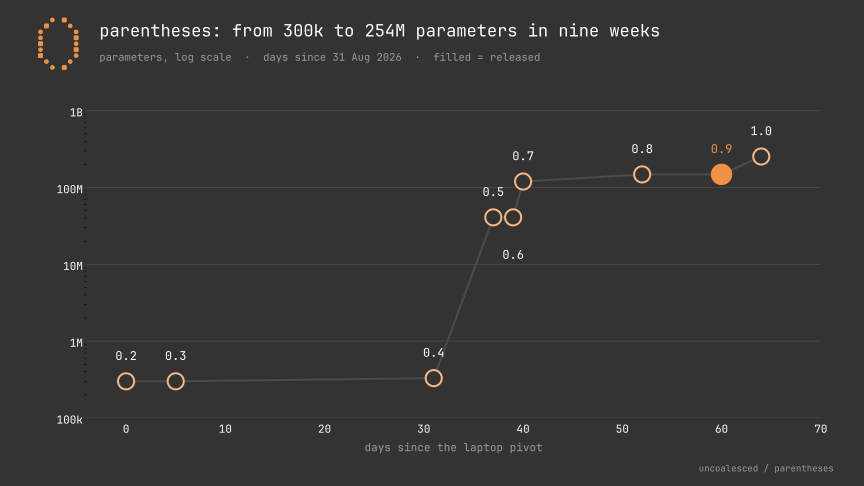

# History

This is how parentheses got from a transformer on a broken desktop to a recurrent model on a laptop. It covers what each version was, why it was replaced, and the mistakes along the way, including the ones I'm not proud of.

## A note on version numbers

Only 0.1, 0.9 and 1.0 were names I used at the time. In 2026 I called everything "0.9" from the first day, because 0.9 was the plan: prove the architecture on a laptop, then build 1.0. Looking back, the 2026 work went through clear stages, so I've given them the numbers 0.2 to 0.8 here, after the fact. Each one is listed with the name it actually ran under, so you can match it to the code and the logs.

## At a glance

| Version | When | What it was | Run name at the time |
|---|---|---|---|
| 0.1 | September 2024 | 64M-parameter transformer on a GTX 1050 (4 GB) | parentheses 0.1 |
| 0.2 | 31 Aug 2026 | ~300k byte-level transformer, English then 22 languages | 0.9-300k |
| 0.3 | 5 Sep 2026 | Same size, switched to selective linear attention | selective-v1 |
| 0.4 | 1 to 7 Oct 2026 | Dravidian-first byte-level runs | dravidian-v1 to v3 |
| 0.5 | 1 to 9 Oct 2026 | First BPE tokenizer, 41M parameters | 0.9-41M |
| 0.6 | 9 Oct 2026 | First attempt at a chat model | 0.9-41M-sft |
| 0.7 | 10 to 21 Oct 2026 | 120M, grown from 41M, deep and narrow | 0.9-120M |
| 0.8 | 22 Oct 2026 | 130M, wide and shallow, first try | 0.9-130M-v2 |
| 0.9 | 22 to 30 Oct 2026 | 130M with the slab_v3 fixes, released | 0.9-130M-v3 |
| 1.0 | 28 Oct 2026 onward | 240M, in training | 1.0-240M |

## 0.1: the transformer that got away (2024)

I started parentheses in September 2024. Version 0.1 was a 64-million-parameter transformer: all the standard parts, trained on a GTX 1050 with 4 GB of memory. For the time, and for that card, it was honestly pretty good. It could hold a conversation.

It also taught me most of what I now try not to do. The training data was poor. A lot of it was old data I'd pulled from Google Cloud that wasn't reliable and was badly out of date, and it gave the model a "yes-man" way of talking, agreeable and GPT-like rather than useful. Worse, I didn't check licences. I used whatever I found, including English books under non-commercial licences that I had no right to train a model on and release.

The project got more complex than I could handle as someone new to machine learning, and then the computer failed, taking the hard drive with it. The model is technically still on that drive, but I can't get it off. 0.1 is gone, and in some ways that's fine: I couldn't have released it with that data anyway.

## 0.2: starting again on a laptop (31 August 2026)

The GTX 1050 wasn't coming back, so in late August 2026 I moved everything to a laptop with an NVIDIA RTX 5050 and 8 GB of memory. The plan was in two parts. Plan One, which I called 0.9, would prove an architecture and a data pipeline at small scale. Plan Two, 1.0, would be the real model.

The first runs were tiny: a byte-level transformer of about 300,000 parameters, five layers, four heads. It trained on Simple English Wikipedia and 50 Project Gutenberg books, about 265 million bytes, then on English plus 20 languages, then 22.

The first bug worth remembering came here. My validation split was the last 1% of a stream sorted alphabetically by language, which meant the validation set was 100% Chinese. Every validation number before I caught it was meaningless. It's a small thing, but it's why I now check what's actually in an evaluation set before trusting a score.

## 0.3: leaving the transformer (5 September 2026)

On 5 September I replaced attention. The reason was a feature I wanted: FreeThink, a mode where the model keeps generating and reading retrieved text in a long stream. A transformer's cost per token grows with everything before it. A recurrent model with a fixed-size state costs the same for the millionth token as for the first, which is exactly what a long stream needs.

So I swapped the transformer for selective linear attention, the recurrent family that Mamba-2 and RWKV belong to, and kept the size and data the same for a fair comparison. The recurrent version came out slightly worse (validation loss 1.4905 against the transformer's 1.4784). I switched anyway, because the long-stream behaviour mattered more than a 1% gap at 300,000 parameters, and the gap was something I expected to close with better design. The transformer code left the repository later in September.

Around the same time I made the decision that shaped everything after: the project would be Dravidian-first. Kannada first, because I'm in Bengaluru, then Tamil, Telugu and Malayalam, with English alongside rather than in charge.

## 0.4: Dravidian-first, byte by byte (1 to 7 October 2026)

The first full Dravidian runs were still byte-level and still around 300,000 parameters, now on Dravidian text with English replay and slices of four smaller languages. The first run died when the laptop went to sleep overnight. It's a very laptop problem, and I resumed it on 6 October.

This is also where I made a licensing mistake I want to be clear about. One of the low-resource slices was Aheri Gondi text that is all rights reserved and research-only. It went into the mix for these byte-level runs. Once I understood the terms, the rule became that no model trained on it can be released, and it has been excluded from every run since. None of the byte-level 0.4 models were released, and none ever will be.

## 0.5: a real tokenizer and 41M parameters (1 to 9 October 2026)

Feeding the model raw bytes was simple but wasteful, and I didn't want a standard tokenizer either. Standard GPT-style tokenizers cut Kannada words in the middle of letters. I built a 32,000-token byte-level BPE vocabulary whose splitting rule keeps vowel signs and viramas attached to the letter they belong to. The [architecture guide](ARCHITECTURE.md#the-tokenizer-keeps-letters-whole) has the numbers.

With the tokenizer came the first serious size: 40.9 million parameters, 16 layers, width 384. I picked that size with a fixed benchmark rule rather than by feel, and it became the base for everything that followed. The longest run finished on 9 October.

## 0.6: the first chat attempt (9 October 2026)

On top of the 41M model I tried instruction tuning to make it chat. It didn't work in the way that mattered most: the Kannada was bad. Looking at the data explained why. Kannada made up only 1.2% of the chat training mix. A model can't learn to talk in a language it barely sees in that stage, however much of it saw in pretraining. That number changed how I build every mix.

## 0.7: growing to 120M (10 to 21 October 2026)

For 120M I didn't start from scratch. I grew the 41M model by widening it in a way that keeps its behaviour, so it started out already knowing what 41M knew. The result had 32 layers at width 512, about 120 million parameters.

The first training run at the usual learning rate damaged the grown model instead of improving it, so I restarted at a third of that rate. Over five sessions it saw 1.25 billion tokens of pretraining.

The chat side of 120M was a long run of honesty work. The first instruction-tuning set turned out to leak about half of my evaluation questions into training, so its scores were worthless and I threw it out. Versions after that focused on getting the model to say "I don't know". Along the way I also removed 242 lines of hard-coded answer rules from the chat script. They made the demo look better and the model no smarter, so they had to go. I also stopped trusting one evaluation pipeline after an audit showed its judging wasn't what it claimed to be.

What finally ended 120M was its shape. Thirty-two narrow layers made the recurrent signal hard to train: gradients differed by a factor of 23.5 between layer 0 and layer 15. Some of the state arithmetic was also losing precision in 16-bit floats.

## 0.8: wide and shallow (22 October 2026)

The fix was to go wide instead of deep: 16 layers at width 768, about 148 million parameters. The first version of that layout lasted less than a day. The same day, I added four changes that became slab_v3, and that became 0.9.

## 0.9: the release (22 to 30 October 2026)

parentheses-0.9-130M is the 0.8 layout plus slab_v3: token-shift mixing, a learned write gate, a value highway from the first layer, and 32-bit precision for the decay scan. It pretrained on about 1.5 billion token positions on the laptop, then went through instruction tuning, preference tuning and checkpoint averaging. The [architecture guide](ARCHITECTURE.md) covers all of it.

Before release I audited my own evaluation and found the problem from 0.7 again in a new place: 18 of the 24 prompts in my honest reasoning suite were copies of training prompts. The score went from 15 of 24 to 5 of 24 once I used fresh prompts. I published the 5.

I released it on GitHub and Hugging Face at the end of October. The weights are CC BY-NC 4.0, non-commercial, and there's a specific reason. Some of the instruction data I used carried non-commercial licences, namely Camel-AI, SciQ and No Robots, and some Karya data had no licence stated at all. I should have caught that before training, not after. Releasing the weights as non-commercial was the honest way to ship what I'd built without claiming rights I didn't have.

Right after release, someone on Bluesky tried it and got gibberish. That turned out to be a bug in the chat script: it skipped 63 of the model's weights when loading the Hugging Face files. It's fixed now, and it's the reason the [setup guide](SETUP.md) exists.

## The licence rule (2 November 2026)

Three versions in a row had a licence problem: 0.1's books, 0.4's Aheri Gondi text, 0.9's instruction data. On 2 November I made the rule I should have started with. Everything I release from now on is under Apache 2.0, and a dataset can be used for training only if its licence permits commercial use. No non-commercial, no research-only, no "no licence stated", no text generated by Llama models. The full rule is in [LICENSE_POLICY.md](../LICENSE_POLICY.md).

It costs a lot. Most good Kannada text is non-commercial, so the rule shuts out exactly the data this project needs most. But it means anyone can use what comes next without worrying about where it came from.

## 1.0: in progress (28 October 2026 onward)

1.0 is 16 layers at width 1024 with 16 heads, grown from 0.9. It's called 240M, and the exact count is about 254 million parameters. Four training sessions are done, all on the same laptop. The fourth, which added STEM, maths and code, made the Dravidian languages slightly worse, and the fifth is designed to fix that. The [roadmap](ROADMAP.md) has the details and what comes after.

## What I'd tell myself in 2024

Check the licence before you download the data, not after you've trained on it. Look inside your evaluation set before you trust a score from it. And don't make the demo look better than the model is.

---

Related: [README](../README.md), [Roadmap](ROADMAP.md), [Architecture](ARCHITECTURE.md), [Setup](SETUP.md)
