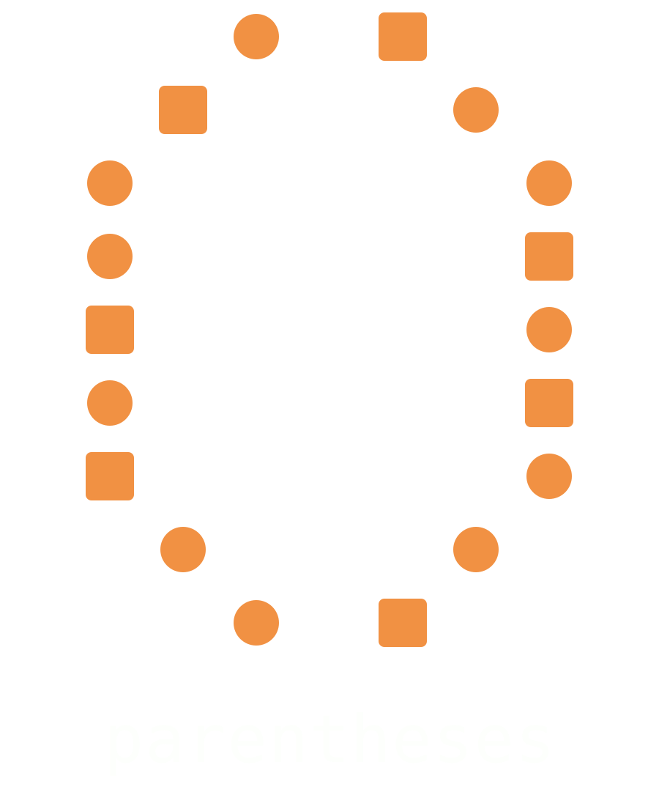
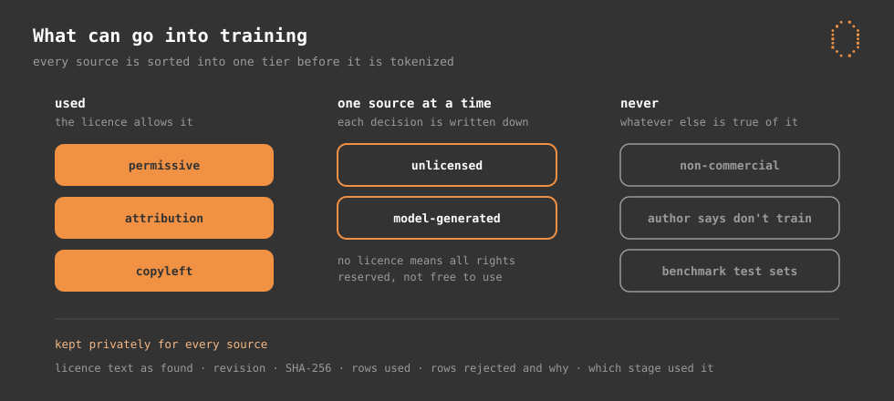

  

<h3 align="center">Training data by licence tier</h3>

  What kinds of data go into parentheses 1.1, and what never does.

  <a href="../README.md">README</a> •
  <a href="../HISTORY.md">History</a> •
  <a href="BENCHMARK_SPEC.md">Benchmark protocol</a>

---

parentheses 1.1 is an open-weights release. The weights are Apache 2.0 and the inference code is MIT. The training data is not redistributed, and this repository has no per-source list. Every source is logged in a private ledger, and the table on this page is generated from that ledger.

  

## Tiers

| Tier | What it covers | In 1.1 |
|:---|:---|:---|
| permissive | Public domain, CC0, MIT, Apache 2.0, BSD and similar | Used |
| attribution | CC BY, ODC-By and similar | Used |
| copyleft | CC BY-SA, GFDL, GPL-licensed text | Used |
| model-generated | Text produced by another model, whatever licence the uploader attached | One source at a time, decision recorded |
| unlicensed | No licence stated | One source at a time, decision recorded |
| noncommercial | CC BY-NC and similar | Never |
| training-blocked | The author says not to train on it | Never |

Benchmark test sets are never training data, whatever their licence.

Two of these need a word. "No licence stated" does not mean free to use. It means the author kept all rights, which makes it the most restricted case on the list, and that is why each such source needs its own decision. Model-generated text is in a similar spot: a permissive tag on a dataset of another company's model outputs does not settle what that company's terms allow.

## Share by tier

No 1.1 training run has happened yet, so there is nothing to report. When there is, this section will list the number of sources and the share of training tokens in each tier.

## What the private ledger holds

For every source: where it came from and at which revision, the licence text as we found it, the tier, the date fetched, a SHA-256 of the file manifest, how many rows were used, how many were rejected and why, and which training stage consumed it. For the two case-by-case tiers it also holds who accepted the risk and when.

## What this page is not

It is not a claim that every input is free of legal risk. Whether training on copyrighted text is permitted differs between countries and is still being argued in court in several of them. This page says what went in, by category, so you can decide for yourself. If you need a model whose every source is permissively licensed and listed, that is 1.0.

Engineered by uncoalesced

