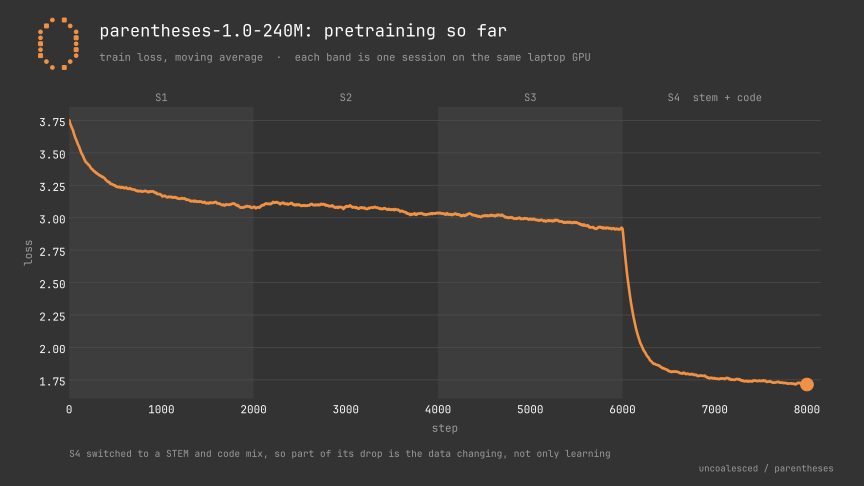

# Roadmap

parentheses is a small language model I am building from scratch on one 8 GB laptop GPU, aimed mostly at Kannada and the other Dravidian languages, with English alongside them. The released preview is parentheses-0.9-130M. The next model, parentheses-1.0-240M, is in progress, and I am working through it one training session at a time. This is a work in progress. This page says what is done, what is next, and where I think the weak spots are.

## At a glance

| Milestone | Status | Notes |
|---|---|---|
| 0.9-130M release | Released | Preview weights under CC BY-NC 4.0 (non-commercial), code under MIT. Available on GitHub and Hugging Face. |
| 1.0-240M Session 1 | Done | Steps 1 to 2,000. Validation loss 3.3110. |
| 1.0-240M Session 2 | Done | Steps 2,001 to 4,000. |
| 1.0-240M Session 3 | Done | Steps 4,001 to 6,000. Validation loss 3.1120, perplexity 22.47 (a different validation set from Session 1's). |
| 1.0-240M Session 4 | Done | Steps 6,001 to 8,000. STEM, maths and code mix. Held-out bits per byte got worse in all nine languages. |
| 1.0-240M Session 5 | Next | Steps 8,001 to 10,000. English textbooks as the main data, with Dravidian and English replay. |
| 1.0-240M Session 6 | Planned | The single learning-rate anneal. |
| 1.0-240M SFT v5 | Planned | About 8,000 abstention-aware reasoning traces. |
| 1.0-240M Session 8 | Planned | On-policy DPO v2 and SWA-3 checkpoint averaging. |
| 1.0-240M release | Planned | No date. |

## Where 0.9 stands

The 0.9 preview is the reason the 1.0 plan looks the way it does, so I want to be specific about what it can and cannot do.

Some parts are solid. The model generates about 27 tokens per second on the laptop GPU, and the speed stays flat as the answer gets longer. Scripts come out right in 40 of 40 checks for the five main languages, and 53 of 72 across all nine. In 72 runs it never leaked a control token into the output, and it refused none of 19 sensitive but legitimate technical prompts. The ONNX export runs under DirectML and matches the PyTorch model to within about 2e-5.

The weak parts are the ones that matter most. Held-out bits per byte, where lower is better, run from 0.44 in Malayalam and 0.45 in Tamil up to 1.57 in Kuvi. English scores 1.21. That looks worse than the main Dravidian languages, but it isn't a fair comparison: bits per byte divides by bytes, and each Indic letter takes three bytes in UTF-8 where an English letter takes one, so Indic text scores lower per byte. In practice English is the most fluent part of its chat. Koya, Kuvi and Kolami are scored on only 12 validation documents each, so treat those three numbers as rough.

It hallucinates. It once told me a Martian colony was founded in 1842, and it gives fluent, confident answers that are simply wrong. At 148M parameters I should expect this, and it is still the most annoying thing about the model. The `<think>` block opened in 36 of 72 runs and closed by itself in only 4 of those 36.

On a set of fresh reasoning prompts, it scored 5 of 24. My first score was 15 of 24, but 18 of those prompts had been copied from training data, so that number does not count.

Kannada chat is weak. Kannada prompts often get echoed back or answered in English, and multi-step arithmetic falls apart. Plain sums like "What is 17 x 6?" are answered by a built-in exact calculator, not by the model, so do not read that as the model doing maths. Low-resource languages sit around 74 percent script accuracy.

One bug needs a mention. For a while, `scripts/chat.py` ignored `slab_v3` in `config.json` when it loaded the Hugging Face folder, and it silently dropped 63 weight tensors. That produced the number soup one Bluesky tester saw. It is fixed, and chat.py now prints a warning if any tensors fail to load. If you cloned before the fix, pull.

Those weak spots are the case for 1.0: more and cleaner training text, a training mix that keeps the Dravidian languages from slipping while English is added, and a real way to teach the model to say "I don't know."

## parentheses-1.0-240M

1.0-240M is grown from 0.9 rather than trained from scratch. It uses the slab_v4 architecture: 16 layers, model width 1024, 16 heads with rank 1024 per layer, and a tri-channel boundary reset.

The chart shows train loss across Sessions 1 to 4. Loss falls quickly in Session 1, then creeps from about 3.1 to about 2.9 across Sessions 2 and 3. At step 6,001 it drops to around 2.0 within a hundred steps. That cliff is the data switching to STEM and code, which is easier to predict, so it isn't progress. The chart also says nothing about the Dravidian languages; held-out bits per byte, below, is the number I trust for those. Sessions 5 onward aren't on the chart yet.

### Sessions 1 and 2

Session 1 covered steps 1 to 2,000 and ended at validation loss 3.3110. Session 2 ran from 2,001 to 4,000 at the full 1024 width. Both were plain pretraining; the interesting changes start in Session 3.

### Session 3

Session 3 picked up at step 4,000 and ran to step 6,000. Two things changed. I started interleaving two memory-mapped sources: a reasoning-heavy set, and a large multilingual pool with Indic and Dravidian text. The reasoning set went first at a 10 to 6 ratio, then the ratio moved to 6 to 10 after step 4,250. The goal was more pretraining throughput on the Dravidian pool without losing the reasoning, and without shocking the low-resource embeddings. I also tracked two validation losses at once, one for general multilingual perplexity and one for reasoning. The session ended at validation loss 3.1120, perplexity 22.47, with 393.22M tokens seen by then. That validation set isn't the one Session 1 used, so 3.3110 and 3.1120 can't be compared directly.

### Session 4

Session 4 covered steps 6,001 to 8,000 and used 131.07M tokens. The point was to add STEM, maths and code, and the data came from permissively licensed sets: Bespoke-Stratos, Orca-Math, MetaMathQA, NuminaMath, SmolTalk and Python-Edu.

It made things worse on held-out data. Bits per byte went up in all nine languages. The largest relative increases were Kuvi, up about 7 percent, and Kolami, up 5.9 percent. Kannada went from 0.489 to 0.500, Tamil from 0.482 to 0.496, Telugu from 0.579 to 0.598 and Malayalam from 0.400 to 0.414. I am not going to dress that up. Session 4 added the STEM, maths and code I wanted, and it cost ground on Dravidian text, which is the part of the model I care about most.

### Session 5

Session 5 is next, covering steps 8,001 to 10,000. English textbook text from Cosmopedia-v2 and FineWeb-Edu is the primary data. Replay from my Dravidian and English set goes up to 8 of every 16 micro-steps, from 6 in Session 4. That is my direct response to the regression. The learning rate stays constant at 3e-4, and the one anneal happens in Session 6. I have not run Session 5 yet, so I do not know whether the bigger replay share will stop the damage.

### Sessions 6 to 8

Session 6 is the only learning-rate anneal in the run. SFT v5 and Session 8 come after it, and they are covered in the next section.

## Teaching it to say I don't know

Every version gets the same three goals: never fabricate, say "I don't know" when it does not know, and do not refuse legitimate questions. The third goal is the easiest to lose. A model trained to hedge can start refusing ordinary questions, so I measure refusals alongside abstention.

0.9 already had a version of this. Its DPO v2 pass used 900 preference pairs, and 400 of them were abstention pairs across five languages, where the preferred answer admits it does not know. The pass moved the model a little (a whole-set margin of +0.3507 and 84.2 percent preference accuracy). It still invented a Martian colony. A pass that small was never going to be enough.

For 1.0, the SFT v5 pass adds about 8,000 abstention-aware reasoning traces, where the reasoning ends with an honest "I don't know" when the evidence is missing. Session 8 is on-policy DPO v2. The model writes its own candidate answers, preference training runs on those, and a 0.1 times NLL term keeps the model from drifting. Then I average three checkpoints (SWA-3) for stability.

I do not know yet whether any of this will work at 240M. When I evaluate it, hallucination, abstention and refusal rates have to be read together, because a model that refuses everything would pass the first check and fail the third.

## The data problem

On 2026-11-02 I set a rule for everything I release from now on. Code, tokenizers and weights go out under Apache 2.0, and a dataset can be used for training only if its license permits commercial use. The full policy is in [LICENSE_POLICY.md](../LICENSE_POLICY.md). The 0.9 weights are still CC BY-NC 4.0, so 0.9 stays non-commercial. The rule applies from 1.0 on.

This hits Kannada hardest. Most of the good Kannada and Dravidian text corpora I know of carry non-commercial terms, such as CC BY-NC or research-only conditions. Under the rule I cannot train on them, and that is the main blocker for the 1.0 release. It is a frustrating one, because the data exists and the model cannot use it yet.

What would help is commercially licensed Kannada and Dravidian text, meaning sources released under CC BY, CC BY-SA, public domain or ODbL. Text that I write myself also qualifies. Another route is data I generate with a teacher model whose license allows commercial use. The policy names Apache-2.0 Qwen models as an example of a usable teacher. Outputs from Llama and from NVIDIA API trial keys are excluded, and I record each teacher's terms before a full run.

## Further out

These are intentions, not promises, and none of them has a date.

Expanding the conversational data for multi-turn chat is planned. I want the model to hold a conversation across several turns, and the data needs to grow for that.

I also want better coverage for the low-resource languages. Tulu, Koya, Kuvi and Kolami are marked experimental, and their scores rest on very little validation text. More licensed text for them, checked by people who speak them, is the honest way to improve.

## How you can help

Right now the whole project is me, working on one laptop. I said on Bluesky that I would post domains for open contributions. They aren't decided yet, and there's no formal contribution process, so the problems below are the place to start.

The biggest one is commercially licensed Kannada and Dravidian text, described above. Native-speaker checks come next. The script checks are automatic, but whether an answer in Tulu or Kuvi reads naturally needs someone who speaks the language. Setup reports matter too. I have only tested on Windows with an NVIDIA GPU, so reports from Linux, macOS or AMD machines are useful. The `--device mps` path on Apple Silicon is untested.

If `--device cuda` fails with "Torch not compiled with CUDA enabled", you probably have the CPU-only PyTorch build. [SETUP.md](SETUP.md) has the fix, and the same file has the verified install and run commands.

For bugs, open an issue at https://github.com/uncoalesced/parentheses/issues. The most useful reports include the command you ran, your Python and PyTorch versions, your GPU, and the full output.

---

Related: [README](../README.md), [Setup](SETUP.md), [Architecture](ARCHITECTURE.md), [Documentation](DOCUMENTATION.md)
